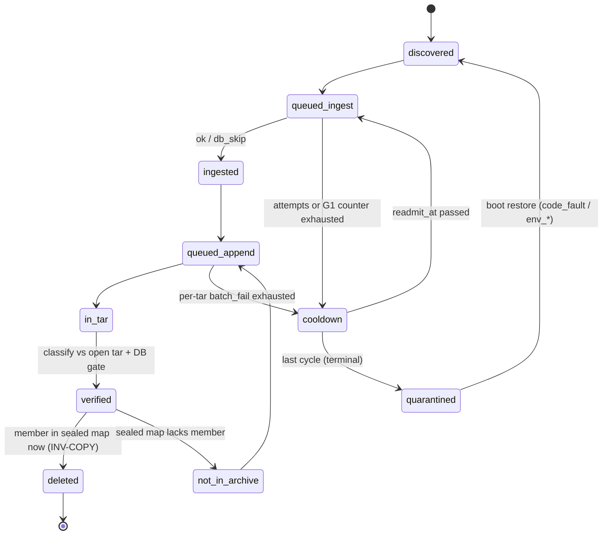
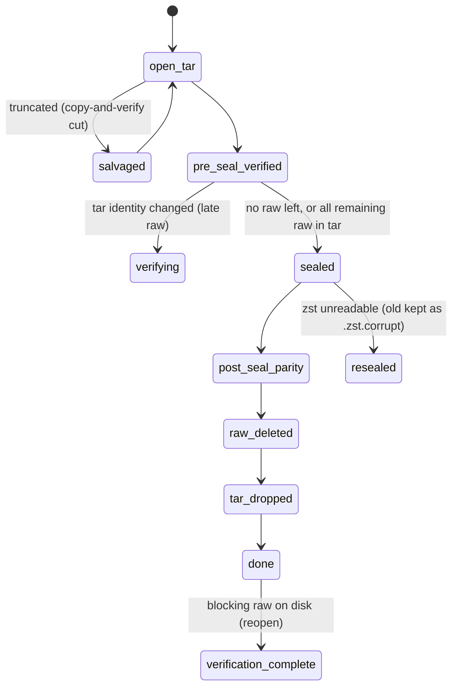

# sync_timedb state machine

Every state a raw stats file, its day and its daily tar can be in; every gate
that reads that state; and the exit each negative state has. Invariant
**INV-NEG** (`sync-timedb-queue-orchestrator-contract.mdc`): every negative
flag has (a) a clear on the success path, (b) a bounded retry that does not
depend on the gated action, and (c) a terminal resolution that lets the day
close. Invariant **INV-COPY** (`sync-timedb-lock-and-archive-contract.mdc`): at
every instant every byte of every closed raw file exists in the raw file, a
sealed member proven by the sealed member map, or an unchanged open tar.

Kept honest by `hpcperfstats/tests/test_sync_timedb_state_doc_registry.py`,
which runs `scripts/sync_timedb_state_inventory.py` (AST walk of
`hpcperfstats/dbload/**`) and fails when a registry kind, shard field, job
kind, inventoried value or gate site is missing below. Regenerate the dynamic
appendix with `python3 scripts/sync_timedb_state_inventory.py --write-doc`.

## §1 Storage model

| Store | Lives in | Cleared by restart | Cleared by contract reset |
|---|---|---|---|
| Job store queues (ingest ZSET, append/discover/day_close LISTs), payload fields (`attempt`, `env_defer`, `timeout_attempt`, `emit`, `batch_fail`) | memory + `.sync_timedb_job_store.json` snapshot | in-flight claims and leases only | yes |
| Members store day shards | memory + `.sync_timedb_archive_members/<day>.json` | memory fields (`tar_hot`, `append_inflight`, `populate_owner`, `restore`, `events`) | yes |
| Day-removal manifests | `.sync_timedb_day_raw_removal/<day>.json` | no | yes |
| Queue dead letters | `.sync_timedb_queue_dead_letter.json` | no | yes |
| Quarantine | `.sync_timedb_unparsable_raw/` + `.sync_timedb_unparsable_raw.json` | no | manifest only (files stay; boot restore re-reads orphans) |
| Sealed member maps | `{daily_dir}/.sync_timedb_sealed_members/<day>.json` | no | no (self-validated by zst identity) |
| Salvage backups | `{daily_dir}/.sync_timedb_tar_salvage/` | no | no (removed after post-seal parity) |
| Integrity census | `{daily_dir}/.sync_timedb_sealed_integrity.json` | no | no |
| Archive scratch: `<day>.tar.{merge,dedupe,repair,decomp,zst}.tmp`, `hps_{union_extract,pax_convert,tar_repair}_*` dirs, `.atomic.*` and `*.json.tmp` write temps | `{daily_dir}`, `{archive_dir}` and their `.sync_timedb_*` subdirs | no | no (idle sweep removes a dead-day file unmodified for `sync_archive_scratch_max_idle_hours` while the day's tar and restore locks are free, or a day-less path whose whole tree is that idle; derived temporaries, never the only copy; safety copies (`.corrupt.*`, `.pre-restore.*`, salvage, quarantine) are never touched; `report` mode only logs) |
| Migration snapshot | `.sync_timedb_migration_backup/dead-ends-v1/` | no | no |
| Per-day remainder counters | memory | rebuilt from the job store at boot (DE-32) | n/a |

Registered persistence kinds (`PERSISTENCE_ARTIFACT_REGISTRY`):
`ingest_checkpoint`, `archive_dead_letter` (unused; legacy file), `queue_dead_letter`,
`archive_maint_hints` (unused), `day_close_manifest` (unused; legacy file),
`day_raw_removal_dir`, `unparsable_raw`, `zero_host_ingest_mark`,
`file_complete_ingest_mark`, `job_store_snapshot`, `archive_members_store_dir`.
Unregistered self-validating kind: `sealed_member_map`.

Job kinds: `JOB_KIND_INGEST` (`ingest`), `JOB_KIND_APPEND` (`append`),
`JOB_KIND_DISCOVER` (`discover`), `JOB_KIND_DAY_CLOSE` (`day_close`).

## §2 Flag catalog

### Members store `_DayShard` fields

| Field | Polarity | Set | Clear / bound |
|---|---|---|---|
| `day_token`, `lock`, `events`, `members`, `complete` | state | populate | invalidate / merge |
| `day_skip` | negative, sidecar | `set_archive_day_ingest_skip` (unreadable archive) | `_clear_stale_day_ingest_skip_if_tar_repaired` when the authoritative archive reads (A4); sealed-only re-check age-gated by `set_at` (G3); `day_skip_blocks_tar_write` clears when the tar reads; transient errors never set it (DE-6b/DE-29/DE-31) |
| `degraded` | negative | `populate_archive_members` | cleared with `day_skip` (A4) and on merge |
| `tar_hot` | negative, memory | `set_ingest_tar_hot` (`populate_wait`, `populate_enqueue`) | waiter `finally`; populate-pool worker clears `populate_enqueue` (DE-7) |
| `append_inflight`, `populate_owner`, `restore` | coordination, memory | append / populate / restore owners | owner `finally`; restore decompress is progress-idle-killed (DE-8) |
| `populate_source`, `dedupe_hint` | informational | populate | none needed |

`day_skip` kinds: `open_tar_gnu_tvf_failed`, `tar_truncated_or_unreadable`,
`zst_frame_invalid`, `read_error`, `salvage_backup_failed`. Exit table:
`SYNC_TIMEDB_NEGATIVE_STATE_EXITS["day_skip_kind"]`.

### Orchestrator flags

| Flag | Polarity | Set | Clear / bound |
|---|---|---|---|
| `_FULL_REDISCOVER_PENDING` | negative, memory | a discover walk skipped incomplete catchup files at the ingest cap (`dropped_at_capacity > 0`) | cleared when the idle pass submits a whole-archive walk (catchup queue at or below half the cap); re-set only if that walk drops again; a walk that drops nothing ends the chain. `sync_ingest_full_rescan_interval_hours` (default 6) also forces a walk |
| `_BOOT_FULL_DISCOVER_PENDING` | negative, memory | boot queues the whole-archive discover identity | cleared in the `finally` of the walk that ran it (background or `run_once` force pass), success or failure; while set, day_close returns `yielded` at the seal stage (`reason=full_discover_pending`, yield backoff 30-300 s, no attempt bump); pre-seal verify and raw deletes still run. Undiscovered raw for a just-sealed day forced full reseals (hpcperfstats04 2026-10-29). While set the day_close fill also holds every backfill (non-hot) day (`_day_close_held_for_discover`) |
| day_close seal `reason=unarchived_raw` / `unarchived_raw_check_failed` | negative, outcome | the day has an open tar and `_closed_raw_not_archived` (streamed census fd walk kept by filename day; not the lock-serialized `build_day_scoped_closed_raw_by_gz`) finds closed raw that is a same-size member of neither the open tar nor the sealed member map, or the scan / open-tar member read failed | clears when every raw file of the day is archived (append after ingest) or gone; bounded retry: the found paths go to `_handoff_retryable_paths_to_ingest` (`over_cap=True`, dead-letter cooldown respected) and day_close returns `yielded` (yield backoff 30-300 s, no attempt bump); terminal: ingest + append archive the file, or its dead letter turns terminal and quarantine moves it off disk. Before this the seal saw only raw the manifest and queues knew about (hpcperfstats04 2026-10-29: 08-25 sealed and deleted its raw without 189 never-queued files, then restored, appended and resealed) |
| space pressure (`sync_timedb_space_pressure._STATE`: `pressure`, `append_day`, `hold_since`) | negative, memory | `sync_archive_space_pressure_free_bytes` (X, default 1T; 0 = off) is set and the daily archive filesystem has less than X free (measured on the path or its directory only; a statfs error or a missing archive dir is unknown, keeps the current state and fails `fits_hard_reserve`, never reads as 0 free). Appends then wait while any day close is in a `FINISHING_STAGES` stage (reconcile, dedupe, seal, post-seal verify, raw deletes, tar drop; the `disk_remaining_raw` / `wait_on_ingest` / `no_tar_handoff` checks, `pre_seal_verify`, which runs one classify batch per claim and yields, and the seal's own `full_discover_pending` / `unarchived_raw` checks (`seal_check`) do not count) and otherwise go to one day at a time (the oldest parked day); after that day has no parked or in-flight appends the next day waits until a day close gives space back (`note_space_freed`: raw deleted, the tar sealed away or dropped; entering a finishing stage is not enough, since a reconcile that then yields frees nothing). `_append_batch_need` keeps every batch (raw bytes plus the restore of a sealed day) above `sync_archive_min_free_bytes` plus half the restore for its reseal, net of the reservations other admitted work holds (`space.reserve` at append submit, released in `_drain_append_ready`; `space.reserving` around `finish` / `growth` restores). Only a day whose next batch fits is chosen; a held day whose batch stops fitting gives up the slot without a hold, so one oversized day cannot block every other day. An unparsable INI value logs one warning and uses `1T`. Restores outside the append dispatch: `space_gate="growth"` (the default; no production caller restores through it today, ingest prewarm passes no restore days) is denied, `finish` (day-close verify, open-tar repair, salvage) keeps only the hard reserve, `off` (append worker; gated at dispatch). Seal compression drops the nice/ionice wrapper | clears at 2X free (an `under_pressure` call that ends it bumps `epoch`, and a `select_append_day` already running then returns `ALL_DAYS` without writing the slot or a hold); the held append day clears when a day close gives space back; bounded retry: `DAY_CLOSE_START_GRACE_S` (600 s) without one releases the hold, parked claims stay parked (no requeue, no attempt bump) and denials log `space_pressure deny` at most every 300 s per day; terminal: day close is never gated by it and gives the space back. hpcperfstats02 2026-10-30: 97% full, restores of 300-600 GB sealed days for appends while three seals starved behind `ionice -n6` |
| `_discover_frontier_day` | negative, memory | a discover walk at the ingest cap could not queue an incomplete backfill file (nothing younger queued to push out), or a pushed-out file was not queued again, or the store refused the add (`zadd_ingest` at the cap after hot files joined past it) for a file that is not dead-lettered (`StreamingDiscoverStats.frontier_day`); at the cap discover pushes out younger files until the older one fits | a whole-archive walk replaces it (None when it queued every incomplete backfill file it saw); a windowed walk only lowers it; a walk that raises keeps it. Bounded retry: held days requeue at the day_close fill without an attempt bump; `_FULL_REDISCOVER_PENDING` (set by the same drops) runs the next whole walk once the catchup queue is at half the cap, plus the 6 h periodic walk. Terminal: the walks advance it oldest-first until one drops nothing. Hot-band days are never held. The day_close fill holds backfill days on or after it (hpcperfstats04 2026-10-29: host-order walks queued 50k files across every day and kept 56 days restoring, appending and resealing every batch) |

### Day-removal manifest

Phases: `verifying` → `verification_complete` → `deleting` → `done`.
(Cooperative-yield phase tokens such as `migrate_legacy_gz` label the
`DayCloseYieldError` stage; they are not manifest phases.)
`verify_stage`: `none`, `pre_seal_complete`, `post_seal_complete`.
Manifest keys: `phase`, `verify_stage`, `worker_stage`, `members_done`,
`members_total`, `last_progress`, `last_progress_at`, `last_progress_ts`,
`started_at`, `completed_at`, `verified_count`, `skipped_count`,
`deleted_count`, `pre_seal_classify_index`, `pre_seal_classify_paths`,
`reverify_cycles` (A7 bound; reset by a passing post-seal parity),
`verified_tar_identity` (DE-26 late-raw detector).

Entry statuses and their exits (`SYNC_TIMEDB_NEGATIVE_STATE_EXITS["day_removal_status"]`):

| Status | Meaning | Exit |
|---|---|---|
| `verified` | member + DB gate passed | delete only when the raw is a same-size member of the **sealed map** now (DL-2/DL-3); otherwise `delete_deferred=sealed_copy_unproven` or reset to `skipped_not_in_archive` |
| `skipped_not_head_tail_ingested`, `skipped_not_head_ingested`, `skipped_not_sample_ingested` | DB gate not yet passed | retryable: reclassify, hand off to ingest |
| `skipped_not_in_archive`, `skipped_size_mismatch` | not (yet) a tar member | retryable: reclassify, hand off to append |
| `skipped_seal_invalid` | tar/zst validation failed | repair-required (DE-25): blocks `done`; reseal (DE-26) then reclassify |
| `skipped_fingerprint_changed` | raw changed after verify | repair-required: reclassified each pass, fresh status recorded (DE-13) |
| `skipped_active_segment` | still the host's live segment | blocks `done` only once it is no longer active |
| `skipped_quarantine` | quarantined | terminal |
| `skipped_locked`, `skipped_no_gz`, `skipped_no_work` | legacy classifier skips | retryable / reseal |

Salvage manifest statuses: `backed_up`, `salvaged`, `restored`,
`aborted_unchanged`, `restore_failed`. Other inventoried status values:
`deferred`, `queued` (job-store/census tokens).

### Queue dead letter (A2)

Entry: `kind`, `identity`, `attempt`, `reason`, `recorded_at`,
`first_recorded_at`, `cycle`, `env`, `readmit_at`, `terminal`,
`readmitted_at`. Upserted per kind+identity; `readmit_at = now +
backoff[cycle-1]` (`sync_dead_letter_readmit_backoff_s`, env errors use
`sync_dead_letter_env_backoff_s`); past the last cooldown `terminal=true` and
ingest/append raw is quarantined (`failure_class` `exhausted`, `code_fault` or
`env_<type>`); a day_close terminal is an ERROR kept in the census. Success
ACKs remove the entry. Legacy entries normalize to cycle 1; fill-skip reasons
(`skip_cgroup_headroom`, `skip_budget_bytes`, `skip_file_cache_pressure`,
`skip_fp`, `fp_refresh`) re-admit immediately (DE-21).

### Quarantine (A3)

`failure_class`: `parse`, `empty`, `exhausted` (terminal, never auto-restored);
`code_fault`, `env_<type>` (restored at boot when the original path is absent
and the day is not sealed-only). DE-3: a reappeared path is moved again; DE-4:
destination collisions get `.N`.

## §3 Gate catalog (outcomes)

Ingest worker outcomes (`ingest_ok=False` exits via `negative_state_exit`):
`timeout`, `lookup_budget` (bounded by `timeout_attempt`, DE-5);
`ingest_mark_failed`, `write_failed` (a DB chunk write failed; DE-22 root cause), `ingested` (contract violation), `restore_deferred`,
`probe_transient` (environment, bounded by `env_defer`); `active_segment`
(ACK, rediscovered on rotation); `parse_fail`, `repair_failed`, `quarantine`,
`fail` and any unknown value (attempts → cooldown → terminal). Positive:
`ok`, `db_skip`, `skip`. Drain exceptions: environment / coordination errors
(`is_environment_error`, every `ArchiveMembersStoreUnavailableError`) requeue
without a file attempt, bounded by `env_defer`; others use attempts.

Day-close outcomes: `complete` (ACK), `yielded`, `deferred_age`,
`incomplete_raw`, `skipped` (cooperative requeue; bounded by the repairs in
§5 and the backoff tracker), `verify_failed`, `error` (attempts → cooldown;
DE-12, DE-28, A7 `reverify_cycles`).

Readability probe (`probe_tar_archive_readability`, DE-29): `readable`,
`corrupt`, `transient`, `missing`; only `corrupt` may repair/restore.

## §4 Lifecycles

## §5 Dead-end matrix (remediated)

| ID | Remediation | Regression test |
|---|---|---|
| DE-1/5/12 | dead-letter cooldown, readmit pass, terminal quarantine; timeouts counted; day_close exceptions bump | `test_dead_letter_readmits_after_cooldown`, `test_repeated_timeout_reaches_dead_letter`, `test_day_close_exception_bumps_attempt` |
| DE-2/19 | streaming parse/write faults re-raise, never quarantine; typed write-stage shutdown | `test_write_stage_error_is_retryable_not_quarantine`, `test_code_fault_is_not_quarantined` |
| DE-3/4 | quarantine `failure_class`, boot restore, reappeared move, collision suffix | `test_boot_restores_non_parse_quarantine`, `test_reappeared_quarantined_path_is_moved` |
| DE-6/6b/31 | authoritative-archive clear before degraded short-circuit; transient errors never set day_skip | `test_day_skip_clears_on_sealed_only_readable_day`, `test_eagain_zstd_spawn_does_not_set_day_skip` |
| DE-7 | populate worker clears `populate_enqueue` | `test_populate_pool_clears_tar_hot` |
| DE-8 | restore decompress progress idle kill | `test_decompress_idle_kill_releases_restore_token` |
| DE-9 | reseal over unreadable zst, old kept | `test_unreadable_zst_reseals_from_tar` |
| DE-10/25 | only quarantine is terminal; frozen done days reopen | `test_seal_invalid_not_terminal_phase_done_not_written`, `test_frozen_production_manifest_closes_end_to_end` |
| DE-11/23 | copy-and-verify salvage; append rollback; empty tar drop | `test_truncated_open_tar_salvaged_to_valid_prefix`, `test_interrupted_append_truncates_back_to_pre_append_size`, `test_empty_open_tar_completes` |
| DE-13 | reclassify decoupled; fresh status recorded | `test_reclassify_runs_with_delete_failed_pending` |
| DE-14 | OperationalError requeues (environment) | `test_operational_error_requeues_not_dropped` |
| DE-15/16 | dead-owner reap; populate attempt cap | `test_dead_worker_inflight_reaped_when_recycle_disabled`, `test_populate_requeue_attempts_capped` |
| DE-17/20/22 | type-based environment class, G2 outcome table | `test_members_unavailable_any_message_is_transient`, `test_every_negative_value_has_exit_entry` |
| DE-18 | per-tar batch failure accounting | `test_append_batch_failure_does_not_dead_letter_every_path` |
| DE-24 | no-tar handoff; zst-only day enqueue; a day_close that finds the day already complete sets its open manifest to `done`, else the zst-only scan re-enqueues it forever (hpcperfstats04 2026-10-29: 08-07/09/11/12 claimed and vacated `complete` ~157 times each per run) | `test_day_close_without_tar_hands_off_remaining_raw`, `test_complete_day_close_closes_open_manifest_and_stops_requeue` |
| DE-26 | seal while raw remains only when all remaining raw is in the tar; late raw reopens verify; an H19 sentinel whose listing is empty (raw already deleted) does not defer the seal (hpcperfstats04 2026-10-29: 09-18 tar 10541 vs zst 10526 members, `post_seal_verify` failed every claim) | `test_seal_with_raw_only_when_all_remaining_raw_in_tar`, `test_late_raw_resets_pre_seal_verify_stage`, `test_sentinel_with_no_raw_left_does_not_defer_the_seal` |
| DE-27/32 | per-day append signal; one day function; boot rebuild | `test_wait_on_ingest_uses_per_day_append_remainder`, `test_day_remainder_rebuilt_from_job_store_at_boot` |
| DE-28 | stage failure counter | `test_reconcile_failure_counts_toward_noprogress` |
| DE-33 | `zadd_ingest` discover cap (`sync_ingest_queue_max_size`) no longer refuses day-close handoff or dead-letter readmit (`over_cap=True`); found on hpcperfstats04 2026-10-27 (3000 cap vs 387k queued: 1,999 raw files of 2026-08-24 never queued, `ingest_handoff` counted them) | `test_zadd_ingest_over_cap_admits_handoff_catchup` |
| DE-29/30 | readability tri-state; space admission | `test_transient_oserror_is_not_corrupt_and_sets_no_day_skip`, `test_space_admit_denies_reseal_below_reserve` |
| DL-1/2/3/5/8/12 | sealed-prefix restore gate, sealed-map delete gate, rewrite superset check, yield guard, gz containment | `test_restore_from_sealed_refused_when_tar_prefix_has_members_not_in_zst`, `test_raw_delete_requires_member_in_sealed_zst`, `test_rewrite_aborts_when_source_tar_changed_under_lock`, `test_migrate_refuses_unlink_when_new_zst_missing_members` |

## §6 Gate-closure table

Every requeue / ACK / dead-letter / sticky-flag / quarantine invocation in
`hpcperfstats/dbload` (inventory key `file:function:callee`).

| Site | Trigger | Attempts | Bound / exit |
|---|---|---|---|
| `sync_timedb_archive_helpers.py:_ensure_open_tar_readable_for_ingest_lookup:set_archive_day_ingest_skip` | open tar still unreadable after salvage/repair/restore | n/a | G3 re-check; cleared when the tar reads (A4, `day_skip_blocks_tar_write`) |
| `sync_timedb_archive_helpers.py:mark_archive_day_ingest_skip_and_raise:set_archive_day_ingest_skip` | sealed stream failure (non-transient) | n/a | G3 age-gated re-check of the sealed file |
| `sync_timedb_archive_members_coord.py:enqueue_archive_members_populate:set_ingest_tar_hot` | discover cold probe | n/a | cleared by the populate worker (DE-7) |
| `sync_timedb_archive_members_coord.py:populate_archive_members:set_degraded` | populate failure | n/a | cleared with day_skip (A4) and on merge |
| `sync_timedb_archive_members_coord.py:request_archive_members_populate_and_wait:set_ingest_tar_hot` | populate wait | n/a | cleared in the waiter's `finally` |
| `sync_timedb_archive_members_coord.py:set_archive_day_ingest_skip:set_day_skip` | wrapper | n/a | as callers |
| `sync_timedb_archive_members_coord.py:set_ingest_tar_hot:set_ingest_tar_hot` | wrapper | n/a | as callers |
| `sync_timedb_populate_pool.py:_populate_pool_worker_entry:requeue_populate_queue_job` | populate exception | job `attempt` | dropped at `sync_archive_retry_max_attempts` (DE-16) |
| `sync_timedb_queue_orchestrator.py:_dead_letter_claim:ack_job` | dead-letter | n/a | A2 cooldown → terminal |
| `sync_timedb_queue_orchestrator.py:_drain_append_ready:ack_job` | append success / gate-skip handoff | n/a | exit (success) |
| `sync_timedb_queue_orchestrator.py:_drain_append_ready:_requeue_bounded_without_attempt_bump` | append soft_requeue (restore race; open-tar member scan returned nothing for a tar past one record, e.g. read-lock timeout under a seal) | G1 `env_defer` | lock holder finishes (DE-8 idle kill, seal progress); past `sync_noprogress_escalate_after` → A2 env cooldown |
| `sync_timedb_queue_orchestrator.py:_drain_day_close_ready:_requeue_claimed_job_without_attempt_bump` | cooperative outcome (`yielded`, `incomplete_raw`, `deferred_age`, `skipped`) | no | yield backoff; DE-24/25/26/28 repairs, `reverify_cycles` → `verify_failed` |
| `sync_timedb_queue_orchestrator.py:_drain_day_close_ready:ack_job` | `complete` | n/a | exit (success; dead letter removed) |
| `sync_timedb_queue_orchestrator.py:_drain_ingest_ready:_requeue_claimed_job_without_attempt_bump` | bare TimeoutError sentinel path | no | store lease TTL reap |
| `sync_timedb_queue_orchestrator.py:_drain_ingest_ready:ack_job` | ingest success; `active_segment` | n/a | exit; active segment rediscovered on rotation |
| `sync_timedb_queue_orchestrator.py:_fail_append_batch:requeue_job` | batch-level append failure | per-tar `batch_fail` | dead-letter at the attempt ceiling (DE-18) |
| `sync_timedb_queue_orchestrator.py:_fill_append_slots:ack_job` | impossible identity (missing path, no day) | n/a | drop (discover re-enqueues a reappearing path) |
| `sync_timedb_queue_orchestrator.py:_fill_append_slots:requeue_job` | admission backpressure | no | `alone_progress` admits when nothing is in flight |
| `sync_timedb_queue_orchestrator.py:_fill_day_close_slots:_requeue_claimed_job_without_attempt_bump` | sticky yield backoff; backfill day held by the discover frontier or the boot walk (`_day_close_held_for_discover`); the pass stops at the first repeated identity | no | backoff expiry (30→300 s); the next whole-archive walk moves the frontier |
| `sync_timedb_queue_orchestrator.py:_fill_day_close_slots:requeue_job` | oldest-first reorder | no | same claim pass |
| `sync_timedb_queue_orchestrator.py:_fill_ingest_band:ack_job` | lock sidecar / missing path | n/a | drop (discover re-enqueues) |
| `sync_timedb_queue_orchestrator.py:_fill_ingest_band:requeue_job` | fill skips (budget, cgroup, file cache, lease conflict) | no | `alone_progress`; penalty score |
| `sync_timedb_queue_orchestrator.py:_idle_reconstruct_pass:ack_job` | discover job done | n/a | exit |
| `sync_timedb_queue_orchestrator.py:_reap_dead_owner_ingest_inflight:_requeue_claimed_job_without_attempt_bump` | owning pool terminated (DE-15) | no | claim returns to the queue |
| `sync_timedb_queue_orchestrator.py:_reband_claimed_ingest_if_needed:requeue_job` | band changed at claim | no | penalty score (RC9) |
| `sync_timedb_queue_orchestrator.py:_release_claims_on_shutdown:requeue_job` | shutdown drain | no | process exit |
| `sync_timedb_queue_orchestrator.py:_requeue_bounded_without_attempt_bump:_requeue_claimed_job_without_attempt_bump` | G1 helper | payload counter | A2 cooldown at the cap |
| `sync_timedb_queue_orchestrator.py:_requeue_claimed_job_without_attempt_bump:requeue_job` | shared primitive | no | per caller |
| `sync_timedb_queue_orchestrator.py:_requeue_ingest_fill_skip:requeue_job` | fill skip | no | `alone_progress` |
| `sync_timedb_queue_orchestrator.py:_requeue_pool_collateral:requeue_job` | stuck-cohort recycle collateral | no | recycle completes |
| `sync_timedb_queue_orchestrator.py:_resolve_terminal_dead_letter:quarantine_ingest_failed_raw_path` | terminal dead letter | n/a | quarantine (restorable classes per A3) |
| `sync_timedb_queue_orchestrator.py:_retry_or_dead_letter:requeue_job` | attempt below ceiling | yes | dead-letter at the ceiling |
| `sync_timedb_queue_orchestrator.py:_run_background_discover:ack_job` | discover job done | n/a | exit |
| `sync_timedb_queue_orchestrator.py:_try_submit_pending_append_days:requeue_job` | same-tar inflight | no | inflight completes |
| `sync_timedb.py:_quarantine_failed_ingest_parse:quarantine_ingest_failed_raw_path` | explicit empty-payload parse result | n/a | quarantine (`empty`, terminal) |
| `sync_timedb.py:_signal_ingest_hot_for_populate:set_ingest_tar_hot` | ingest needs the tar | n/a | cleared by the signalling path |
| `sync_timedb_queue_orchestrator.py:_drain_append_ready:_fail_append_batch` | append failure (exception, ok=False, False) | per-tar | DE-18 |
| `sync_timedb_queue_orchestrator.py:_drain_ingest_ready:_retry_or_dead_letter` | file-attributed ingest failure | yes | A2 |
| `sync_timedb_queue_orchestrator.py:_drain_day_close_ready:_retry_or_dead_letter` | `verify_failed` / `error` / exception | yes | A2 (day terminal = ERROR) |
| `sync_timedb_queue_orchestrator.py:_drain_ingest_ready:_requeue_bounded_without_attempt_bump` | environment error, timeout, mark failure | G1 counters | A2 env cooldown |
| `sync_timedb_queue_orchestrator.py:_requeue_bounded_without_attempt_bump:_dead_letter_claim` | G1 cap reached | n/a | A2 |
| `sync_timedb_queue_orchestrator.py:_retry_or_dead_letter:_dead_letter_claim` | attempts exhausted | n/a | A2 |
| `sync_timedb_queue_orchestrator.py:_fail_append_batch:_dead_letter_claim` | per-tar cap reached | n/a | A2 |
| `sync_timedb_queue_orchestrator.py:_dead_letter_claim:upsert_queue_dead_letter` | record cooldown entry | n/a | readmit / terminal |
| `sync_timedb_job_store.py:append_queue_dead_letter:upsert_queue_dead_letter` | compatibility wrapper | n/a | as above |

## §7 Operator census

Saved recipes (sidecar census; deleted-vs-`.zst` loss check):
`test_runs/sync-timedb-dead-end-census-recipe-2026-10-25.md`. After this
release also check: dead-letter entries carry `cycle` / `readmit_at`; log
tokens `dead_letter readmit n=`, `noprogress escalate`, `day_remainder rebuilt`,
`Day raw removal reopen done`, `tar salvaged to valid prefix`,
`archive_space_admit deny`, `sealed integrity sweep failed`,
`quarantine boot restore`; sidecars `.sync_timedb_sealed_integrity.json`,
`.sync_timedb_sealed_members/`, `.sync_timedb_tar_salvage/`,
`.sync_timedb_migration_backup/`.

The `queue_orchestrator census` line carries `raw_stats_files_on_disk=N`: the
closed raw files discover would walk (lock sidecars and dot-prefixed sidecar
directories excluded), re-counted by the same fd walk at most every
`RAW_STATS_COUNT_INTERVAL_S` (600 s); a failed walk keeps the last value and
the token is absent until the first count succeeds. It also carries
`last_ingested_backfill_day=YYYY-MM-DD`: the calendar day of the most recent
backfill (non-hot) ingest ACK (`ingested` or `db_skip`), held in
`_LAST_INGESTED_BACKFILL_DAY` and overwritten without a lock; hot files do not
set it (they would pin it to today), and it is absent until the first one.
With `sync_archive_space_pressure_free_bytes` set the line also carries
`space=ok free=<T> pressure_below=<T>` or
`space=pressure free=<T> resume_at=<2X> append_day=<day|none>`
(`sync_timedb_space_pressure.census_token`).

## §8 Dead-code appendix

Removed in this release (no production callers): `SyncFileState`,
`_SYNC_STATE_TRANSITIONS`, `_transition_file_state`,
`DayCloseManifestCoordinator`, `quarantine_unparsable_closed_raw_paths`,
`remove_verified_archived_raw_files`,
`run_supervisor_day_raw_removal_delete_pass`, `advance_raw_removal_blockers`,
`promote_phase_if_verify_stage_ahead`, `discover_*_handoffs`. The registry
kinds `archive_dead_letter`, `archive_maint_hints` and `day_close_manifest`
stay registered (documented unused) so no persistence contract bump wipes live
dead letters, marks or the job snapshot.

## §9 Phase 1 RCA notes and re-verification (2026-10-26, code at 40e9850b+)

| Item | Finding | Status |
|---|---|---|
| Origin of `skipped_seal_invalid` on frozen `done` days | Two observed causes: an unreadable open tar (01 2026-09-29, DE-11) and tar ⊋ zst after post-seal appends (04 2026-08-23, DE-26); DE-25 then wrote `done` with raw on disk. | closed (operator findings #14–#15); remediated (reopen + reseal + salvage) |
| Second producer of `ArchiveMembersStoreUnavailableError` on non-`day_skip` days (01: 10-17/18/19/22) | Producers in code: `request_archive_members_populate_and_wait` (lookup returned no members: populate stalled/refused), `execute_archive_members_populate_for_canonical` and `_ensure_populate_scan_allowed` (populate on a forbidden pool / scan refused), `_ensure_open_tar_readable_for_ingest_lookup` (append in flight, repair yield, transient probe), `_prewarm_archive_members_for_days`, `mark_archive_day_ingest_skip_and_raise` (transient sealed reads). Non-`day_skip` days fit the populate-wait miss under the 267k-job backlog. Which one dominated on 01 cannot be told without logs (01 is down). | bounded by type (A11): any of them now requeues without a file attempt and escalates into the env cooldown; no further code change needed |
| Why the pipeline flagged 10-04/05/24 unreadable | The pipeline probe holds the read lock, so the operator-probe race does not apply. Candidates: a transient failure classified as corrupt (EAGAIN spawning `tar`, as seen with zstd on 01; DE-29) or a probe during an interrupted append (DE-23). Neither is provable without the lost logs. | remediated by the tri-state probe (transient never sets `day_skip`), append rollback, and the stale-flag clears (A4/G3, `day_skip_blocks_tar_write`) |
| DE-22 `ingested` with `ingest_ok=False` (04: 3 entries) | Root cause found: both ingest paths packed `outcome="ingested"` even when a DB chunk write failed (`ingest_ok=False`). | fixed: outcome `write_failed` (env requeue); regression `test_write_failed_outcome_is_environment_requeue` |
| DE-19 `cannot unpack non-iterable` | No quarantined file can be replayed (01/02 down; 04 has none, finding #7). Every write/submit path in today's code returns a tuple; the producer was most likely in the parse path rewritten by the Codon commit `d52590cd`. | classification fixed (code faults never quarantine; `code_fault` restorable); real-file replay is an open handoff |
| 02 2023-05-08 sibling | Sealed archive intact; `day_skip` stale (findings #15–#16). | closed; G3 clears it |
| Medium-confidence rows | DE-9: reconcile returned `skip/zst_unreadable` and the seal overwrote an unreadable zst. DE-15: thread-pool futures abandoned by `terminate()` stay pending. Day-remainder key mismatch: confirmed (first-sample day vs filename epoch). Discarded verify executors: `_run_day_close_job` builds a coordinator per job; manifests are re-read from disk on state creation, so stale in-memory state is not written back. | verified; DE-9/15/32 remediated |
| Unaudited surfaces | `listend.py` writes no day-close state (live marks only; a dead host's active segment stays `skipped_active_segment` and does not block `done` while it is still active). `sync_timedb_codon_bridge`, `multiprocessing_pool_health`, `sync_timedb_job_discover` capacity gates, ingest-readiness negative cache (60 s TTL) and `startup_archive_scan` hold no persistent negative flag. A persistence contract reset drops manifests and dead letters but leaves quarantine files (restored by the boot restore) and the daily-dir sidecars (§1). | no persistent negative state; noted |
| Census cross-check (01/02/04 values) | Every observed status, reason and kind is in the inventory or the G2 table: statuses (§2), `day_skip` kinds incl. `read_error`, dead-letter reasons (`append_failed`, `ArchiveMembersStoreUnavailableError`, `OperationalError`, `RuntimeError`, `OSError`, `PermissionError`, `parse_fail`, `skip_fp`, `skip_cgroup_headroom`, `ingest_mark_failed`, `ingested`) map to §2/§3 exits. | closed |

## Appendix: dynamic producers

Computed (non-literal) state values found by the inventory; each is a
passthrough of an upstream literal listed above or a diagnostic string.

<!-- BEGIN GENERATED: dynamic producers -->

| Site | Expressions |
|---|---|
| `sync_timedb.py:_add_stats_file_to_db_impl` outcome | `'ingested' if ingest_ok else 'write_failed'` |
| `sync_timedb.py:_add_stats_file_to_db_streaming_incremental` outcome | `'ingested' if ingest_ok else 'write_failed'` |
| `sync_timedb.py:_ingest_file_outcome_from_worker` outcome | `outcome` |
| `sync_timedb.py:_record_ingest_marks_from_worker_result` outcome | `outcome.outcome` |
| `sync_timedb.py:_signal_ingest_hot_for_populate` reason | `reason` |
| `sync_timedb_archive_helpers.py:_ensure_open_tar_readable_for_ingest_lookup` kind | `SKIP_KIND_OPEN_TAR_GNU_TVF_FAILED` |
| `sync_timedb_archive_helpers.py:_maybe_stall_yield_at_checkpoint` phase | `yield_phase` |
| `sync_timedb_archive_helpers.py:_quarantine_one_closed_raw_path` reason | `reason` |
| `sync_timedb_archive_helpers.py:_rewrite_daily_tar_largest_member_wins` phase | `yield_phase` |
| `sync_timedb_archive_helpers.py:_rewrite_daily_tar_largest_member_wins` reason | `reason` |
| `sync_timedb_archive_helpers.py:classify_day_close_candidates` phase | `phase_name` |
| `sync_timedb_archive_helpers.py:classify_day_close_candidates` status | `status` |
| `sync_timedb_archive_helpers.py:ensure_open_daily_tar_readable` outcome | `'salvaged' if salvaged.readable else salvaged.transient_reason or 'salvage_faile` |
| `sync_timedb_archive_helpers.py:invalidate_after_daily_tar_mutation` reason | `reason` |
| `sync_timedb_archive_helpers.py:mark_archive_day_ingest_skip_and_raise` kind | `kind` |
| `sync_timedb_archive_helpers.py:migrate_one_daily_legacy_gz` reason | `defer_reason` |
| `sync_timedb_archive_helpers.py:rebuild_daily_tar_member_union_in_place` phase | `yield_phase` |
| `sync_timedb_archive_helpers.py:rebuild_daily_tar_member_union_in_place` reason | `reason` |
| `sync_timedb_archive_helpers.py:salvage_truncated_tar_prefix` status | `'restored' if restored else 'restore_failed'` |
| `sync_timedb_archive_maint.py:day_phase_hint_entry` phase | `phase` |
| `sync_timedb_archive_members_coord.py:set_archive_day_ingest_skip` kind | `str(kind)` |
| `sync_timedb_archive_members_coord.py:set_ingest_tar_hot` reason | `reason or 'populate'` |
| `sync_timedb_archive_members_store.py:load` kind | `str(skip.get('kind'))` |
| `sync_timedb_archive_members_store.py:set_day_skip` kind | `str(kind)` |
| `sync_timedb_day_close_cooperation.py:check_day_close_yield_or_continue` phase | `phase` |
| `sync_timedb_day_close_cooperation.py:check_day_close_yield_or_continue` reason | `reason` |
| `sync_timedb_day_close_cooperation.py:log_janitor_day_close_yield` phase | `phase` |
| `sync_timedb_day_close_cooperation.py:log_janitor_day_close_yield` reason | `reason` |
| `sync_timedb_day_raw_removal.py:_apply_batch_delete_body` phase | `PHASE_DELETING`; `PHASE_DONE`; `PHASE_VERIFICATION_COMPLETE`; `PHASE_VERIFYING` |
| `sync_timedb_day_raw_removal.py:_apply_batch_delete_body` verify_stage | `VERIFY_STAGE_NONE` |
| `sync_timedb_day_raw_removal.py:_finalize_quarantine_terminal_done` phase | `PHASE_DONE` |
| `sync_timedb_day_raw_removal.py:_mark_done_waiting_on_ingest` phase | `PHASE_DONE` |
| `sync_timedb_day_raw_removal.py:_new_manifest` phase | `PHASE_VERIFYING` |
| `sync_timedb_day_raw_removal.py:_new_manifest` verify_stage | `VERIFY_STAGE_NONE` |
| `sync_timedb_day_raw_removal.py:_post_seal_verify_body` verify_stage | `VERIFY_STAGE_POST_SEAL` |
| `sync_timedb_day_raw_removal.py:_pre_seal_verify_body` phase | `PHASE_VERIFICATION_COMPLETE`; `PHASE_VERIFYING` |
| `sync_timedb_day_raw_removal.py:_pre_seal_verify_body` verify_stage | `VERIFY_STAGE_PRE_SEAL` |
| `sync_timedb_day_raw_removal.py:_prepare_ghost_delete_retry` phase | `PHASE_DELETING` |
| `sync_timedb_day_raw_removal.py:_record_entry` reason | `reason` |
| `sync_timedb_day_raw_removal.py:_record_entry` status | `status` |
| `sync_timedb_day_raw_removal.py:_try_handoff_to_ingest` reason | `reason` |
| `sync_timedb_day_raw_removal.py:_verify_body` phase | `PHASE_VERIFICATION_COMPLETE`; `PHASE_VERIFYING` |
| `sync_timedb_day_raw_removal.py:begin_deleting` phase | `PHASE_DELETING` |
| `sync_timedb_day_raw_removal.py:kick_closed_raw_paths_to_ingest` reason | `reason or 'day_close_wait_on_ingest'` |
| `sync_timedb_day_raw_removal.py:kick_closed_raw_unblock` reason | `reason or 'closed_raw_unblock_waiting_on_ingest'` |
| `sync_timedb_day_raw_removal.py:note_sealed_archive_changed` verify_stage | `VERIFY_STAGE_PRE_SEAL` |
| `sync_timedb_day_raw_removal.py:progress_summary` phase | `str(self._manifest.get('phase') or '')` |
| `sync_timedb_day_raw_removal.py:reopen_delete_phase_if_verified_on_disk` phase | `PHASE_DELETING` |
| `sync_timedb_day_raw_removal.py:reopen_done_with_blocking_raw_on_disk` phase | `PHASE_VERIFICATION_COMPLETE` |
| `sync_timedb_day_raw_removal.py:reopen_done_with_blocking_raw_on_disk` verify_stage | `VERIFY_STAGE_PRE_SEAL` |
| `sync_timedb_day_raw_removal.py:reopen_stale_done_all_skipped` phase | `PHASE_VERIFYING` |
| `sync_timedb_day_raw_removal.py:reopen_stale_done_all_skipped` verify_stage | `VERIFY_STAGE_NONE` |
| `sync_timedb_day_raw_removal.py:reopen_verify_if_tar_grew_since_verify` phase | `PHASE_VERIFYING` |
| `sync_timedb_day_raw_removal.py:reopen_verify_if_tar_grew_since_verify` verify_stage | `VERIFY_STAGE_NONE` |
| `sync_timedb_day_raw_removal.py:requeue_closed_raw_paths_for_ingest` reason | `reason` |
| `sync_timedb_day_raw_removal.py:try_finish_tar_drop_if_ready` phase | `PHASE_DONE` |
| `sync_timedb_job_discover.py:stream_enqueue_ingest_from_find_records` kind | `jq.JOB_KIND_INGEST` |
| `sync_timedb_job_reconstruct.py:enqueue_day_close_if_needed` kind | `jq.JOB_KIND_DAY_CLOSE` |
| `sync_timedb_job_reconstruct.py:enqueue_reconstruct_jobs_for_closed_path` kind | `jq.JOB_KIND_APPEND`; `jq.JOB_KIND_INGEST` |
| `sync_timedb_job_store.py:_upsert_queue_dead_letter_locked` kind | `key[0]` |
| `sync_timedb_job_store.py:_upsert_queue_dead_letter_locked` reason | `str(reason)[:500]` |
| `sync_timedb_job_store.py:ack_job` kind | `kind` |
| `sync_timedb_job_store.py:append_queue_dead_letter` kind | `kind` |
| `sync_timedb_job_store.py:append_queue_dead_letter` reason | `reason` |
| `sync_timedb_job_store.py:claim_ingest` kind | `kind` |
| `sync_timedb_job_store.py:claim_list_job` kind | `kind` |
| `sync_timedb_job_store.py:claim_list` kind | `kind_s` |
| `sync_timedb_job_store.py:count_inflight_by_band` kind | `JOB_KIND_INGEST` |
| `sync_timedb_job_store.py:queue_census` kind | `kind` |
| `sync_timedb_job_store.py:queue_has_capacity` kind | `kind` |
| `sync_timedb_job_store.py:reconcile_this_owner_orphan_leases` kind | `kind` |
| `sync_timedb_job_store.py:requeue_job` kind | `kind` |
| `sync_timedb_job_store.py:steal_dead_owner_leases` kind | `kind` |
| `sync_timedb_job_store.py:steal_job_lease_if_owner_dead` kind | `kind` |
| `sync_timedb_persistence.py:_validate_envelope` kind | `kind` |
| `sync_timedb_persistence.py:load_persistence_document` kind | `kind` |
| `sync_timedb_queue_orchestrator.py:_dead_letter_claim` kind | `kind` |
| `sync_timedb_queue_orchestrator.py:_dead_letter_claim` reason | `reason` |
| `sync_timedb_queue_orchestrator.py:_drain_append_ready` kind | `jq.JOB_KIND_APPEND` |
| `sync_timedb_queue_orchestrator.py:_drain_append_ready` reason | `f'append_failed:{type(exc).__name__}'` |
| `sync_timedb_queue_orchestrator.py:_drain_day_close_ready` kind | `jq.JOB_KIND_DAY_CLOSE` |
| `sync_timedb_queue_orchestrator.py:_drain_day_close_ready` reason | `failure or outcome` |
| `sync_timedb_queue_orchestrator.py:_drain_ingest_ready` kind | `jq.JOB_KIND_APPEND`; `jq.JOB_KIND_INGEST` |
| `sync_timedb_queue_orchestrator.py:_drain_ingest_ready` outcome | `outcome or 'timeout'` |
| `sync_timedb_queue_orchestrator.py:_drain_ingest_ready` reason | `environment_error_tag(exc)`; `f'env:{outcome}'`; `f'timeout:{outcome}'`; `outcome or 'ingest_incomplete'`; `type(exc).__name__` |
| `sync_timedb_queue_orchestrator.py:_fail_append_batch` kind | `jq.JOB_KIND_APPEND` |
| `sync_timedb_queue_orchestrator.py:_fail_append_batch` reason | `reason` |
| `sync_timedb_queue_orchestrator.py:_fill_append_slots` kind | `jq.JOB_KIND_APPEND` |
| `sync_timedb_queue_orchestrator.py:_fill_day_close_slots` kind | `jq.JOB_KIND_DAY_CLOSE` |
| `sync_timedb_queue_orchestrator.py:_fill_ingest_band` kind | `jq.JOB_KIND_INGEST` |
| `sync_timedb_queue_orchestrator.py:_idle_reconstruct_pass` kind | `jq.JOB_KIND_DISCOVER` |
| `sync_timedb_queue_orchestrator.py:_ingest_runtime_lease_hygiene` kind | `jq.JOB_KIND_INGEST` |
| `sync_timedb_queue_orchestrator.py:_protect_local_inflight_deadlines` kind | `kind` |
| `sync_timedb_queue_orchestrator.py:_readmit_due_dead_letters` kind | `kind` |
| `sync_timedb_queue_orchestrator.py:_reap_stale_inflight` kind | `kind`; `str(kind)` |
| `sync_timedb_queue_orchestrator.py:_reband_claimed_ingest_if_needed` kind | `jq.JOB_KIND_INGEST` |
| `sync_timedb_queue_orchestrator.py:_reconcile_local_ingest_maps_to_store` kind | `jq.JOB_KIND_INGEST` |
| `sync_timedb_queue_orchestrator.py:_release_claims_on_shutdown` kind | `kind` |
| `sync_timedb_queue_orchestrator.py:_requeue_bounded_without_attempt_bump` kind | `kind` |
| `sync_timedb_queue_orchestrator.py:_requeue_bounded_without_attempt_bump` reason | `reason` |
| `sync_timedb_queue_orchestrator.py:_requeue_claimed_job_without_attempt_bump` kind | `claim.kind` |
| `sync_timedb_queue_orchestrator.py:_requeue_ingest_fill_skip` kind | `jq.JOB_KIND_INGEST` |
| `sync_timedb_queue_orchestrator.py:_requeue_pool_collateral` kind | `jq.JOB_KIND_INGEST` |
| `sync_timedb_queue_orchestrator.py:_retry_or_dead_letter` kind | `kind` |
| `sync_timedb_queue_orchestrator.py:_retry_or_dead_letter` reason | `reason` |
| `sync_timedb_queue_orchestrator.py:_run_background_discover` kind | `jq.JOB_KIND_DISCOVER` |
| `sync_timedb_queue_orchestrator.py:_run_day_close_job` reason | `'deferred_raw_not_in_tar' if seal_deferred else ''`; `'remaining_raw' if remaining_raw else 'tar_present'`; `'seal_failed' if failed else 'reseal_after_delete'`; `'unarchived_raw_check_failed' if unarchived is None else f'unarchived_raw n={len`; `f'deleted={released}'`; `f'paths={len(handed)}'`; `reason`; `type(exc).__name__` |
| `sync_timedb_queue_orchestrator.py:_run_pre_seal_verify` reason | `type(exc).__name__` |
| `sync_timedb_queue_orchestrator.py:_try_submit_pending_append_days` kind | `jq.JOB_KIND_APPEND` |
| `sync_timedb_queue_orchestrator.py:run_sync_timedb_queue_orchestrator` kind | `jq.JOB_KIND_DISCOVER` |
| `sync_timedb_sealed_member_map.py:sealed_integrity_sweep_once` status | `'ok' if ok else 'failed'` |
| `sync_timedb_space_pressure.py:admit_restore` reason | `f'{reason} mode={mode}'` |
| `zstd_cli.py:decompress_compressed_to_tar` reason | `restore_reason` |
| `zstd_cli.py:zstd_compress_tar_to_file` phase | `yield_phase` |

<!-- END GENERATED: dynamic producers -->
