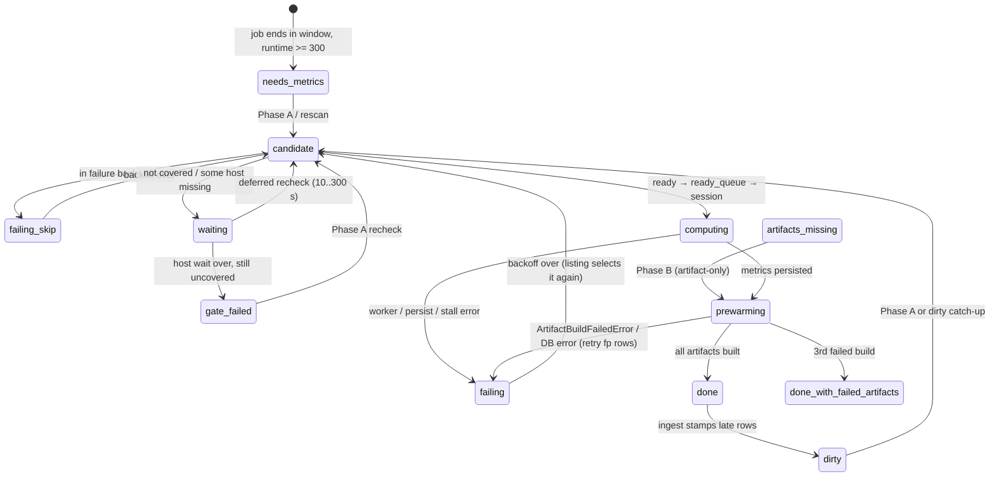

# update_metrics state machine

Every state a job, a scheduler pass and the `update_metrics.py` process can be
in; every gate that reads that state; and the exit each negative state has.
Companion to `SYNC_TIMEDB_STATE_MACHINE.md`. A **job** here means metrics
(`metrics_data`) **and** its artifacts (job plots, job detail, multiprecision
mix, per-type detail); a job is *finished* only when both succeeded. The
review that drove the current design (finding IDs `S*`, `C*`, `T*`) is
`docs/artifacts/update_metrics_review_2026-10-30.md`.

Code: `hpcperfstats/analysis/metrics/update_metrics.py` (scheduler),
`lib/metrics.py` (compute, persist, gate failure),
`lib/metrics_sliding_session.py`, `lib/metrics_idle_slot_supplement.py`,
`site/lib/machine/job_plot_artifacts.py`,
`site/lib/machine/job_detail_artifacts.py`,
`site/lib/machine/cache_utils.py` (`mark_jids_metrics_dirty`),
`site/lib/machine/public_metrics_artifacts.py`.

Invariant **INV-NEG** is borrowed from sync_timedb: every negative state has
(a) a clear on the success path, (b) a bounded retry, and (c) a terminal
resolution. §6 lists each negative state's exits.

## §1 Storage model

| Store | Lives in | Written by | Survives restart |
|---|---|---|---|
| `metrics_data` (one row per catalog metric: `value` or `no_data_reason`) | PostgreSQL | worker task `_unwrap_and_persist` → `_persist_metrics_batch` (sliding path) or the parent (barrier path); `persist_window_coverage_gate_failure` | yes |
| `job_data.metrics_distinct_time_count`, `telemetry_first_time`, `telemetry_last_time`, `host_data_schema_json` | PostgreSQL | `_persist_metrics_batch`, same transaction as the metric rows (S4) | yes |
| `job_data.metrics_dirty_at` (migration 0041, partial index 0042) | PostgreSQL | set by sync_timedb ingest (`_invalidate_jid_caches` → `mark_jids_metrics_dirty`) on ended, already-processed jobs; cleared by `_persist_metrics_batch` (stamps older than `compute_started_at`) and by `persist_window_coverage_gate_failure` | yes |
| `job_plot_artifact` (`plot_kind` × `layout=normal`; payload is a plot **or** an `unavailable_reason`; `input_fingerprint` is the real fingerprint or a `retry<n>:` fingerprint) | PostgreSQL | prewarm `persist_job_plot_artifacts_for_jid` | yes |
| `job_detail_artifact` (`job_detail`, `multiprecision_mix`, `type_detail/<type>`; same fingerprint rule) | PostgreSQL | prewarm `persist_job_detail_artifacts_for_jid` | yes |
| `/pub/` expansion-factor artifacts | PostgreSQL / cache | `_PublicEfRefresher` (background) or the blocking phase (one-shot runs) | yes |
| Redis plot / detail / jid-derived cache keys | Redis | invalidated by persist, gate failure, `--jid`, sync_timedb ingest | yes (TTL) |
| `_JOB_FAILURE_MEMORY` (jid → attempts, retry time, last error; ≤100k) | process memory | `_note_job_outcome` | no (passes yes) |
| `_ARTIFACT_CATCHUP_LAST_SCAN` (day → last Phase B scan) | process memory | `_artifact_catchup_due` | no |
| `_PUBLIC_EF_STATUS` (refreshes, degraded, consecutive degraded, last stats) | process memory | `_record_public_ef_refresh` | no |
| Ready queue, `scheduled_jids`, deferred-not-ready map, strict cooldowns, rescan seen set, scheduler stats | process memory, per pass | scheduler threads | no |

Fingerprints: `PlotArtifactInputFingerprintHex` / `DetailArtifactInputFingerprintHex`
(SQL, `artifact_readiness_expressions.py`). The plot fingerprint covers jid,
start/end, host list, `metrics_distinct_time_count`, telemetry bounds, Bokeh
version and `APP_PLOT_ARTIFACT_SCHEMA_VERSION`, so a recompute that changes
the sample count makes every plot stale. A **retry fingerprint** is
`retry<n>:` plus a prefix of the real one (64 characters): it never equals the
real fingerprint, so Phase B and the website treat the row as not built
(`artifact_build_failure_fingerprint`, `ARTIFACT_BUILD_RETRY_LIMIT = 3`).

## §2 Data workflow

```mermaid
flowchart TD
  subgraph proc[update_metrics.py process]
    start([supervisord start\nsleep 90]) --> argv{mode}
    argv -- --jid --> onejid[_main_one_jid] --> exitj([exit 0/1])
    argv -- explicit dates / sleep_after off --> single[one pass\npublic_ef=blocking] --> exits([sleep 600 / exit 0])
    argv -- supervised default --> loop[_run_continuous_scheduler]
    loop --> pass[pass over rebuilt 7-day window\npublic_ef=background]
    pass --> idle[idle metrics_scheduler_pass_interval_s] --> pass
    loop -.-> ef[_PublicEfRefresher thread\npublic-ef-pool x4\nevery metrics_public_ef_interval_s]
  end

  subgraph onepass[one pass]
    lst[Listing per day\nPhase A: need metrics or dirty\nPhase B: artifact catch-up, <=1/h/day\n+ dirty catch-up before window] --> prod
    resc[rescan thread\n2 newest days] --> prod
    prod[readiness producer\nskip failure backoff\nproxy reject → per-host coverage] -->|ready| rq[(ready_queue\nunique via scheduled_jids)]
    prod -->|not ready, wait not over| dq[(deferred\n10→300 s backoff)]
    prod -->|not covered after host wait| gf[gate failure\none transaction]
    dq --> prod
    rq --> slide[one continuous sliding session\nmax_inflight = pool threads]
    slide --> w1[worker: compute + persist\n_unwrap_and_persist]
    slide --> wa[artifact-only ref:\nprewarm only]
    w1 -->|ok| w2[worker: prewarm\njob detail → type detail → plots]
    w1 -->|fail| out
    w2 --> out[(outcome per job\nok = metrics_ok and prewarm_ok)]
    wa --> out
    out --> acct[_record_outcomes\ncounters, scheduled_jids,\nfailure memory, completion rate]
  end
  ingest[sync_timedb ingest] -->|late rows for ended job| dirty[(metrics_dirty_at)]
  dirty --> lst
```

The barrier batch path (`Metrics.run` then prewarm for the whole batch) is
used only when the sliding session is disabled
(`metrics_idle_slot_supplement_enabled=no`) or the pool lacks `apply_async`.

## §3 Per-job state (derived from rows plus process memory)

| State | Condition | Selected by | Next |
|---|---|---|---|
| `ineligible` | `runtime < 300`, or ended before the window and not dirty | nothing | none |
| `needs_metrics` | fewer catalog-metric rows than `expected_job_metric_row_count()`, or a catalog row with no value and no reason (C4: only current catalog names count) | Phase A, rescan | readiness |
| `dirty` | `metrics_dirty_at` set (late host_data) | Phase A in window; dirty catch-up before it (C7) | readiness, recompute |
| `gate_failed` | catalog complete with `INSUFFICIENT_DATA_FOR_METRICS_PROCESSING` rows | Phase A recheck | readiness again |
| `waiting_for_hosts` | union of hosts covers the window, some host does not, job ended < `metrics_readiness_host_wait_seconds` ago | deferred | ready once all hosts cover or the wait passes |
| `waiting_for_data` | window not covered, job ended < host wait ago | deferred, no gate row | ready or `gate_failed` |
| `failing` | in `_JOB_FAILURE_MEMORY`, retry time in the future | skipped before readiness | retried after 5 min / 30 min / 2 h / 6 h / then daily |
| `artifacts_missing` / `artifacts_stale` | missing plot/detail rows, fewer type-detail rows than schema types, or any fingerprint ≠ current (includes retry fingerprints) | Phase B (≤ once an hour per day) | prewarm only |
| `done` | metrics complete, no gate rows, not dirty, every artifact current | nothing | none |
| `done_with_failed_artifacts` | a failure payload stored under the real fingerprint after `ARTIFACT_BUILD_RETRY_LIMIT` builds | nothing | terminal until inputs change |



## §4 Scheduler and process states

### §4.1 Process

| State | Entered | Left |
|---|---|---|
| `boot` | supervisord `sleep 90; exec python3.14t update_metrics.py` | after imports and the Codon gate: `codon_metrics status=enabled …` logged; on `/opt/python3.14t` a missing `/opt/hpcperfstats/codon_metrics/hpcperfstats_codon_metrics.so` logs `codon_metrics status=disabled reason=… required=1` and exits (`SystemExit`, supervisord restarts; rebuild the image) |
| `one_jid` | `--jid <JID>` | exit 0 when metrics **and** artifacts succeed, else 1 |
| `single_pass` | explicit dates or `sleep_after` off | blocking `/pub/` phase, one pass, `/pub/` refresh, then 600 s sleep (explicit dates) and exit 0 |
| `continuous` | supervised default | `_run_continuous_scheduler`: pass → close DB connections → idle `metrics_scheduler_pass_interval_s` → next pass; ends on shutdown |
| `public_ef_refresh` | thread started by `continuous` | refreshes immediately and every `metrics_public_ef_interval_s`; stops with the loop |
| `stall_exit` | `stats.stall_exit_triggered` | `MetricsSchedulerStallExit` → exit 1 → restart |
| `db_unavailable` | `DatabaseUnavailableExit` | exit 2 |
| `sigterm` | SIGTERM sets `shutdown_requested` | exit 143 |

### §4.2 Readiness producer (per candidate)

| Step | Gate | Outcome |
|---|---|---|
| failure backoff | `_job_failure_backoff_active(jid)` | dropped before any query (`failure_backoff_skips`) |
| proxy | window coverage on aggregate host min/max | `reject` → defer (gate row only after the host wait) |
| strict cooldown | 30 s after a strict DB error | defer |
| strict | aggregate coverage **and** every host covers the window (`_WindowBounds.host_coverage`), unless the job ended ≥ `metrics_readiness_host_wait_seconds` ago | ready → `ready_queue` (unique) |
| deferred | `_deferred_retry_after_s`: 10 s doubling to 300 s; quarantine 300 s after 30 tries or 900 s | rechecked while the consumer has work |
| listing DB error | keyset page timeout | day cooldown 60 s, iterator rebuilt |

Producer exit: (a) listing done, no rescan backlog, and either no deferred
jids or an idle consumer → normal end (`listing done; leaving N not-ready
jid(s) to the next pass`); (b) listing **not** done and no progress for
`STALL_EXIT_AFTER_SECONDS` with an idle consumer → `no_ready_candidates`
stall exit; (c) unexpected fill exception → `listing_query_failed` stall exit.

### §4.3 Consumer and compute

The consumer pops the first ready batch and runs **one continuous sliding
session** (`continuous=True`): every slot is fed FIFO from `ready_queue`;
with an empty queue the session waits (the stall clock restarts when work
resumes) until `_session_should_stop()` — producer done and queue empty, or
failures with no metrics persisted for `STALL_EXIT_AFTER_SECONDS`
(`compute_all_failed` stall exit). Each finished job is accounted
immediately (`on_result` → `on_outcome` → `_record_outcomes`). A
no-progress stall inside the session fails pending items
(`sliding_session_stall`; items already in prewarm keep their committed
metrics outcome) and resets the pool.

Barrier path only: `effective_batch_cap` halves when a batch reaches
`metrics_compute_watchdog_s` and grows by 16 after a full batch with no
failure (`_next_compute_batch_cap`).

**Per-job compute (columnar, pandas-free):** `compute_metrics` opens the
job once (`open_job_table`: `jid_table` metadata + one psycopg `COPY …
(FORMAT BINARY)` per host×time chunk, decoded by the Codon K0 kernel into a
sorted `JobFrame`), computes every metric from `FrameIndex` reductions
(Codon `group_reduce` / `grid_mean` / `join_sorted`, NumPy reference on
hosts without the pyext) and leaves the table in `HANDOFF` for the detail
and plot prewarm of the same job on the same pool thread (review finding
T4 closed: one fetch per job). Kernels are single-threaded and write into
caller buffers; parallelism is jobs across pool threads. With the kernel
loaded, a kernel failure raises `CodonKernelError`, the job fails into the
failure memory below and nothing falls back to NumPy. Contract:
`update-metrics-columnar-codon-contract.mdc`.

### §4.4 Outcome statuses

`ok` (the scheduler outcome) = metrics persisted **and** prewarm succeeded;
`metrics_ok` keeps the metrics half.

| Status (`failure_kind`) | Producer | Counted as |
|---|---|---|
| finished | metrics ok + prewarm ok (or artifact-only + prewarm ok) | `processed`, `metrics_ok_total` |
| `prewarm_failed` | metrics ok, prewarm raised / stalled / did not run | `failed`, `metrics_ok_total`, `prewarm_failed_total` |
| `empty_rows` | worker payload without rows (S12) | `failed` |
| `worker_db_error`, `worker_compute_error`, `worker_stall_timeout` | worker | `failed`, `worker_failed_outcomes_total` |
| `parent_persist_timeout`, `parent_persist_db_error` | persist | `failed`, `parent_persist_failures_total` |
| `missing_run_outcome`, `empty_worker_payload`, `per_jid_retry_exception`, `stall_recovery_budget_exhausted` | barrier path | `failed` |
| `sliding_session_stall`, `sliding_worker_exception`, `sliding_persist_exception` | sliding session | `failed` |
| `sliding_session_interrupted` | shutdown | `failed` (not remembered as a job failure) |

Every non-finished outcome except a shutdown interruption enters the failure
backoff; a finished one clears it. Stall reasons: `no_ready_candidates`,
`listing_query_failed` (producer); `compute_stuck_inflight`,
`compute_all_failed`, `worker_failed_outcomes`, `parent_persist_failed`
(consumer; cleared once metrics persist again). Consumer stall decisions use
`max(processed, metrics_ok_total)`, so artifact-only failures never look like
a wedged compute stage.

## §5 Artifact writes (prewarm)

Order per jid: job detail, then plots. Retries within a pass: up to 2, and
only for `DatabaseError` / `InterfaceError`.

| Step | Skips when | On error |
|---|---|---|
| job detail + multiprecision mix | both rows carry the current fingerprint (T6) | an FSIO / BeeGFS / NFS / GPU-inventory sub-query that raises is recorded; the detail row gets a retry fingerprint |
| type detail per schema type | row with the current fingerprint exists | failure payload under a retry fingerprint |
| plots per `JOB_PLOT_KINDS` | every kind current | builder exception: failure payload under a retry fingerprint; "interpreter shutdown" text: no row; batch upsert error: raised |

After writing, a function that stored any retry-fingerprint row raises
`ArtifactBuildFailedError` (job not finished). The third failed build of the
same inputs stores the real fingerprint (terminal unavailable).

## §6 Negative-state exit table (INV-NEG)

| Negative state | (a) clear on success | (b) bounded retry | (c) terminal |
|---|---|---|---|
| not ready (deferred) | ready → queue, meta released | 10 s doubling to 300 s, in-pass while the consumer works | pass ends normally; next pass relists; after the host wait → `gate_failed` |
| waiting for hosts | every host covers | same as deferred | after `metrics_readiness_host_wait_seconds` computes with the reporting hosts |
| `gate_failed` | recompute overwrites | relisted every pass (Phase A recheck); late data sets `dirty` | stays until data arrives (dirty catch-up reaches it outside the window) |
| `dirty` | persist clears stamps older than the compute start | relisted every pass | gate failure consumes the stamp when still uncovered |
| compute / persist failure | finished outcome clears memory | 5 min → 30 min → 2 h → 6 h | daily retry, logged once |
| prewarm failure | finished outcome | failure backoff; Phase B relists retry-fingerprint rows hourly | 3rd build stores the real fingerprint |
| strict / listing cooldown | expires (30 s / 60 s) | yes | n/a |
| `/pub/` degraded | next clean refresh resets the consecutive count | every `metrics_public_ef_interval_s` | warning with `consecutive=` count |
| consumer stall | metrics persist again | 900 s | process exit 1 |

## §7 Operator census

- `metrics progress: completed_last_hour= processed_total= ... metrics_ok_total= prewarm_failed_total= failing_jids= daily_retry_jids= failure_backoff_skips= ... public_ef_degraded= ...` (hourly). `completed_last_hour` / `processed_total` count **finished** jobs and move as jobs finish.
- `metrics scheduler: compute batch heartbeat phase= size= completed_jids= age_s=` (60 s).
- `metrics_deferred_coverage jid= start_ok= end_ok= ... hosts_covered=N/M` (once per jid per pass).
- `metrics scheduler: listing done; leaving N not-ready jid(s) to the next pass`.
- `metrics scheduler: pass N done; next pass in Ss public_ef_last={...}`.
- `metrics scheduler: jid=X failed N times; retrying daily (last=...)`.
- `metrics scheduler: WARNING /pub/ EF refresh degraded consecutive= degraded_total= stats=`.
- `metrics scheduler: candidate rescan failed day= errors_total=` (≤ once per 300 s).
- `Finished metrics scheduler ... processed= failed= metrics_ok_total= prewarm_failed_total= ... deferred_meta_size= ...`.
- `plot prewarm failed jid= kind=`, `type_detail artifact prewarm failed jid= type=` (Django logger, warning level).
- `codon_metrics status=enabled module=hpcperfstats_codon_metrics gil=off dir=/opt/hpcperfstats/codon_metrics required=1` at boot (or `status=disabled reason=… required=0|1`; `required=1` exits).

Exit codes: 0 normal / shutdown, 1 stall exit or `--jid` failure, 2 database
unavailable, 143 SIGTERM.

## §8 Knobs (`[PIPELINE]`, defaults from `conf_parser.py`)

| Key | Default | Governs |
|---|---|---|
| `metrics_pool_processes` | 32 | worker threads (free-threaded 3.14t), sliding `max_inflight` |
| `metrics_scheduler_pass_interval_s` | 60 | idle between passes of the continuous loop |
| `metrics_public_ef_interval_s` | 3600 (min 60) | background `/pub/` refresh period |
| `metrics_scheduler_mode` | `global_priority` | round-robin over days vs `strict_date` (per-day passes, unchanged) |
| `metrics_scheduler_ready_queue_target` | 100 | ready-queue cap, probe target |
| `metrics_idle_slot_supplement_enabled` | yes | sliding session (continuous) vs barrier batches |
| `metrics_plot_prewarm_mode` | `pipeline_required` | `inline` runs prewarm on the consumer thread |
| `metrics_run_poll_timeout_s` / `metrics_run_stall_timeout_s` | 5 / 900 | session / imap stall detection |
| `metrics_compute_watchdog_s` / `_total_watchdog_s` | 120 / 0 | barrier-path batch-cap downshift |
| `metrics_deferred_not_ready_retry_s` / `_max_retries` / `_max_age_s` / `_quarantine_s` | 10 / 30 / 900 / 300 | deferred readiness backoff |
| `metrics_readiness_require_window_coverage` | yes | coverage gate + gate-failure writes |
| `metrics_readiness_start_margin_seconds` / `_end_margin_seconds` | 600 / 600 | per-host coverage tolerance |
| `metrics_readiness_host_wait_seconds` | 21600 | wait for every host; also the earliest gate-failure write |
| `metrics_worker_statement_timeout_ms` / `metrics_persist_statement_timeout_ms` / `metrics_persist_lock_timeout_ms` | 120000 / 120000 / 10000 | DB timeouts |

Code constants: `ARTIFACT_BUILD_RETRY_LIMIT = 3`, `JOB_FAILURE_BACKOFF_S`,
`ARTIFACT_CATCHUP_INTERVAL_S = 3600`, `RESCAN_RECENT_DAYS = 2`,
`PUBLIC_EF_POOL_THREADS = 4`, `STALL_EXIT_AFTER_SECONDS = 900`.
