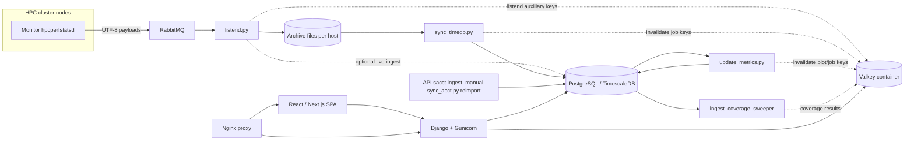
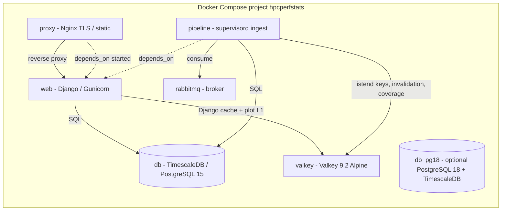

# HPCPerfStats - System Design Document

| Field | Value |
|--------|--------|
| **Status** | As-built reference (describes the current repository layout and contracts) |
| **Last updated** | 2026-11-26 |
| **Scope** | Monitor daemon (C), Python ingest/analysis/site stack, Docker Compose deployment |

This document follows a structure common to technical design docs (problem/context -> goals -> architecture -> data -> contracts -> operations -> risks/alternatives -> open questions), aligned with practices described in industry write-ups on design documentation (for example [Google-style design doc flow](https://www.lodely.com/blog/design-docs-at-google) and similar architecture templates).

---

## 1. Context and problem statement

HPC centers need **multi-resolution visibility** into how jobs use nodes: CPU, memory, accelerators, network, and power, correlated with **scheduler accounting** (job IDs, time ranges, nodelist). Raw telemetry alone is not enough; operators and researchers need **job-indexed** views and derived metrics.

**HPCPerfStats** (formerly known as TACC Stats) addresses this by combining:

1. A **lightweight node daemon** that samples hardware and ships UTF-8 text payloads to a message broker.
2. An **off-cluster** Python stack that archives raw messages, loads structured rows into **PostgreSQL/TimescaleDB**, computes **aggregates and plots**, and serves a **Django + React (Next.js)** web application.

---

## 2. Goals and success criteria

### 2.1 Goals

- **Collect** representative node-level performance samples on cluster nodes with bounded overhead (see `README.md` and `docs/measurements/monitor_overhead_stampede3_spr_2026-08-14.md` for a recorded Stampede3 SPR `pidstat` capture).
- **Reliably transport** samples from nodes to a central service via **RabbitMQ**.
- **Persist** raw archives and normalized time-series/job records for audit and reprocessing.
- **Join** node telemetry with **Slurm accounting**-backed job metadata to support per-job analysis.
- **Expose** curated metrics, tables, and Bokeh-backed plots through the web UI and APIs.

### 2.2 Non-goals

- Replacing the site batch scheduler or owning cluster provisioning.
- Modifying application source code on user jobs (optional **XALT**-related documentation and checks are governed by workspace rules; XALT itself is upstream).
- Guaranteeing sub-second real-time dashboards for every metric (the pipeline is **near-line**; latencies depend on ingest intervals and worker scheduling).

### 2.3 How we measure "healthy" operation

Operational signals used in this repo (not a complete SLO spec):

- Compose **healthchecks** for `db`, `db_pg18`, `valkey`, `rabbitmq`, and `proxy` (`docker-compose.defaults.yaml`).
- Automated tests for `listend` message handling, `sync_timedb` archive edge cases, metrics updates, and web/API behavior (`docs/TESTING.md`).
- **Idempotent** metrics recomputation expectations where documented under ingestion/metrics rules.

---

## 3. High-level architecture

### 3.1 Data flow

### 3.2 Compose containers (central stack)

All central services run on the Compose network **`hpcperfstats_net`**. Service definitions live in the tracked **`docker-compose.defaults.yaml`**. The site-local, gitignored **`docker-compose.yaml`** (bootstrap from **`docker-compose.yaml.example`**) `include`s it and adds bind volumes and optional knobs.

**Deployment split:**

- **On nodes:** C monitor (`monitor/`), typically installed from the RPM package `hpcperfstatsd` (`monitor/hpcperfstats.spec`) and run by the systemd unit `hpcperfstats.service`.
- **Central stack:** Docker Compose (site `docker-compose.yaml` includes `docker-compose.defaults.yaml`): **`web`**, **`pipeline`**, **`db`**, **`valkey`**, **`rabbitmq`**, **`proxy`**, plus the optional **`db_pg18`** (profile **`pg18-migrate`**).

---

## 4. Stakeholders and consumers

| Role | Need |
|------|------|
| **HPC operators** | Operate compose services, storage paths, credentials, broker capacity, and ingest schedules. |
| **Researchers / users** | Inspect job performance, compare runs, interpret plots and summaries. |
| **Developers** | Preserve **monitor<->consumer** and **`host_data.type`<->analysis** contracts when extending metrics or UI. |

Primary maintainer contact appears in `pyproject.toml` authors (Texas Advanced Computing Center).

---

## 5. Component inventory

### 5.1 Monitor (C daemon)

- **Purpose:** Collect node-level statistics from hardware counters read through `perf_event_open` (no MSR access), `/proc`, `/sys`, accelerators (e.g. DCGM), network counters, etc., and publish them to RabbitMQ as UTF-8 text messages; one message can carry several batched samples, up to the soft size cap `STATS_BUFFER_RMQ_SOFT_MAX_BYTES` (`monitor/src/stats_buffer.h`).
- **Build:** Autotools; production packaging via static-bundle + RPM spec under `monitor/` (see `README.md`).
- **Workspace rule split:** Application Python code treats `monitor/` as **read-only** unless the user explicitly approves edits; monitor-only work follows `monitor/cursor-rules/` (which does **not** apply `hpcperfstats/cursor-rules/` to monitor changes). In a **dual** workspace (`.cursor/workspace-profile` first word `dual`), monitor edits need no approval pause and follow the monitor rule tree.

### 5.2 Docker Compose services

| Service | Role |
|---------|------|
| **`web`** | Builds from `services-conf/pipeline_web.Dockerfile` with context `./` (build target `hpcperfstats-full`, image `hpcperfstats`); runs Django under Gunicorn (`0.0.0.0:8000` in the container) via `services-conf/django_startup.sh`; publishing it on the host is an optional, commented knob in `docker-compose.yaml.example` (`HPCPERFSTATS_WEB_PORT`, default `8000`). `web` has no `depends_on`: `django_startup.sh` waits for Valkey (`dbload/lib/valkeywait.py`) and PostgreSQL (`dbload/lib/dbwait.py`) before `migrate` / `collectstatic`. |
| **`pipeline`** | Same image as `web`; runs `supervisor_startup.sh` to supervise long-running ingest/processing programs (see section 6). Uses the **`hpcperfstatsdata`** bind (mounted at **`/hpcperfstats/`**) for archive, accounting, daily archive, and **cluster syslog** under **`/hpcperfstats/logs/`** (bind `device:` in the site **`docker-compose.yaml`**). Publishes syslog port **514** (UDP/TCP). Reaches **`db`**, **`valkey`**, and **`rabbitmq`** on `hpcperfstats_net`. |
| **`db`** | TimescaleDB on PostgreSQL 15 (`docker.io/timescale/timescaledb:2.28.3-pg15`); the production `db` unless the site file also includes **`docker-compose.pg18-primary.yaml`**, which parks it under profile **`pg15-retired`** and makes `db_pg18` answer to hostname `db`. Compose sets **`shm_size: "16gb"`** and Postgres tuning (`shared_buffers`, timeouts, WAL) for concurrent Django + pipeline load. |
| **`db_pg18`** | Optional dual-run homemade PostgreSQL 18 + TimescaleDB (`hpcperfstats-db` from `services-conf/db.Dockerfile`; profile **`pg18-migrate`**, alias **`db18`**). Logical migrate runbook: `docs/OPERATOR_PG18_MIGRATION.md`; cutover overlay: `docker-compose.pg18-primary.yaml`. Same **`shm_size: "16gb"`** plus **`io_method=worker`** (PostgreSQL 18 I/O worker pool). |
| **`valkey`** | **Dedicated Compose container** (`docker.io/valkey/valkey:9.2.0-alpine3.24`, `valkey-server`, in `docker-compose.defaults.yaml`). Network alias **`valkey`**. Shared instance for Django cache (TTL keys) and listend auxiliaries (`recent_host:*`, `monitor_identity:*`, `ingest_rotation:v1:*`), and the ingest coverage sweep results. `sync_timedb` uses it only to invalidate per-job cache keys after a `host_data` write; its jobs and archive-member maps live in-process with disk sidecars. **`maxmemory` 16gb** with **`volatile-lru`**. `appendonly no`; **`--io-threads 4`**; Unix socket **`/run/valkey/valkey.sock`** on volume **`valkey_runtime`** (shared with `web` and `pipeline`; clients default to `unix:///run/valkey/valkey.sock?db=1` via `[CACHE] valkey_location`). Healthcheck: TCP `PING` and socket `PING`. |
| **`rabbitmq`** | Broker for monitor->site message delivery (`docker.io/library/rabbitmq:4.4.1-management-alpine`, AMQP **5672** published; management HTTP **15672** compose-internal only). Admin Monitor queue/node stats use the management API from `web`, not AMQP. Memory cap: Compose **`mem_limit` / `memswap_limit` 96g** plus **`vm_memory_high_watermark.absolute = 64GiB`** (`services-conf/rabbitmq_vm_memory.conf`) so publishers block ~32 GiB below the cgroup wall instead of growing unbounded or hitting Erlang `binary_alloc`. Erlang allocator: **`ERL_FLAGS=+MBas aobf +MBlmbcs 512 +MHlmbcs 512`**. |
| **`proxy`** | Nginx TLS/front door (`hpcperfstats-proxy` from `services-conf/proxy.Dockerfile`); **`docker-compose.defaults.yaml`** mounts committed **`services-conf/nginx.conf`** as **`default.conf`**, the shared `nginx-*.conf` / `.inc` snippets, and **`proxy_ssl_source:/mnt/ssl-source:ro`**; image build **`cp`**s **`nginx.conf`**, generates **`hps-proxy-allowed-hosts.inc`** from INI; **`proxy_entrypoint.sh`** materializes TLS PEMs from the settings mount into fixed paths under **`/etc/ssl/hpcperfstats`**. Serves static files, media and the SPA export from the `staticfiles_ram` / `media_ram` volumes and proxies API/HTML to **`web`**. |

### 5.3 Python package layout (concise)

- **`hpcperfstats/listend.py`** - RabbitMQ consumer; archive writer (section 7.2); best-effort Valkey recent-host tracking; optional live DB ingest (`dbload/lib/listend_db_ingest.py`, `[PIPELINE] listend_db_ingest_enabled`, default `no`).
- **`hpcperfstats/dbload/`** - Time-series and accounting loaders (`sync_timedb.py`, `sync_acct.py`, helpers); in-process archive-members / job stores under `dbload/lib/`.
- **`hpcperfstats/analysis/`** - Metrics computation, plotting, roofline and vendor-specific logic; **`update_metrics.py`** persists plot/detail artifacts after recompute.
- **`hpcperfstats/site/`** - Django project, DRF APIs, OpenAPI schema, React/Next frontend under `site/frontend/`.

### 5.4 External API client

- **`hpcperfstats-tools`** (in-tree monorepo directory under this checkout; separate Python distribution / import `hpcperfstats_tools`) is the **canonical CLI/client** for the Django API (endpoints, auth headers, schemas). Server-side business rules stay in Django; the client validates responses (workspace guardrails).

---

## 6. Runtime processes (pipeline)

The tracked supervisor configuration (`services-conf/supervisord.conf`) runs **supervisord as `hpcperfstats`** and defines long-running programs including:

- **`listend.py`** (`hpcperfstats-rabbitmq-listener`) - RabbitMQ listener (archive append/rotation).
- **`sync_timedb.py`** (supervisord runs it with no arguments) - Imports node-level data from the archive into the database. The coordinator is the in-process `job:v1` queue orchestrator (`dbload/lib/sync_timedb_queue_orchestrator.py`): it holds an exclusive `archive_dir` flock, streams `discover` into `ingest` / `append` / `day_close` jobs, and runs `day_close` as seal, raw removal, then tar-drop. For manual runs, one `YYYY-MM-DD` or two dates set a discover range hint, a leading `once` exits after one idle reconstruct pass, and `--jid <JID>` is a one-shot ingest-only run. Archive-member maps use the in-process members store (`sync_timedb_archive_members_store` / `sync_timedb_archive_members_coord`).
- **`update_metrics.py`** - Builds/updates job-indexed and secondary metrics from DB state; persists **`job_plot_artifact`** / **`job_detail_artifact`** and invalidates related Valkey keys.
- **`ingest_coverage_sweeper`** - Admin Monitor ingest coverage sweep (one host at a time, results to Valkey); exits and stays stopped when `ingest_coverage_sweep_enabled = no`.
- **`rabbitmq_watcher.py`** (`rabbitmq-watcher`) - Polls the RabbitMQ management API and logs broker memory, with `ERROR` bands above a threshold.

It also includes **`rsync_data`** (via **`rsync_data_wrapper.sh`**, preferring guarded **`rsync_data.sh`** then **`rsync_data.sh.example`**). **Cluster syslog** (`syslog-ng`, **`render_syslog_ng_generated`**, **`seal_syslog_daily`**) is in the image and configured under **`[SYSLOG]`** / **`data_dir/logs/`**, but those programs are **not** supervised; enable them manually as root when needed (see `README.md`).

**Accounting (job-level) ingest** is **not** a supervisord program:

- **`hpcperfstats-sacct-gen`** from **hpcperfstats-tools** runs `sacct` and **POST**s the result to the API ingest endpoint (`sacct_ingest` in `site/lib/machine/api.py`), which loads `job_data` with the `sync_acct` logic and keeps the day on disk as `{acct_path}/YYYY-MM-DD.txt` (`README.md`).
- **`sync_acct.py`** is run manually only: it reimports archived days from those `{acct_path}/YYYY-MM-DD.txt` files into `job_data`, skipping jobs already loaded (`README.md`, "Reimporting archived days").

---

## 7. Data design

### 7.1 Glossary

| Term | Meaning |
|------|--------|
| **Node-level data** | Raw performance samples from a host; **not** inherently tied to a job ID in the payload. |
| **Job-level data** | Scheduler accounting fields (job ID, user, start/end, nodelist, partition, etc.). |
| **Job-indexed data** | Derived association of node samples with jobs using time overlap and nodelist, plus downstream aggregates. |

### 7.2 Archive layout (listend)

`listend.py` appends monitor payloads under the configured **archive directory**, per host, using a **`current`** file and **`$`-prefixed rotation** semantics. Epoch-named files and hardlink relationships are coordinated so **`sync_timedb`** can avoid racing active writes (see `hpcperfstats/dbload/lib/sync_timedb_archive_helpers.py` and listend tests). This is the **transport/archive contract** documented in `monitor/cursor-rules/monitor-workspace-contract.mdc`. A per-host duplicate-sample guard keeps a redelivered or re-sent sample (same header line) from being appended twice, and an archive item whose consume channel already went away is left for the broker to redeliver instead of being archived (`hpcperfstats/cursor-rules/listend-live-db-ingest-contract.mdc`).

**Cluster syslog (pipeline):** under the same **`data_dir`** bind mount, **`logs/current/`** holds live per-host syslog files (date in the filename), and **`logs/log_archive/`** holds sealed **daily** **`*.tar.gz`** bundles - analogous in operator terms to **`archive_dir`'s `current`** workflow and **`daily_archive`** cold storage, though the on-disk mechanics differ.

**Canonical consumer/parser contract** for monitor output: treat **`hpcperfstats/listend.py`** as source of truth for:

- UTF-8 text payloads.
- **Schema/rotation** lines starting with `$` (host identification on the consumer side uses the prescribed token positions).
- **Stats** lines: whitespace-separated fields with **host as the third token** (`<timestamp> <jobid> <host> ...`).

### 7.3 Database and metrics

- Time-series and job tables are read by **`update_metrics.py`** to populate derived metrics used by the site and plots.
- **Deterministic, DB-backed aggregation** is preferred over ad-hoc recompute (runtime/metrics safety rule).
- Durable plot/detail embeds live in PostgreSQL as **`job_plot_artifact`** and **`job_detail_artifact`** (gzip JSON); Valkey holds only short-TTL / L1 copies where configured.

### 7.4 Monitor <-> analysis contract (`host_data.type`)

The monitor publishes **`host_data.type`** strings (from C `stats_type.st_name` / schema). **Analysis code must treat those names as the contract**: Intel IMC ordering, PMC priority, AMD (per-family `amd_x86_uncore_df_{rome,milan,genoa,turin}`, `amd_x86_rapl`; core counters in `host_cpu_hw`), ARM/Grace paths, and **roofline nominal peaks** must stay aligned with what the monitor can emit.

Canonical Python references (see `hpcperfstats/cursor-rules/monitor-analysis-architecture-sync.mdc` and `hpcperfstats/analysis/README_ARCH_AGNOSTIC.md`):

- `hpcperfstats/dbload/lib/monitor_naming/canonical.py` - `INTEL_IMC_STATS_TYPES` and related type name sets; `monitor_naming/legacy.py` holds the legacy alias names that ingest and analysis read from older `host_data` rows and archives.
- `hpcperfstats/analysis/metrics/lib/plot/roofline_peaks.py` - peak tables and inference.
- `hpcperfstats/analysis/metrics/lib/plot/roofline.py` - merge logic.

### 7.5 Valkey roles (same container, multiple key namespaces)

The **`valkey` Compose service** is the single shared Valkey instance. Django configures it via `cfg.get_valkey_location()` (`django_valkey.cache.ValkeyCache`, key prefix `hpcperfstats`, default pickle serializer). Raw commands (SADD/SMEMBERS/SCAN/INFO) go through `cache_utils.get_valkey_client()`, which wraps `django_valkey.get_valkey_connection`; listend uses valkey-py `valkey.from_url`. Host pytest normally uses LocMem unless `HPCPERFSTATS_PYTEST_LIVE_VALKEY=1` (compose Valkey workflows).

| Role | Typical consumers | Notes |
|------|-------------------|--------|
| **Django / ORM view cache** | `web` (`cache_utils.py`) | Versioned keys such as **`KEY_JOB`** (pickled `job_data`), site filter facets, GPU/XALT/proc helpers. Stale pickled prefetch must be refreshed on read when metrics rows change. |
| **Job plot L1** | `web` (`api_job_plots` / `job_plot_artifacts`) | Short-lived Bokeh `json_item` embeds; oversized payloads may skip Valkey. L2 durable store is **`job_plot_artifact`** in Postgres. |
| **Invalidation** | `update_metrics`, `sync_timedb` (after `host_data` writes) | Deletes plot keysets and related job keys so recomputes are visible after refresh. |
| **Archive-members coordination** | `pipeline` / `sync_timedb` | In-process members store + disk sidecars (`SyncTimedbArchiveMembersStore`). Not a Valkey key namespace. |
| **listend auxiliaries** | `pipeline` / `listend.py` | `recent_host:*`, `monitor_identity:*` and `ingest_rotation:v1:*` operational keys, not a substitute for the on-disk archive. |
| **Ingest coverage** | `pipeline` / `ingest_coverage_sweeper` | Admin Monitor per-host coverage results. |

Operator tuning for this container (memory cap, LRU, threads) is in **`docker-compose.defaults.yaml`** under **`valkey:`**; see also `docs/DEPLOY_CONCURRENCY_AND_NUMA.md` when aligning host/VM sizing.

---

## 8. Web application and APIs

- **Django** serves the backend; **DRF** exposes JSON APIs consumed by the React SPA and by **hpcperfstats-tools**.
- **OpenAPI** schema under `site/openapi/` drives **orval**-generated TypeScript clients in the SPA (`frontend-stack-wiring-contract` / `openapi-orval-sync` rules).
- **React / Next.js** SPA routes under **`/machine/`** and **`/pub/`** (Next `output: "export"`; Nginx serves the export from `/srv/static/frontend`; see web E2E and frontend prod-build rules).
- **Job Detail** shows scheduler fields plus the job data tabs **Metrics**, **Summary plots**, **Roofline**, **Multiprecision Mix**, **Processes**, **Execution and hosts**, and **Device data** (`src/views/JobDetail.tsx`). Detail and type-detail payloads are served from **`job_detail_artifact`** when present (researcher guide: `docs/using-the-website-as-a-researcher.md`).
- **Display policy:** User-visible numbers and plot ticks must **not** use scientific notation (dedicated workspace rule: use shared formatters in Python/Bokeh and `formatDecimalStandard` / standard notation in JS).

---

## 9. Security, configuration, and operations

- **Configuration** is driven by `hpcperfstats.ini` (container path commonly `/home/hpcperfstats/hpcperfstats.ini`) and files under `services-conf/`. `*.example` files document intended shapes; copy/rename per `README.md`. **Immutable-image policy:** bake INI into the image; do not bind-mount a mutable INI over production containers unless an explicit local-dev exception applies.
- **Secrets** (TLS certs, API keys) are environment- and deployment-specific; TLS PEMs are read from the **`proxy_ssl_source`** settings volume at **`proxy`** container start and materialized under **`/etc/ssl/hpcperfstats`**; Django settings and nginx consume fixed paths defined in `services-conf/`.
- **CSP** changes should be minimal and scoped when touching frontend pages (React workspace rule).
- **Valkey** holds no durable user data; flushing Valkey is safe for correctness after a cold start (expect temporary cache misses and higher DB/plot rebuild cost). Archive files and Postgres remain authoritative.

---

## 10. Testing and documentation expectations

- **Python:** pytest with Django settings (`pyproject.toml`); many tests under `hpcperfstats/tests/` and `hpcperfstats/site/.../tests/`.
- **Web E2E:** `test_web_pages_e2e.py` and Playwright `test_web_pages_browser_e2e.py` must be updated when web routes or SPA behavior changes.
- **Compose workflows:** For DB/Valkey-dependent tests, run inside the rootless Podman compose network (`podman-compose`) so hostnames like `db` and **`valkey`** resolve (see `full-test-with-db-valkey` and `local-compose-db-lifecycle-for-web-tests` rules; Valkey cache workflow: `tests/run_valkey_cache_pytest_workflow.sh`).
- **Testing entrypoints:** `docs/TESTING.md` must stay in sync when test commands or runners change.

---

## 11. Alternatives considered

This section records **typical** tradeoffs implicit in the design - not a formal ADR log.

| Alternative | Why not primary here |
|-------------|----------------------|
| Pull-based polling from nodes | Push via RabbitMQ decouples node connectivity from DB availability and buffers bursts. |
| Single monolithic "do everything" container | Split **`web`** vs **`pipeline`** isolates request serving from long-running ingest loops. |
| Only API-based accounting, with no on-disk copy | Each ingested day stays on disk as `{acct_path}/YYYY-MM-DD.txt`, so a manual **`sync_acct.py`** run can reimport archived days into `job_data`. |
| Persist all plot payloads only in Valkey | Durable **`job_plot_artifact` / `job_detail_artifact`** in Postgres survive Valkey eviction; Valkey is L1 / coordination only. |
| Co-locate Valkey inside the web image | A **dedicated `valkey` Compose service** keeps cache lifecycle, healthchecks, and memory policy independent of Gunicorn restarts. |

---

## 12. Open questions and follow-ups

- **Capacity planning** (RabbitMQ queue depth, archive storage growth, DB retention, Valkey `maxmemory`) is deployment-specific and not fully specified in-repo.
- **Per-site hostname allowlists and INI paths** (`HPCPERFSTATS_INI`) must match compose mounts - verify on each environment.

---

## 13. References (in-repo)

| Topic | Location |
|-------|-----------|
| Fresh install, monitor RPM, broker config, and **index of all `docs/`** | `README.md` |
| Existing-stack upgrades (rebuild, Valkey/INI, PG18 dual-run) | `docs/upgrade.md` |
| Telemetry / variable definitions (canonical) | `docs/MONITOR_VARIABLES.md` |
| Regenerate / augment `MONITOR_VARIABLES.md` | `docs/regenerate_monitor_variables_catalog.py`, `docs/augment_monitor_variables_diagnostics.py` |
| Researcher-facing web UI guide | `docs/using-the-website-as-a-researcher.md` |
| Architecture-agnostic analysis | `hpcperfstats/analysis/README_ARCH_AGNOSTIC.md` |
| Compose topology (`valkey` / `db` / `db_pg18` / `rabbitmq` / `proxy` / `web` / `pipeline`) | `docker-compose.defaults.yaml`, `docker-compose.yaml.example`, `docker-compose.pg18-primary.yaml` |
| Supervisor programs | `services-conf/supervisord.conf` (rsync via `rsync_data_wrapper.sh`) |
| Job plot / detail caching | `hpcperfstats/cursor-rules/job-plot-artifacts-caching.mdc`, `hpcperfstats/site/lib/machine/job_plot_artifacts.py` |
| Workspace guardrails (monitor/tools/nginx/valkey) | `hpcperfstats/cursor-rules/workspace-guardrails.mdc` |
| Monitor message contract | `monitor/cursor-rules/monitor-workspace-contract.mdc` |
| Monitor <-> analysis type sync | `hpcperfstats/cursor-rules/monitor-analysis-architecture-sync.mdc` |
| Deploy concurrency / pool sizing | `docs/DEPLOY_CONCURRENCY_AND_NUMA.md` |
