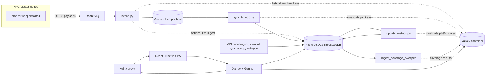
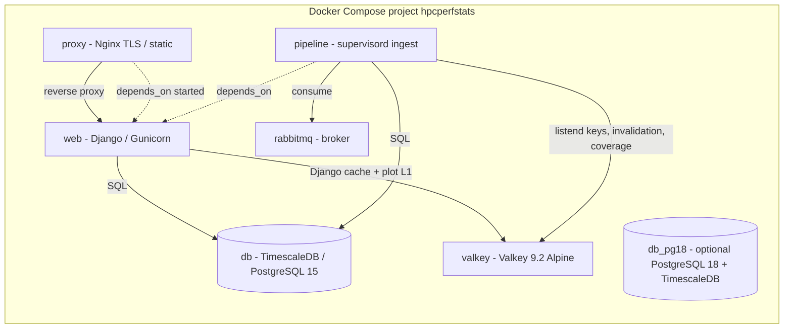

# Architecture

This page explains how HPCPerfStats is built: the data flow from node to web page, the components, the contracts between them and the design choices behind them.
It is for developers changing any layer and operators who want to know what each part does.

HPC centers need multi-resolution visibility into how jobs use nodes: CPU, memory, accelerators, network and power, correlated with scheduler accounting (job IDs, time ranges, nodelist).
Raw telemetry alone is not enough; operators and researchers need job-indexed views and derived metrics.
HPCPerfStats (formerly known as TACC Stats) combines two parts:

1. A lightweight node daemon that samples hardware and ships UTF-8 text payloads to a message broker.
2. An off-cluster Python stack that archives raw messages, loads structured rows into PostgreSQL/TimescaleDB, computes aggregates and plots, and serves a Django + React (Next.js) web application.

## Goals

- Collect representative node-level performance samples on cluster nodes with bounded overhead ([`docs/measurements/monitor_overhead_stampede3_spr_2026-08-14.md`](../measurements/monitor_overhead_stampede3_spr_2026-08-14.md) records a Stampede3 SPR `pidstat` capture).
- Reliably transport samples from nodes to a central service via RabbitMQ.
- Persist raw archives and normalized time-series and job records for audit and reprocessing.
- Join node telemetry with Slurm accounting-backed job metadata for per-job analysis.
- Expose curated metrics, tables and Bokeh-backed plots through the web UI and APIs.

Non-goals:

- Replacing the site batch scheduler or owning cluster provisioning.
- Modifying application source code on user jobs; XALT itself is upstream.
- Guaranteeing sub-second real-time dashboards for every metric: the pipeline is near-line, and latency depends on ingest intervals and worker scheduling.

The repo's operational health signals (not a complete SLO spec) are the Compose healthchecks for `db`, `db_pg18`, `valkey`, `rabbitmq` and `proxy` (`docker-compose.defaults.yaml`), automated tests for `listend` message handling, `sync_timedb` archive edge cases, metrics updates and web and API behaviour ([Test layout](../reference/test-layout.md)), and idempotent metrics recomputation.

## Data flow

Data always lands on disk in the archive before the database, so the archive can rebuild the database and Valkey is never the only copy of anything.

## Deployment

On nodes, the C monitor (`monitor/`) is installed from the RPM package `hpcperfstatsd` (`monitor/hpcperfstats.spec`) and run by the systemd unit `hpcperfstats.service`.
The central stack is Docker Compose: the site `docker-compose.yaml` includes `docker-compose.defaults.yaml` and runs `web`, `pipeline`, `db`, `valkey`, `rabbitmq` and `proxy`, plus the optional `db_pg18` (profile `pg18-migrate`).
[Compose services](../reference/compose-services.md) describes each service's image, limits and mounts.

Request serving and ingest live in separate containers built from one image, so a long ingest loop never competes with Gunicorn for process slots.

## Stakeholders

| Role                  | Need                                                                                                         |
| --------------------- | ------------------------------------------------------------------------------------------------------------ |
| HPC operators         | Operate compose services, storage paths, credentials, broker capacity and ingest schedules                   |
| Researchers and users | Inspect job performance, compare runs, interpret plots and summaries                                         |
| Developers            | Preserve the monitor \<-> consumer and `host_data.type` \<-> analysis contracts when extending metrics or UI |

The primary maintainer contact is in the `pyproject.toml` authors (Texas Advanced Computing Center).

## Components

### Monitor

The monitor collects node-level statistics from hardware counters read through `perf_event_open` (no MSR access), `/proc`, `/sys`, accelerators (DCGM and others) and network counters.
It publishes them to RabbitMQ as UTF-8 text messages; one message can carry several batched samples, up to the soft size cap `STATS_BUFFER_RMQ_SOFT_MAX_BYTES` (`monitor/src/stats_buffer.h`).
It builds with Autotools, and production packaging is the static bundle plus RPM spec under `monitor/` ([Install HPCPerfStats](../tutorials/install-hpcperfstats.md#step-8-build-and-install-the-node-monitor)).
The shipped config samples fast-tier keys every `sample_freq` (30 s) and takes a full sample every `sample_freq_slow` (600 s), plus a sample at job start and end.

Monitor C code has its own agent rule tree, `monitor/cursor-rules/`, and application Python work treats `monitor/` as read-only unless the change is approved; a dual workspace (`.cursor/workspace-profile` first word `dual`) follows the monitor tree for monitor edits.

### Python packages

- `hpcperfstats/listend.py`: RabbitMQ consumer and archive writer, with best-effort Valkey recent-host tracking and optional live DB ingest (`dbload/lib/listend_db_ingest.py`, `[PIPELINE] listend_db_ingest_enabled`, default `no`).
- `hpcperfstats/dbload/`: time-series and accounting loaders (`sync_timedb.py`, `sync_acct.py`, helpers), with the in-process archive-members and job stores under `dbload/lib/`.
- `hpcperfstats/analysis/`: metrics computation, plotting, roofline and vendor-specific logic; `update_metrics.py` persists plot and detail artifacts after recompute.
- `hpcperfstats/site/`: the Django project, DRF APIs, OpenAPI schema, and the React/Next frontend under `site/frontend/`.

`hpcperfstats-tools` (an in-tree directory with its own Python distribution, import `hpcperfstats_tools`) is the canonical CLI and client for the Django API: endpoints, auth headers and schemas.
Server-side business rules stay in Django; the client validates responses.

### Runtime image

`web` and `pipeline` share one image built on `debian:trixie`, not Hub `python:*`.
Web, Gunicorn and helpers use the GIL interpreter `/opt/python3.14` through `/usr/local/bin/python3` and `gunicorn`.
The pipeline daemons `listend`, `sync_timedb` and `update_metrics` are baked onto the free-threaded `/opt/python3.14t/bin/python`, with no INI toggle.
`podman-compose -p hpcperfstats exec pipeline python3` stays GIL for operator one-liners; the greppable startup lines `python_abi executable=... Py_GIL_DISABLED=...` prove the live daemon ABI.

The native stack:

- jemalloc is force-linked and preloaded (`LD_PRELOAD` + `/etc/ld.so.preload`) so CPython and manylinux wheels share it; gunicorn keeps `MALLOC_CONF=background_thread:false`.
- Stdlib `zlib` and other image-built natives link zlib-ng under `/opt/zlib-ng` (`ZLIB_COMPAT`; a direct rpath link, not apt `zlib1g`).
- The image `zstd` CLI and CPython `_zstd` / `compression.zstd` use zstd 1.6.0 under `/opt/zstd` (CLI gzip and zlib support linked to zlib-ng; symlinked into `/usr/local/bin` and `/usr/bin`; not apt `zstd`).
- Production images install Intel MKL from PyPI and source-compile numpy, numexpr and pandas against it for both ABIs (not a host `pip` step), so full image rebuilds take longer than wheel-only installs.

## Runtime processes

`services-conf/supervisord.conf` runs supervisord as `hpcperfstats` in `pipeline` and defines the long-running programs:

- `listend.py` (`hpcperfstats-rabbitmq-listener`): the RabbitMQ listener (archive append and rotation).
- `sync_timedb.py` (run with no arguments): imports node-level data from the archive into the database.
  The coordinator is the in-process `job:v1` queue orchestrator (`dbload/lib/sync_timedb_queue_orchestrator.py`): it holds an exclusive `archive_dir` flock, streams `discover` into `ingest` / `append` / `day_close` jobs, and runs `day_close` as seal, raw removal, then tar-drop.
  Archive-member maps use the in-process members store (`sync_timedb_archive_members_store` / `sync_timedb_archive_members_coord`).
- `update_metrics.py`: builds and updates job-indexed and secondary metrics from DB state, persists `job_plot_artifact` / `job_detail_artifact`, and invalidates related Valkey keys.
- `ingest_coverage_sweeper`: the Admin Monitor ingest coverage sweep (one host at a time, results to Valkey); it exits and stays stopped when `ingest_coverage_sweep_enabled = no`.
- `rabbitmq_watcher.py` (`rabbitmq-watcher`): polls the RabbitMQ management API and logs broker memory, with `ERROR` bands above a threshold.
- `rsync_data`: runs `rsync_data_wrapper.sh`, which prefers the guarded `rsync_data.sh`, then `rsync_data.sh.example`.

Cluster syslog (`syslog-ng`, `render_syslog_ng_generated`, `seal_syslog_daily`) is in the image and configured under `[SYSLOG]` and `data_dir/logs/`, but those programs are not supervised; operators enable them by hand as root ([Cluster syslog](../reference/compose-services.md#cluster-syslog)).
[Pipeline concurrency](pipeline-concurrency.md) explains how the programs share threads, memory and connections.

Accounting (job-level) ingest is not a supervisord program:

- `hpcperfstats-sacct-gen` from hpcperfstats-tools runs `sacct` and POSTs the result to the API ingest endpoint (`sacct_ingest` in `site/lib/machine/api.py`), which loads `job_data` with the `sync_acct` logic and keeps the day on disk as `{acct_path}/YYYY-MM-DD.txt`.
- `sync_acct.py` runs manually only: it reimports archived days from those files into `job_data`, skipping jobs already loaded ([Accounting reimport](../reference/compose-services.md#accounting-reimport)).

## Data design

### Glossary

- **Node-level data**: raw performance samples from a host, not inherently tied to a job ID in the payload.
- **Job-level data**: scheduler accounting fields (job ID, user, start and end, nodelist, partition).
- **Job-indexed data**: the association of node samples with jobs by time overlap and nodelist, plus downstream aggregates.

### Archive layout

`listend.py` appends monitor payloads under the configured archive directory, per host, using a `current` file and `$`-prefixed rotation.
Epoch-named files and hardlink relationships are coordinated so `sync_timedb` can avoid racing active writes (`hpcperfstats/dbload/lib/sync_timedb_archive_helpers.py` and the listend tests).
This is the transport and archive contract in `monitor/cursor-rules/monitor-workspace-contract.mdc`.
A per-host duplicate-sample guard keeps a redelivered or re-sent sample (same header line) from being appended twice, and an archive item whose consume channel already went away is left for the broker to redeliver instead of being archived (`hpcperfstats/cursor-rules/listend-live-db-ingest-contract.mdc`).

Cluster syslog lives under the same `data_dir` bind mount: `logs/current/` holds live per-host syslog files (date in the filename), and `logs/log_archive/` holds sealed daily `*.tar.gz` bundles.
In operator terms that mirrors the archive's `current` workflow and `daily_archive` cold storage, though the on-disk mechanics differ.

`hpcperfstats/listend.py` is the source of truth for the consumer and parser contract of monitor output:

- UTF-8 text payloads.
- Schema and rotation lines start with `$`; the consumer identifies the host from the prescribed token positions.
- Stats lines are whitespace-separated fields with the host as the third token (`<timestamp> <jobid> <host> ...`).

### Database and metrics

`update_metrics.py` reads the time-series and job tables to populate the derived metrics the site and plots use.
Aggregation is deterministic and database-backed rather than ad-hoc recompute.
Durable plot and detail embeds live in PostgreSQL as `job_plot_artifact` and `job_detail_artifact` (gzip JSON); Valkey holds only short-TTL L1 copies where configured (`hpcperfstats/site/lib/machine/job_plot_artifacts.py`).

### Monitor and analysis contract

The monitor publishes `host_data.type` strings (from C `stats_type.st_name` and the schema), and analysis code treats those names as the contract.
Intel IMC ordering, PMC priority, AMD (per-family `amd_x86_uncore_df_{rome,milan,genoa,turin}`, `amd_x86_rapl`; core counters in `host_cpu_hw`), ARM and Grace paths, and roofline nominal peaks must stay aligned with what the monitor can emit.

The canonical Python references (`hpcperfstats/cursor-rules/monitor-analysis-architecture-sync.mdc`, [Analysis architectures](../reference/analysis-architectures.md)):

- `hpcperfstats/dbload/lib/monitor_naming/canonical.py`: `INTEL_IMC_STATS_TYPES` and related type name sets; `monitor_naming/legacy.py` holds the legacy alias names that ingest and analysis read from older `host_data` rows and archives.
- `hpcperfstats/analysis/metrics/lib/plot/roofline_peaks.py`: peak tables and inference.
- `hpcperfstats/analysis/metrics/lib/plot/roofline.py`: merge logic.

The monitor variable catalog is [`docs/MONITOR_VARIABLES.md`](../MONITOR_VARIABLES.md), maintained with `docs/regenerate_monitor_variables_catalog.py` and `docs/augment_monitor_variables_diagnostics.py`.

### Valkey roles

The `valkey` Compose service is the single shared Valkey instance.
Django configures it with `cfg.get_valkey_location()` (`django_valkey.cache.ValkeyCache`, key prefix `hpcperfstats`, default pickle serializer).
Raw commands (SADD, SMEMBERS, SCAN, INFO) go through `cache_utils.get_valkey_client()`, which wraps `django_valkey.get_valkey_connection`; `listend` uses valkey-py `valkey.from_url`.
Host pytest uses LocMem unless `HPCPERFSTATS_PYTEST_LIVE_VALKEY=1` (compose Valkey workflows).

| Role                      | Consumers                                                  | Notes                                                                                                                                                                       |
| ------------------------- | ---------------------------------------------------------- | --------------------------------------------------------------------------------------------------------------------------------------------------------------------------- |
| Django and ORM view cache | `web` (`cache_utils.py`)                                   | Versioned keys such as `KEY_JOB` (pickled `job_data`), site filter facets, GPU, XALT and proc helpers; stale pickled prefetch is refreshed on read when metrics rows change |
| Job plot L1               | `web` (`api_job_plots` / `job_plot_artifacts`)             | Short-lived Bokeh `json_item` embeds; oversized payloads may skip Valkey; the L2 durable store is `job_plot_artifact`                                                       |
| Invalidation              | `update_metrics`, `sync_timedb` (after `host_data` writes) | Deletes plot keysets and related job keys so recomputes show after refresh                                                                                                  |
| listend auxiliaries       | `pipeline` / `listend.py`                                  | `recent_host:*`, `monitor_identity:*` and `ingest_rotation:v1:*` operational keys, not a substitute for the on-disk archive                                                 |
| Ingest coverage           | `pipeline` / `ingest_coverage_sweeper`                     | Admin Monitor per-host coverage results                                                                                                                                     |

`sync_timedb` uses Valkey only to invalidate per-job cache keys after a `host_data` write.
Its jobs and archive-member maps live in process with disk sidecars (`SyncTimedbArchiveMembersStore`), which is not a Valkey key namespace.

## Web application and APIs

- Django serves the backend, and DRF exposes JSON APIs consumed by the React SPA and by hpcperfstats-tools.
- The OpenAPI schema under `site/openapi/` drives orval-generated TypeScript clients in the SPA.
- The React / Next.js SPA routes live under `/machine/` and `/pub/` (Next `output: "export"`); nginx serves the export from `/srv/static/frontend`.
- Job Detail shows scheduler fields plus the job data tabs Metrics, Summary plots, Roofline, Multiprecision Mix, Processes, Execution and hosts, and Device data (`src/views/JobDetail.tsx`).
  Detail and type-detail payloads come from `job_detail_artifact` when present ([Web UI metrics](../reference/web-ui-metrics.md)).
- User-visible numbers and plot ticks never use scientific notation: Python and Bokeh use shared formatters, and JS uses `formatDecimalStandard` / standard notation.

API behaviour clients rely on:

- `GET /api/jobs/{jid}/{type_name}/` (type detail) returns a Bokeh `tplot_item` (`json_item` payload) plus `stats_data` / `schema`; clients embed `tplot_item` with Bokeh `embed_item`.
- `GET /api/jobs/` with filters that match zero jobs returns HTTP 200 with `nj: 0`, an empty `job_list` and a `filter_summary` object.
  HTTP 404 on this endpoint means the database query failed, not "no matches".
- The API has no search endpoint: the React SPA handles job-ID and host routing.
  API clients use `GET /api/jobs/?jid=...`, or open `/machine/job/{jid}/` in a browser.

## Security, configuration and operations

- Configuration is `hpcperfstats.ini` (container path `/home/hpcperfstats/hpcperfstats.ini`) plus files under `services-conf/`; `*.example` files document intended shapes.
  The INI is baked into the image: production never bind-mounts a mutable INI over a container, outside an explicit local-dev exception.
- Secrets (TLS certs, API keys) are deployment-specific.
  TLS PEMs are read from the `proxy_ssl_source` settings volume at `proxy` start and materialized under `/etc/ssl/hpcperfstats`; Django settings and nginx consume fixed paths defined in `services-conf/`.
- CSP changes stay minimal and scoped to the frontend pages they touch.
- Valkey holds no durable user data, and archive files and Postgres stay authoritative.
- Per-site hostname allowlists and INI paths (`HPCPERFSTATS_INI`) must match the compose mounts on each environment.

## Testing

- Python tests run under pytest with Django settings (`pyproject.toml`), under `hpcperfstats/tests/` and `hpcperfstats/site/.../tests/`.
- Web route or SPA changes update `test_web_pages_e2e.py` and the Playwright `test_web_pages_browser_e2e.py`.
- DB- and Valkey-dependent tests run inside the rootless Podman compose network (`podman-compose`) so hostnames like `db` and `valkey` resolve; the Valkey cache workflow is `tests/run_valkey_cache_pytest_workflow.sh`.
- [Run tests](../how-to/develop/run-tests.md) lists the test entrypoints, and [Test layout](../reference/test-layout.md) maps the suites.

## Alternatives and trade-offs

| Alternative                              | Why the stack does otherwise                                                                                                    |
| ---------------------------------------- | ------------------------------------------------------------------------------------------------------------------------------- |
| Pull-based polling from nodes            | Push via RabbitMQ decouples node connectivity from DB availability and buffers bursts                                           |
| One monolithic container                 | Splitting `web` from `pipeline` isolates request serving from long-running ingest loops                                         |
| API-only accounting with no on-disk copy | Each ingested day stays on disk as `{acct_path}/YYYY-MM-DD.txt`, so a manual `sync_acct.py` run can reimport it into `job_data` |
| All plot payloads only in Valkey         | Durable `job_plot_artifact` / `job_detail_artifact` in Postgres survive Valkey eviction; Valkey is L1 and coordination only     |
| Valkey inside the web image              | A dedicated `valkey` Compose service keeps cache lifecycle, healthchecks and memory policy independent of Gunicorn restarts     |

Capacity planning (RabbitMQ queue depth, archive storage growth, DB retention, Valkey `maxmemory`) is deployment-specific and not fully specified in the repo.

## Related

- [Compose services](../reference/compose-services.md)
- [Pipeline concurrency](pipeline-concurrency.md)
- [Pipeline configuration](../reference/pipeline-configuration.md)
- [Install HPCPerfStats](../tutorials/install-hpcperfstats.md)
- [Web UI metrics](../reference/web-ui-metrics.md)
