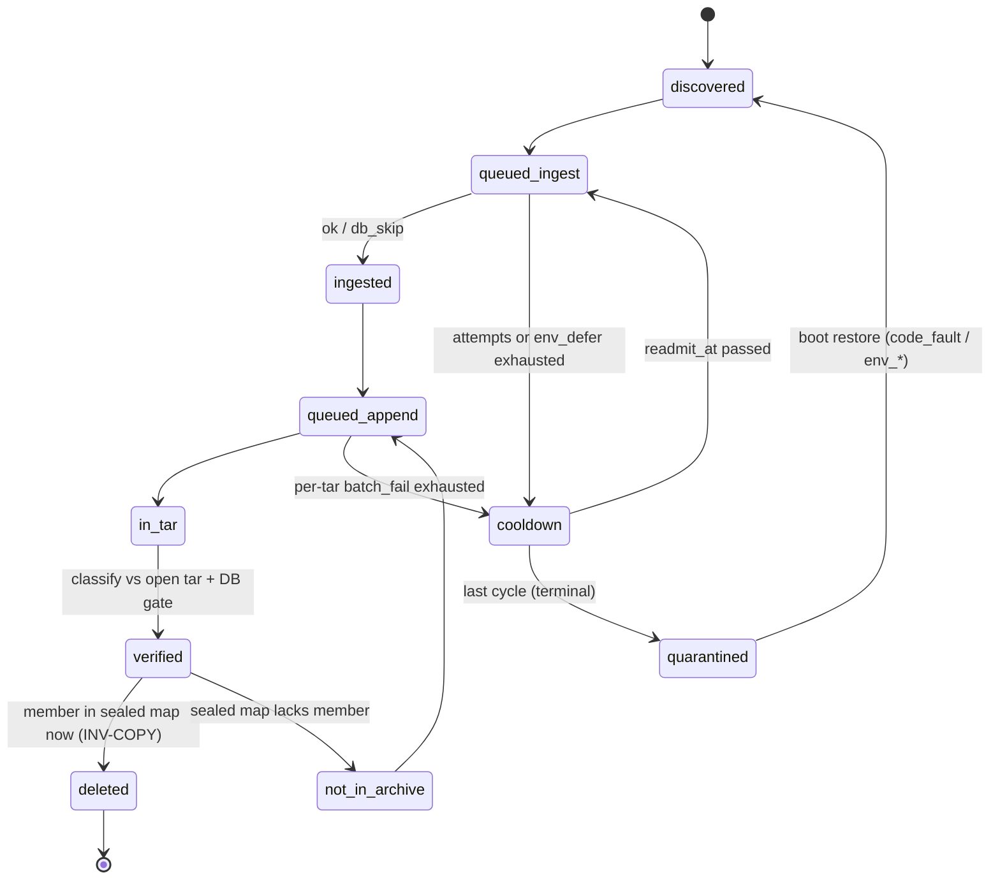
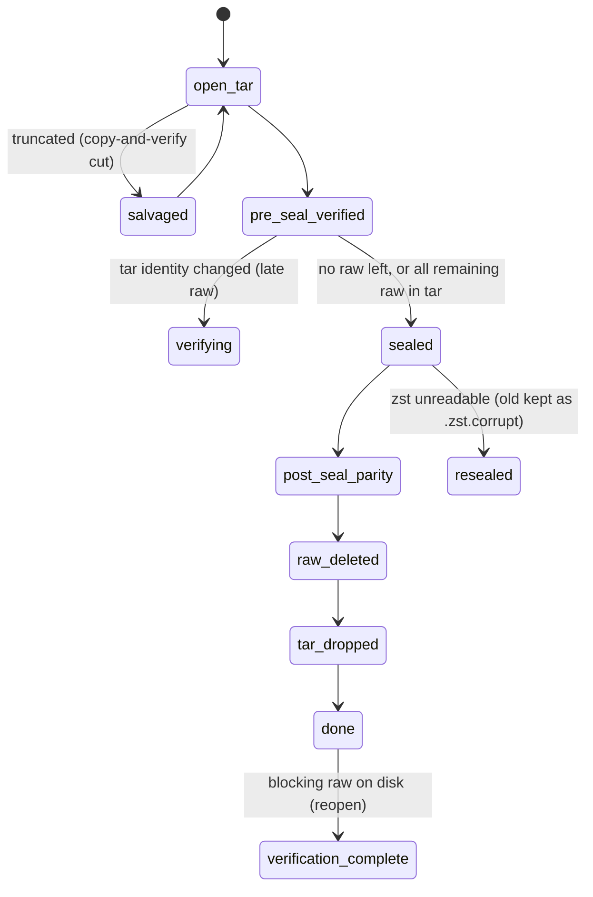

# sync_timedb state machine

This page lists every state a raw stats file, its day and its daily tar can be in, every gate that reads that state, and the exit of each negative state.
It is for `sync_timedb` developers and for operators doing root-cause analysis on a stalled day.

## Invariants and drift guard

The state machine keeps two invariants:

- INV-NEG (`sync-timedb-queue-orchestrator-contract.mdc`): every negative flag has a clear on the success path, a bounded retry that does not depend on the gated action, and a terminal resolution that lets the day close.
- INV-COPY (`sync-timedb-lock-and-archive-contract.mdc`): at every instant every byte of every closed raw file exists in the raw file, in a sealed member proven by the sealed member map, or in an unchanged open tar.

`hpcperfstats/tests/test_sync_timedb_state_doc_registry.py` keeps this page honest.
It runs `scripts/sync_timedb_state_inventory.py` (an AST walk of `hpcperfstats/dbload/**`) and fails when a registry kind, shard field, job kind, inventoried value or gate site is missing from this page.
To regenerate the dynamic appendix:

```bash
../.venv/bin/python3 \
  scripts/sync_timedb_state_inventory.py --write-doc
```

Dead-end IDs (`DE-n`, `DL-n`) name the rows of the [dead-end matrix](#section-5-dead-end-matrix); dated incident evidence for each is in [sync_timedb incidents](../history/sync-timedb-incidents.md).

## Section 1 Storage model

Each store, where it lives, and what a restart or a persistence contract reset clears:

| Store                                                                                                                                             | Lives in                                                                                    | Cleared by restart                                                                  | Cleared by contract reset                                 |
| ------------------------------------------------------------------------------------------------------------------------------------------------- | ------------------------------------------------------------------------------------------- | ----------------------------------------------------------------------------------- | --------------------------------------------------------- |
| Job store queues (ingest ZSET, append/discover/day_close LISTs), payload fields (`attempt`, `env_defer`, `timeout_attempt`, `emit`, `batch_fail`) | memory + `.sync_timedb_job_store.json` snapshot                                             | in-flight claims and leases only                                                    | yes                                                       |
| Members store day shards                                                                                                                          | memory + `.sync_timedb_archive_members/<day>.json`                                          | memory fields (`tar_hot`, `append_inflight`, `populate_owner`, `restore`, `events`) | yes                                                       |
| Day-removal manifests                                                                                                                             | `.sync_timedb_day_raw_removal/<day>.json`                                                   | no                                                                                  | yes                                                       |
| Queue dead letters                                                                                                                                | `.sync_timedb_queue_dead_letter.json`                                                       | no                                                                                  | yes                                                       |
| Quarantine                                                                                                                                        | `.sync_timedb_unparsable_raw/` + `.sync_timedb_unparsable_raw.json`                         | no                                                                                  | manifest only (files stay; boot restore re-reads orphans) |
| Sealed member maps                                                                                                                                | `{daily_dir}/.sync_timedb_sealed_members/<day>.json`                                        | no                                                                                  | no (self-validated by zst identity)                       |
| Salvage backups                                                                                                                                   | `{daily_dir}/.sync_timedb_tar_salvage/`                                                     | no                                                                                  | no (removed after post-seal parity)                       |
| Append journal (clone append)                                                                                                                     | `{daily_dir}/<day>.tar.append_journal` (`{old_end, old_size, st_dev, st_ino, tail_sha256}`) | no                                                                                  | no (see [append journal](#append-journal))                |
| Integrity census                                                                                                                                  | `{daily_dir}/.sync_timedb_sealed_integrity.json`                                            | no                                                                                  | no                                                        |
| Archive scratch                                                                                                                                   | see [archive scratch](#archive-scratch)                                                     | no                                                                                  | no                                                        |
| Migration snapshot                                                                                                                                | `.sync_timedb_migration_backup/dead-ends-v1/`                                               | no                                                                                  | no                                                        |
| Per-day remainder counters                                                                                                                        | memory                                                                                      | rebuilt from the job store at boot (DE-32)                                          | n/a                                                       |

Registered persistence kinds (`PERSISTENCE_ARTIFACT_REGISTRY`): `ingest_checkpoint`, `archive_dead_letter` (unused; legacy file), `queue_dead_letter`, `archive_maint_hints` (unused), `day_close_manifest` (unused; legacy file), `day_raw_removal_dir`, `unparsable_raw`, `zero_host_ingest_mark`, `file_complete_ingest_mark`, `job_store_snapshot`, `archive_members_store_dir`.
The unregistered self-validating kind is `sealed_member_map`.

Job kinds: `JOB_KIND_INGEST` (`ingest`), `JOB_KIND_APPEND` (`append`), `JOB_KIND_DISCOVER` (`discover`), `JOB_KIND_DAY_CLOSE` (`day_close`).

### Append journal

The journal exists only between the journal write and the commit of a clone append.
A killed append's journal is applied by `recover_interrupted_append` at startup, first thing under every daily-tar write lock, or by the sweep.
Recovery truncates the tar to `old_end` when the identity and the tail hash match, and otherwise drops the stale journal.
An unreadable journal is renamed `.corrupt.<ts>` and the tar stays untouched.

### Archive scratch

Scratch files are derived temporaries, never the only copy:

- `<day>.tar.{merge,dedupe,repair,decomp,zst}.tmp`, `hps_{union_extract,pax_convert,tar_repair}_*` dirs (`pax_convert` is residue only; the convert path is gone), `.atomic.*` (including clone-append journal and new-tar temps) and `*.json.tmp` write temps.
- They live in `{daily_dir}`, `{archive_dir}`, their `.sync_timedb_*` subdirs and the sealed-ingest spool `.sync_archive_ingest_spool` (always beside the sealed archive; member extracts `hps_union_extract_*`).
- The extract helper removes its dir on success, failure and exceptions, so only a killed process leaves one.

The idle sweep removes a dead-day file unmodified for `sync_archive_scratch_max_idle_hours` while the day's tar and restore locks are free, or a day-less path whose whole tree is that idle.
The startup sweep, under the archive-dir flock, drops the age for day-scoped files.
Safety copies (`.corrupt.*`, `.pre-restore.*`, salvage, quarantine) are never touched, and `report` mode only logs.

## Section 2 Flag catalog

### Members store `_DayShard` fields

| Field                                                | Polarity             | Set                                                        | Clear / bound                                                                                                                                                                                                                             |
| ---------------------------------------------------- | -------------------- | ---------------------------------------------------------- | ----------------------------------------------------------------------------------------------------------------------------------------------------------------------------------------------------------------------------------------- |
| `day_token`, `lock`, `events`, `members`, `complete` | state                | populate                                                   | invalidate / merge                                                                                                                                                                                                                        |
| `day_skip`                                           | negative, sidecar    | `set_archive_day_ingest_skip` (unreadable archive)         | `_clear_stale_day_ingest_skip_if_tar_repaired` when the authoritative archive reads; sealed-only re-check age-gated by `set_at`; `day_skip_blocks_tar_write` clears when the tar reads; transient errors never set it (DE-6b/DE-29/DE-31) |
| `degraded`                                           | negative             | `populate_archive_members`                                 | cleared with `day_skip` and on merge                                                                                                                                                                                                      |
| `tar_hot`                                            | negative, memory     | `set_ingest_tar_hot` (`populate_wait`, `populate_enqueue`) | waiter `finally`; populate-pool worker clears `populate_enqueue` (DE-7)                                                                                                                                                                   |
| `append_inflight`, `populate_owner`, `restore`       | coordination, memory | append / populate / restore owners                         | owner `finally`; restore decompress is progress-idle-killed (DE-8)                                                                                                                                                                        |
| `populate_source`, `dedupe_hint`                     | informational        | populate                                                   | none needed                                                                                                                                                                                                                               |

`day_skip` kinds: `open_tar_gnu_tvf_failed`, `tar_truncated_or_unreadable`, `zst_frame_invalid`, `read_error`, `salvage_backup_failed`.
Exit table: `SYNC_TIMEDB_NEGATIVE_STATE_EXITS["day_skip_kind"]`.

### Orchestrator flags

Each flag lists when it is set, what clears it, its bounded retry and its terminal exit.

#### `_FULL_REDISCOVER_PENDING`

- Polarity: negative, memory.
- Set: a discover walk skipped incomplete catchup files at the ingest cap (`dropped_at_capacity > 0`), or a background walk raised.
  `_run_background_discover` logs `queue_orchestrator discover failed window= err=` with the traceback, because nothing reads its Future.
- Clear: the idle pass submits a whole-archive walk once the catchup queue is at or below half the cap; it is set again only if that walk drops again, and a walk that drops nothing ends the chain.
- Bound: `sync_ingest_full_rescan_interval_hours` (default 6) also forces a walk.
- Rationale: a failed boot whole-archive walk otherwise stays silent and leaves every older file for the periodic walk.

#### `_BOOT_FULL_DISCOVER_PENDING`

- Polarity: negative, memory.
- Set: boot queues the whole-archive discover identity.
- Clear: the `finally` of the walk that ran it (background or `run_once` force pass), success or failure.
- While set, day_close returns `yielded` at the seal stage (`reason=full_discover_pending`, yield backoff 30-300 s, no attempt bump); pre-seal verify and raw deletes still run.
  The day_close fill also holds every backfill (non-hot) day (`_day_close_held_for_discover`).
- Rationale: undiscovered raw for a freshly sealed day forces a full reseal.

#### day_close seal `reason=unarchived_raw` / `unarchived_raw_check_failed`

- Polarity: negative, outcome.
- Set: the day has an open tar and `_closed_raw_not_archived` finds closed raw that is a same-size member of neither the open tar nor the sealed member map, or the scan or open-tar member read failed.
  The check lists the day by name (`closed_raw_paths_for_day`: one `readdir` per host directory, no per-file stat), not `build_day_scoped_closed_raw_by_gz`, which waits for the shared batched raw-tree walk.
- Clear: every raw file of the day is archived (append after ingest) or gone.
- Bound: the found paths go to `_handoff_retryable_paths_to_ingest` (`over_cap=True`, dead-letter cooldown respected) and day_close returns `yielded` (yield backoff 30-300 s, no attempt bump).
- Terminal: ingest and append archive the file, or its dead letter turns terminal and quarantine moves it off disk.
- Rationale: the seal must see raw that no manifest or queue knows about, or it seals and deletes a day without it.

#### Space pressure

`sync_timedb_space_pressure._STATE` (`pressure`, `reserved`) is a negative, memory flag.

- Set: `sync_archive_space_pressure_free_bytes` (X, default 1T; 0 = off) is set and the daily archive filesystem has less than X free.
  Free space is measured on the path or its directory only; a statfs error or a missing archive dir is unknown, keeps the current state and fails `fits_hard_reserve`, never reads as 0 free.
  An unparsable INI value logs one warning and uses `1T`.
- Freeze: under pressure nothing grows the disk but a seal and a reflink clone append that cannot grow the filesystem.
  - `_select_append_day` allows only parked days whose next batch is a clone append with no restore (the day's open `.tar` exists, or no archive yet, and `clone_capable`); a day that would restore its sealed copy or copy raw bytes stays parked (no requeue, no attempt bump).
  - `_append_batch_need` refuses any batch with a restore (`space_pressure deny op=append reason=space_pressure`).
  - `admit_restore` refuses `growth` and `finish` restores alike (day-close verify, open-tar repair, salvage) and returns the falsy `SPACE_DENIED`; `ensure_open_daily_tar_readable` and its salvage path turn that into a transient `env:ENOSPC` defer, never `repair_failed` or an `open_tar_gnu_tvf_failed` `day_skip`; `off` (append worker) is gated at dispatch.
  - `archive_space_admit` refuses every op but `seal` (`union_rebuild`, `tar_salvage`, `restore_corrupt_tar`, `repair_extract_recreate`, `dedupe`), and `ensure_open_daily_tar_readable` defers a corrupt open tar as `env:ENOSPC` before salvage, in-place repair or sealed restore (`space_pressure deny op=repair`).
  - Denials log at most every 300 s per day and op.
- Dedupe: the dedupe copy (`_rewrite_daily_tar_largest_member_wins` after its header pass finds a repeated name) goes through `archive_space_admit(op="dedupe")` with or without pressure.
  A refusal raises `OSError(ENOSPC)`, which dedupe returns as False with the tar unchanged, and day close does not count it as a stage failure.
- Without pressure, and with X = 0 (only the freeze is off), `_append_batch_need` keeps every batch above `sync_archive_min_free_bytes` plus half the restore for its reseal, net of the reservations other admitted work holds.
  A batch counts raw bytes, or `take * CLONE_HEADER_BYTES` for a clone, plus the restore of a sealed day.
  Reservations are `space.reserve` before append submit (released in `_drain_append_ready`) and `space.reserving` around `finish` / `growth` restores; each counts only what its tar and `.decomp.tmp` have not grown by yet.
- Clear: pressure clears at 2X free.
  The success path is the seal, raw delete and tar drop of day close, which pressure never gates (the seal keeps only the hard reserve).
- Bound: parked appends are re-selected every append tick; refused restores and repairs defer as `env:ENOSPC` (`env_defer` or the day-close yield backoff) and never burn attempts.
- Terminal: day close frees the space and pressure ends; the parked days then restore and append under the hard reserve.
- Rationale: parallel append restores of sealed days can expand terabytes of tar within hours on a nearly full archive.

#### `_SEALING_TARS`

`tar_sealing` / `tar_seal_in_progress` (`sync_timedb_archive_helpers.py`) is a coordination, memory flag.

- Set: `atomic_seal_tar_to_zst` while it holds the daily tar's write lock (member read, compress, `zstd -t`, replace).
  The seal starts only after `_closed_raw_not_archived` found every closed raw file of the day in the tar or its sealed copy.
- Also set by `dedupe_tar_keep_largest_file_per_member` for its whole write-lock block.
  Dedupe copies the tar only when its header pass finds a repeated file name, so a clean tar holds the lock for the header read alone.
  The seal stage right after dedupe runs `_closed_raw_not_archived` and hands any unarchived raw to ingest.
- Readers: discover's `discover_raw_needs_tar_append` returns "no append" for a sealing tar without reading it, and `_try_submit_pending_append_days` keeps a sealing day's append claims parked (lease kept, no requeue, no attempt bump).
- Clear: when that block exits, success or failure; bounded by the seal's own progress idle kill.
- Terminal: the seal ends.
  Files discover skipped are re-found by the next whole-archive walk, and day close hands any raw it finds unarchived back to ingest (`unarchived_raw`, post-seal remaining raw).
- Rationale: a read of a sealing tar waits the 60 s read-lock timeout per file and, timed out, queues a needless append (`soft_skip reason=open_tar_members_unavailable` loops).

#### day_close seal `reason=seal_slot_busy`

`_SEAL_SLOTS_HELD` (`try_claim_seal_slot` / `release_seal_slot`) is a negative, memory flag.

- Set: the seal stage (or the post-delete reseal) finds all `archive_seal_parallel_workers` (default 2) process-wide seal slots held by other tars; the day returns `yielded` instead of starting another disk-bound seal or holding its day_close slot.
  The `reconcile_merge` stage does the same before a DE-9 `zst_unreadable_reseal` or `missing_zst` seal: `reconcile_open_tar_with_sealed_zst` raises `DayCloseYieldError(reason=seal_slot_busy)` and the stage logs `stage_exit reconcile_merge result=yielded reason=seal_slot_busy`.
  The day-close tar drop (`remove_verified_uncompressed_daily_tars`) never seals (`allow_auto_seal=False`); a tar with no sealed copy waits for the post-delete reseal.
- Clear: a slot is released in the `finally` around `seal_dirty_daily_archives` or the reconcile `atomic_seal_tar_to_zst`, success or failure.
- Bound: yield backoff 30-300 s, no attempt bump.
- Terminal: the running seals finish (the zstd progress idle kill bounds each) and the day takes a slot.
- Rationale: concurrent multi-TB seals on a saturated shared volume free nothing for hours.

#### `_DISCOVER_UNREADABLE_TARS`

A negative, memory flag in `sync_timedb_job_reconstruct.py`.

- Set: `discover_raw_needs_tar_append` got a `RuntimeError` (GNU `tvf` failed: truncated) from `get_mutable_tar_authority_member_map` on a day's open tar.
  It records the tar's `(st_size, st_mtime_ns)`, logs `WARN: discover open tar unreadable tar= err=` once, and answers "needs append" for that file and every later file of that tar identity without listing it again.
- Clear: the tar's size or mtime changes (append, salvage, repair, restore), so the next file re-lists it; a process restart empties it (one re-list per tar).
- Bound: the queued appends run `ensure_open_daily_tar_readable` (salvage -> in-place repair -> sealed restore, space-gated `env:ENOSPC` defer) before writing, with DE-18 per-tar batch accounting.
- Terminal: the repair makes the tar readable, or the append path's `day_skip` or dead letter resolves the day.
- Rationale: an escaped listing error kills every whole-archive walk at that day.

#### `_discover_frontier_day`

- Polarity: negative, memory.
- Set: a discover walk at the ingest cap could not queue an incomplete backfill file (nothing younger queued to push out), a pushed-out file was not queued again, or the store refused the add (`zadd_ingest` at the cap after hot files joined past it) for a file that is not dead-lettered (`StreamingDiscoverStats.frontier_day`).
  At the cap discover pushes out younger files until the older one fits.
- Clear: a whole-archive walk replaces it (None when it queued every incomplete backfill file it saw); a windowed walk only lowers it; a walk that raises keeps it.
- Bound: held days requeue at the day_close fill without an attempt bump; `_FULL_REDISCOVER_PENDING` (set by the same drops) runs the next whole walk once the catchup queue is at half the cap, plus the 6 h periodic walk.
- Terminal: the walks advance it oldest-first until one drops nothing.
  Hot-band days are never held; the day_close fill holds backfill days on or after it.
- Rationale: host-order walks otherwise queue files across every day and keep many days restoring, appending and resealing every batch.

### Day-removal manifest

Phases: `verifying` -> `verification_complete` -> `deleting` -> `done`.
Cooperative-yield phase tokens such as `migrate_legacy_gz` label the `DayCloseYieldError` stage; they are not manifest phases.

`verify_stage`: `none`, `pre_seal_complete`, `post_seal_complete`.

Manifest keys: `phase`, `verify_stage`, `worker_stage`, `members_done`, `members_total`, `last_progress`, `last_progress_at`, `last_progress_ts`, `started_at`, `completed_at`, `verified_count`, `skipped_count`, `deleted_count`, `pre_seal_classify_index`, `pre_seal_classify_paths`, `reverify_cycles` (bounds re-verify loops; reset by a passing post-seal parity), `verified_tar_identity` (DE-26 late-raw detector).

Entry statuses and their exits (`SYNC_TIMEDB_NEGATIVE_STATE_EXITS["day_removal_status"]`):

| Status                                                                                       | Meaning                       | Exit                                                                                                                                                                    |
| -------------------------------------------------------------------------------------------- | ----------------------------- | ----------------------------------------------------------------------------------------------------------------------------------------------------------------------- |
| `verified`                                                                                   | member + DB gate passed       | delete only when the raw is a same-size member of the sealed map now (DL-2/DL-3); otherwise `delete_deferred=sealed_copy_unproven` or reset to `skipped_not_in_archive` |
| `skipped_not_head_tail_ingested`, `skipped_not_head_ingested`, `skipped_not_sample_ingested` | DB gate not yet passed        | retryable: reclassify, hand off to ingest                                                                                                                               |
| `skipped_not_in_archive`, `skipped_size_mismatch`                                            | not (yet) a tar member        | retryable: reclassify, hand off to append                                                                                                                               |
| `skipped_seal_invalid`                                                                       | tar/zst validation failed     | repair-required (DE-25): blocks `done`; reseal (DE-26) then reclassify                                                                                                  |
| `skipped_fingerprint_changed`                                                                | raw changed after verify      | repair-required: reclassified each pass, fresh status recorded (DE-13)                                                                                                  |
| `skipped_active_segment`                                                                     | still the host's live segment | blocks `done` only after the segment rotates                                                                                                                            |
| `skipped_quarantine`                                                                         | quarantined                   | terminal                                                                                                                                                                |
| `skipped_locked`, `skipped_no_gz`, `skipped_no_work`                                         | legacy classifier skips       | retryable / reseal                                                                                                                                                      |

Salvage manifest statuses: `backed_up`, `salvaged`, `restored`, `aborted_unchanged`, `restore_failed`.
Other inventoried status values: `deferred`, `queued` (job-store and census tokens).

### Queue dead letter

Entry fields: `kind`, `identity`, `attempt`, `reason`, `recorded_at`, `first_recorded_at`, `cycle`, `env`, `readmit_at`, `terminal`, `readmitted_at`, `space` (absent on older entries, read as false).

- Entries are upserted per kind and identity, with `readmit_at = now + backoff[cycle-1]` from `sync_dead_letter_readmit_backoff_s`; environment errors use `sync_dead_letter_env_backoff_s`.
- Past the last cooldown the entry is `terminal=true`, and ingest or append raw is quarantined (`failure_class` `exhausted`, `code_fault` or `env_<type>`); a day_close terminal is an ERROR kept in the census.
- A success ACK removes the entry.
- Legacy entries normalize to cycle 1.
- Fill-skip reasons (`skip_cgroup_headroom`, `skip_budget_bytes`, `skip_file_cache_pressure`, `skip_fp`, `fp_refresh`) re-admit immediately (DE-21).
- Cap: past `max_entries` (5000) only terminal entries are trimmed; live entries are kept and `WARN: queue dead letter over cap` is logged at most every 300 s.
  Trimming live entries would evict live ingest cooldowns and leave ingested files with no mark, queue entry or dead letter until the next whole-archive walk.

### Space parks

A `space=true` dead-letter entry (`reason=env:ENOSPC`, `sync_timedb_space_pressure.SPACE_DEFER_REASON`, DE-34) records work the space gate refused while pressure is on:

- an ingest whose open-tar repair raised `ArchiveSpaceDeferredError`;
- an append batch whose pre-append repair deferred (`ArchiveAppendOutcome(soft_requeue=True, space_deferred=True)`).

Both drains park on the first such defer (`_dead_letter_claim(space=True)`) instead of spinning the `env_defer` counter.
A park keeps the prior `cycle`, is never `terminal` (so never quarantined) and sets `readmit_at = now`.
It is blocked (`dead_letter_blocked`) and held from readmission (`due_dead_letter_readmissions`) exactly while `under_pressure()`.
When pressure ends, the readmit pass re-enqueues it and a success ACK removes it.
Without pressure the same defer takes the bounded `env_defer` path.
The census line carries `parked_space=N` while any park exists.

### Quarantine

`failure_class` values:

- `parse`, `empty`, `exhausted`: terminal, never auto-restored.
- `code_fault`, `env_<type>`: restored at boot when the original path is absent and the day is not sealed-only.

A reappeared path is moved again (DE-3); destination collisions get `.N` (DE-4).

## Section 3 Gate catalog

Ingest worker outcomes (`ingest_ok=False` exits via `negative_state_exit`):

| Outcome                                                                                                                                       | Exit                                |
| --------------------------------------------------------------------------------------------------------------------------------------------- | ----------------------------------- |
| `timeout`, `lookup_budget`                                                                                                                    | bounded by `timeout_attempt` (DE-5) |
| `ingest_mark_failed`, `write_failed` (a DB chunk write failed; DE-22), `ingested` (contract violation), `restore_deferred`, `probe_transient` | environment, bounded by `env_defer` |
| `active_segment`                                                                                                                              | ACK, rediscovered on rotation       |
| `parse_fail`, `repair_failed`, `quarantine`, `fail` and any unknown value                                                                     | attempts -> cooldown -> terminal    |
| `ok`, `db_skip`, `skip`                                                                                                                       | positive                            |

Drain exceptions: environment and coordination errors (`is_environment_error`, every `ArchiveMembersStoreUnavailableError`) requeue without a file attempt, bounded by `env_defer`; others use attempts.

Day-close outcomes:

- `complete`: ACK.
- `yielded`, `deferred_age`, `incomplete_raw`, `skipped`: cooperative requeue, bounded by the repairs in [section 5](#section-5-dead-end-matrix) and the backoff tracker.
- `verify_failed`, `error`: attempts -> cooldown (DE-12, DE-28, `reverify_cycles`).

Readability probe (`probe_tar_archive_readability`, DE-29): `readable`, `corrupt`, `transient`, `missing`; only `corrupt` may repair or restore.

## Section 4 Lifecycles



A raw file leaves disk only through `verified -> deleted`, and that edge requires the sealed map to hold the member.



A `done` day is not final: blocking raw on disk reopens it, and an unreadable zst reseals from the tar.

## Section 5 Dead-end matrix

Each remediated dead end, its rule and the tests that drive it:

| ID              | Remediation                                                                                                                                                                     | Regression test                                                                                                                                                                                                                                                                                                                                                                                                                                                                    |
| --------------- | ------------------------------------------------------------------------------------------------------------------------------------------------------------------------------- | ---------------------------------------------------------------------------------------------------------------------------------------------------------------------------------------------------------------------------------------------------------------------------------------------------------------------------------------------------------------------------------------------------------------------------------------------------------------------------------- |
| DE-1/5/12       | dead-letter cooldown, readmit pass, terminal quarantine; timeouts counted; day_close exceptions bump                                                                            | `test_dead_letter_readmits_after_cooldown`, `test_repeated_timeout_reaches_dead_letter`, `test_day_close_exception_bumps_attempt`                                                                                                                                                                                                                                                                                                                                                  |
| DE-2/19         | streaming parse/write faults re-raise, never quarantine; typed write-stage shutdown                                                                                             | `test_write_stage_error_is_retryable_not_quarantine`, `test_code_fault_is_not_quarantined`                                                                                                                                                                                                                                                                                                                                                                                         |
| DE-3/4          | quarantine `failure_class`, boot restore, reappeared move, collision suffix                                                                                                     | `test_boot_restores_non_parse_quarantine`, `test_reappeared_quarantined_path_is_moved`                                                                                                                                                                                                                                                                                                                                                                                             |
| DE-6/6b/31      | authoritative-archive clear before degraded short-circuit; transient errors never set day_skip                                                                                  | `test_day_skip_clears_on_sealed_only_readable_day`, `test_eagain_zstd_spawn_does_not_set_day_skip`                                                                                                                                                                                                                                                                                                                                                                                 |
| DE-7            | populate worker clears `populate_enqueue`                                                                                                                                       | `test_populate_pool_clears_tar_hot`                                                                                                                                                                                                                                                                                                                                                                                                                                                |
| DE-8            | restore decompress progress idle kill                                                                                                                                           | `test_decompress_idle_kill_releases_restore_token`                                                                                                                                                                                                                                                                                                                                                                                                                                 |
| DE-9            | reseal over unreadable zst, old kept                                                                                                                                            | `test_unreadable_zst_reseals_from_tar`                                                                                                                                                                                                                                                                                                                                                                                                                                             |
| DE-10/25        | only quarantine is terminal; frozen done days reopen                                                                                                                            | `test_seal_invalid_not_terminal_phase_done_not_written`, `test_frozen_production_manifest_closes_end_to_end`                                                                                                                                                                                                                                                                                                                                                                       |
| DE-11/23        | copy-and-verify salvage; append rollback (the clone writer journal truncates to the journalled old end); empty tar drop                                                         | `test_truncated_open_tar_salvaged_to_valid_prefix`, `test_interrupted_append_truncates_back_to_pre_append_size`, `test_append_enospc_rolls_back_to_pre_append_bytes`, `test_clone_append_kill_at_every_step`, `test_empty_open_tar_completes`                                                                                                                                                                                                                                      |
| DE-13           | reclassify decoupled; fresh status recorded                                                                                                                                     | `test_reclassify_runs_with_delete_failed_pending`                                                                                                                                                                                                                                                                                                                                                                                                                                  |
| DE-14           | OperationalError requeues (environment)                                                                                                                                         | `test_operational_error_requeues_not_dropped`                                                                                                                                                                                                                                                                                                                                                                                                                                      |
| DE-15/16        | dead-owner reap; populate attempt cap                                                                                                                                           | `test_dead_worker_inflight_reaped_when_recycle_disabled`, `test_populate_requeue_attempts_capped`                                                                                                                                                                                                                                                                                                                                                                                  |
| DE-17/20/22     | type-based environment class, outcome exit table                                                                                                                                | `test_members_unavailable_any_message_is_transient`, `test_every_negative_value_has_exit_entry`                                                                                                                                                                                                                                                                                                                                                                                    |
| DE-18           | per-tar batch failure accounting                                                                                                                                                | `test_append_batch_failure_does_not_dead_letter_every_path`                                                                                                                                                                                                                                                                                                                                                                                                                        |
| DE-24           | no-tar handoff; zst-only day enqueue; a day_close that finds the day already complete sets its open manifest to `done`, or the zst-only scan re-enqueues it forever             | `test_day_close_without_tar_hands_off_remaining_raw`, `test_complete_day_close_closes_open_manifest_and_stops_requeue`                                                                                                                                                                                                                                                                                                                                                             |
| DE-26           | seal while raw remains only when all remaining raw is in the tar; late raw reopens verify; an H19 sentinel whose listing is empty (raw already deleted) does not defer the seal | `test_seal_with_raw_only_when_all_remaining_raw_in_tar`, `test_late_raw_resets_pre_seal_verify_stage`, `test_sentinel_with_no_raw_left_does_not_defer_the_seal`                                                                                                                                                                                                                                                                                                                    |
| DE-27/32        | per-day append signal; one day function; boot rebuild                                                                                                                           | `test_wait_on_ingest_uses_per_day_append_remainder`, `test_day_remainder_rebuilt_from_job_store_at_boot`                                                                                                                                                                                                                                                                                                                                                                           |
| DE-28           | stage failure counter                                                                                                                                                           | `test_reconcile_failure_counts_toward_noprogress`                                                                                                                                                                                                                                                                                                                                                                                                                                  |
| DE-29/30        | readability tri-state; space admission                                                                                                                                          | `test_transient_oserror_is_not_corrupt_and_sets_no_day_skip`, `test_space_admit_denies_reseal_below_reserve`                                                                                                                                                                                                                                                                                                                                                                       |
| DE-33           | the `zadd_ingest` discover cap (`sync_ingest_queue_max_size`) never refuses a day-close handoff or a dead-letter readmit (`over_cap=True`)                                      | `test_zadd_ingest_over_cap_admits_handoff_catchup`                                                                                                                                                                                                                                                                                                                                                                                                                                 |
| DE-34           | space-gate refusals park (see [space parks](#space-parks)); append pre-repair deferral is a soft requeue, not a bare `False`; the dead-letter cap never evicts live entries     | `test_sync_timedb_space_park.py` (`test_dead_letter_cap_never_evicts_live_entries`, `test_space_entry_blocked_and_held_until_pressure_clears`, `test_ingest_space_defer_parks_on_first_defer`, `test_append_space_deferral_parks_every_job_under_pressure`, `test_append_unreadable_tar_space_deferral_is_soft_requeue`)                                                                                                                                                           |
| DE-35           | unmanifested raw on `done` sealed-only days, see [DE-35 unmanifested raw](#de-35-unmanifested-raw)                                                                              | `test_done_sealed_only_day_deletes_unmanifested_sealed_raw`, `test_done_sealed_only_day_restores_and_reseals_late_unarchived_raw`, `test_job_entry_check_on_clean_done_days_walks_once_then_never`, `test_unmanifested_raw_memo_rewalks_after_zst_or_manifest_change`                                                                                                                                                                                                              |
| DE-36           | `./`-prefixed member names, see [DE-36 and DE-37 member keys](#de-36-and-de-37-member-keys)                                                                                     | `test_dot_slash_size_mismatch_day_closes_end_to_end`, `test_dot_slash_member_names_match_their_raw_path`, `test_sealed_members_lookup_merges_dot_slash_spellings_max_size`, `test_raw_path_in_sealed_members_matches_dot_slash_spelling`, `test_parse_tar_tvf_normalizes_dot_slash_member_name`, `test_dedupe_merges_dot_slash_spellings_keeps_largest`, `test_sealed_spool_extracts_dot_slash_stored_member`, `test_union_rebuild_copies_dot_slash_stored_members`                |
| DE-37           | members compared by the `<node>/<epoch>` key, see [DE-36 and DE-37 member keys](#de-36-and-de-37-member-keys)                                                                   | `test_member_key_is_node_and_epoch_for_any_prefix`, `test_raw_path_in_sealed_members_matches_absolute_prefix_spelling`, `test_extract_by_key_matches_whole_components_only`, `test_sealed_spool_extracts_largest_copy_across_prefixes`, `test_member_key_collision_warns_once_per_archive`, `test_members_store_reload_rekeys_full_name_day_files`, `test_dot_slash_size_mismatch_day_closes_end_to_end[/mnt/old_root/]`, `test_extract_recreate_repair_keeps_stored_member_names` |
| DL-1/2/3/5/8/12 | sealed-prefix restore gate, sealed-map delete gate, rewrite superset check, yield guard, gz containment                                                                         | `test_restore_from_sealed_refused_when_tar_prefix_has_members_not_in_zst`, `test_raw_delete_requires_member_in_sealed_zst`, `test_rewrite_aborts_when_source_tar_changed_under_lock`, `test_migrate_refuses_unlink_when_new_zst_missing_members`                                                                                                                                                                                                                                   |

### DE-35 unmanifested raw

A `done` or `verification_complete` manifest is read entry-only, so a sealed-only day (no open tar) could claim `complete` while raw its manifest never listed sat on disk.
`_adopt_unmanifested_raw` lists the day and records every unlisted raw file as `skipped_not_in_archive`, which blocks completion and reopens the day (DE-25 path).

- Listing: `closed_raw_paths_for_day` (`sync_timedb_job_discover.py`), the same listing as the seal's unarchived-raw check: one `readdir` per host directory, names kept by filename day, no per-file stat, never the shared batched raw-tree walk (`_DAY_SCOPED_CLOSED_RAW_WALK`).
- Memo: `_UNMANIFESTED_RAW_SCANS` keeps, per tar, the unlisted raw the last listing found, keyed by the `archive_identity` of the zst and of the manifest file.
  The job-entry completeness check, the coordinator reopen and the later stages of a claim reuse it, and a clean day is listed again only after its zst or manifest changes; a re-claim of an unchanged clean day costs a few `stat` calls (T0).
- A listing error raises to the caller, adopts nothing and stores no memo, so the next check lists again.
- Rationale: a whole-archive stat walk per check on about 1M raw files held every day_close slot at `stage=complete_check` for hours, so restored days never got a slot to reseal.
- Reason `unmanifested_sealed_raw`: a same-size member of the sealed member map (T0); the sealed-only reclassify (DB gate) plus the DL-3 delete gate remove it.
- Reason `unmanifested_unarchived_raw`: late raw in no archive.
  The reclassify keeps it retryable and hands it to ingest and append; the append restores the sealed day, and day close then seals it (DE-26) and deletes it only once the new sealed map holds it (DL-3).
  The append is dispatch-gated by `_append_batch_need`: refused under space pressure, else the restore must keep the hard reserve net of other reservations; at most `sync_archive_pool_processes` appends run at once, one per tar.

The adoption logs `Day raw removal unmanifested raw day= adopted_sealed= adopted_unarchived= sealed_map=` when the counts change.
An invalid map adopts nothing (the kind cannot be told) and queues its rebuild, retried on the next claim.

### DE-36 and DE-37 member keys

Tar member names `./hpcperfstats/archive/<host>/<epoch>` and `hpcperfstats/archive/<host>/<epoch>` are one file.
A comparison that treats them as two keeps both in GNU `tvf` maps, sealed member maps and day-removal manifests (`/./` keys), so a raw that grew after its old copy was archived under the `./` name never matches its member (`skipped_size_mismatch`, seal `deferred_raw_not_in_tar`, `incomplete_raw`).

Members are compared by the key `<node>/<epoch>` (the last two path components, `get_tar_member_name`), so every prefix spelling of one raw file (`./hpcperfstats/archive/...`, `hpcperfstats/archive/...`, `/./...`, an absolute path, another archive root) is one member.

- Normalization: names pass through `os.path.normpath` at the choke points `get_tar_member_name`, `_parse_tar_tvf_size_and_name` (every tvf map merges both spellings, largest size wins), `raw_path_in_sealed_members`, sealed map write, `sealed_members_lookup` and the dedupe rewrite key.
- Keyed sites: every GNU `tvf` listing (`_run_gnu_tvf_file_members` re-keys rows via `_member_key_rows`; `_parse_tar_tvf_size_and_name` still returns the normalized stored name so the collision guard can name it), `tar_has_duplicate_file_members`, the `tf` fallback map, the dedupe rewrite, `raw_path_in_sealed_members`, sealed map write and `sealed_members_lookup`, and members-store day files on reload (`members_by_key`).
- Persisted sealed maps keep their sha256 check against entries as stored, are re-keyed after, and keep max size; the persistence contract stays the same and old maps stay valid.
- Names written into tars stay full paths (clone append header); manifest keys stay full raw paths; pre-seal seeds resolve a key under `archive_data_dir`.
- Extract by key is one GNU `tar -x --no-anchored --no-wildcards <node>/<epoch>` into a fresh `hps_union_extract_*` dir.
  It matches at any `/` boundary (`./a/b/c`, `a/b/c`, `/x/a/b/c` for `b/c`, never `a/xb/c`), and `_extract_member_copy` keeps the copy whose key and size match.
- Two different stored names with one key log `WARN: tar member key collision tar= key= names=` once per archive per process; max size is kept.
- `_repair_truncated_daily_tar_via_extract_recreate` names the extracted top-level entries (`-C <dir> -- <entries>`), not `-C <dir> .`, which writes every member as `./hpcperfstats/...`; a repaired tar keeps the clone-append names.

## Section 6 Gate-closure table

Every requeue, ACK, dead-letter, sticky-flag and quarantine invocation in `hpcperfstats/dbload` (inventory key `file:function:callee`):

| Site                                                                                                                | Trigger                                                                                                                                                           | Attempts                      | Bound / exit                                                                      |
| ------------------------------------------------------------------------------------------------------------------- | ----------------------------------------------------------------------------------------------------------------------------------------------------------------- | ----------------------------- | --------------------------------------------------------------------------------- |
| `sync_timedb_archive_helpers.py:_ensure_open_tar_readable_for_ingest_lookup:set_archive_day_ingest_skip`            | open tar still unreadable after salvage/repair/restore                                                                                                            | n/a                           | sealed-only re-check; cleared when the tar reads (`day_skip_blocks_tar_write`)    |
| `sync_timedb_archive_helpers.py:mark_archive_day_ingest_skip_and_raise:set_archive_day_ingest_skip`                 | sealed stream failure (non-transient)                                                                                                                             | n/a                           | age-gated re-check of the sealed file                                             |
| `sync_timedb_archive_members_coord.py:enqueue_archive_members_populate:set_ingest_tar_hot`                          | discover cold probe                                                                                                                                               | n/a                           | cleared by the populate worker (DE-7)                                             |
| `sync_timedb_archive_members_coord.py:populate_archive_members:set_degraded`                                        | populate failure                                                                                                                                                  | n/a                           | cleared with day_skip and on merge                                                |
| `sync_timedb_archive_members_coord.py:request_archive_members_populate_and_wait:set_ingest_tar_hot`                 | populate wait                                                                                                                                                     | n/a                           | cleared in the waiter's `finally`                                                 |
| `sync_timedb_archive_members_coord.py:set_archive_day_ingest_skip:set_day_skip`                                     | wrapper                                                                                                                                                           | n/a                           | as callers                                                                        |
| `sync_timedb_archive_members_coord.py:set_ingest_tar_hot:set_ingest_tar_hot`                                        | wrapper                                                                                                                                                           | n/a                           | as callers                                                                        |
| `sync_timedb_populate_pool.py:_populate_pool_worker_entry:requeue_populate_queue_job`                               | populate exception                                                                                                                                                | job `attempt`                 | dropped at `sync_archive_retry_max_attempts` (DE-16)                              |
| `sync_timedb_queue_orchestrator.py:_dead_letter_claim:ack_job`                                                      | dead-letter                                                                                                                                                       | n/a                           | dead-letter cooldown -> terminal                                                  |
| `sync_timedb_queue_orchestrator.py:_drain_append_ready:ack_job`                                                     | append success / gate-skip handoff                                                                                                                                | n/a                           | exit (success)                                                                    |
| `sync_timedb_queue_orchestrator.py:_drain_append_ready:_requeue_bounded_without_attempt_bump`                       | append soft_requeue (see [append soft requeue](#append-soft-requeue))                                                                                             | `env_defer`                   | lock holder finishes; past `sync_noprogress_escalate_after` -> env cooldown       |
| `sync_timedb_queue_orchestrator.py:_drain_day_close_ready:_requeue_claimed_job_without_attempt_bump`                | cooperative outcome (`yielded`, `incomplete_raw`, `deferred_age`, `skipped`)                                                                                      | no                            | yield backoff; DE-24/25/26/28 repairs, `reverify_cycles` -> `verify_failed`       |
| `sync_timedb_queue_orchestrator.py:_drain_day_close_ready:ack_job`                                                  | `complete`                                                                                                                                                        | n/a                           | exit (success; dead letter removed)                                               |
| `sync_timedb_queue_orchestrator.py:_drain_ingest_ready:_requeue_claimed_job_without_attempt_bump`                   | bare TimeoutError sentinel path                                                                                                                                   | no                            | store lease TTL reap                                                              |
| `sync_timedb_queue_orchestrator.py:_drain_ingest_ready:ack_job`                                                     | ingest success; `active_segment`                                                                                                                                  | n/a                           | exit; active segment rediscovered on rotation                                     |
| `sync_timedb_queue_orchestrator.py:_fail_append_batch:requeue_job`                                                  | batch-level append failure                                                                                                                                        | per-tar `batch_fail`          | dead-letter at the attempt ceiling (DE-18)                                        |
| `sync_timedb_queue_orchestrator.py:_fill_append_slots:ack_job`                                                      | impossible identity (missing path, no day)                                                                                                                        | n/a                           | drop (discover re-enqueues a reappearing path)                                    |
| `sync_timedb_queue_orchestrator.py:_fill_append_slots:requeue_job`                                                  | admission backpressure                                                                                                                                            | no                            | `alone_progress` admits when nothing is in flight                                 |
| `sync_timedb_queue_orchestrator.py:_fill_day_close_slots:_requeue_claimed_job_without_attempt_bump`                 | sticky yield backoff; backfill day held by the discover frontier or the boot walk (`_day_close_held_for_discover`); the pass stops at the first repeated identity | no                            | backoff expiry (30 -> 300 s); the next whole-archive walk moves the frontier      |
| `sync_timedb_queue_orchestrator.py:_fill_day_close_slots:requeue_job`                                               | oldest-first reorder                                                                                                                                              | no                            | same claim pass                                                                   |
| `sync_timedb_queue_orchestrator.py:_fill_ingest_band:ack_job`                                                       | lock sidecar / missing path                                                                                                                                       | n/a                           | drop (discover re-enqueues)                                                       |
| `sync_timedb_queue_orchestrator.py:_fill_ingest_band:requeue_job`                                                   | fill skips (budget, cgroup, file cache, lease conflict)                                                                                                           | no                            | `alone_progress`; penalty score                                                   |
| `sync_timedb_queue_orchestrator.py:_idle_reconstruct_pass:ack_job`                                                  | discover job done                                                                                                                                                 | n/a                           | exit                                                                              |
| `sync_timedb_queue_orchestrator.py:_reap_dead_owner_ingest_inflight:_requeue_claimed_job_without_attempt_bump`      | owning pool terminated (DE-15)                                                                                                                                    | no                            | claim returns to the queue                                                        |
| `sync_timedb_queue_orchestrator.py:_reband_claimed_ingest_if_needed:requeue_job`                                    | band changed at claim                                                                                                                                             | no                            | penalty score                                                                     |
| `sync_timedb_queue_orchestrator.py:_release_claims_on_shutdown:requeue_job`                                         | shutdown drain                                                                                                                                                    | no                            | process exit                                                                      |
| `sync_timedb_queue_orchestrator.py:_requeue_bounded_without_attempt_bump:_requeue_claimed_job_without_attempt_bump` | bounded requeue helper                                                                                                                                            | payload counter               | dead-letter cooldown at the cap                                                   |
| `sync_timedb_queue_orchestrator.py:_requeue_claimed_job_without_attempt_bump:requeue_job`                           | shared primitive                                                                                                                                                  | no                            | per caller                                                                        |
| `sync_timedb_queue_orchestrator.py:_requeue_ingest_fill_skip:requeue_job`                                           | fill skip                                                                                                                                                         | no                            | `alone_progress`                                                                  |
| `sync_timedb_queue_orchestrator.py:_requeue_pool_collateral:requeue_job`                                            | stuck-cohort recycle collateral                                                                                                                                   | no                            | recycle completes                                                                 |
| `sync_timedb_queue_orchestrator.py:_resolve_terminal_dead_letter:quarantine_ingest_failed_raw_path`                 | terminal dead letter                                                                                                                                              | n/a                           | quarantine (restorable classes per [quarantine](#quarantine))                     |
| `sync_timedb_queue_orchestrator.py:_retry_or_dead_letter:requeue_job`                                               | attempt below ceiling                                                                                                                                             | yes                           | dead-letter at the ceiling                                                        |
| `sync_timedb_queue_orchestrator.py:_run_background_discover:ack_job`                                                | discover job done                                                                                                                                                 | n/a                           | exit                                                                              |
| `sync_timedb_queue_orchestrator.py:_try_submit_pending_append_days:requeue_job`                                     | same-tar inflight                                                                                                                                                 | no                            | inflight completes                                                                |
| `sync_timedb.py:_quarantine_failed_ingest_parse:quarantine_ingest_failed_raw_path`                                  | explicit empty-payload parse result                                                                                                                               | n/a                           | quarantine (`empty`, terminal)                                                    |
| `sync_timedb.py:_signal_ingest_hot_for_populate:set_ingest_tar_hot`                                                 | ingest needs the tar                                                                                                                                              | n/a                           | cleared by the signalling path                                                    |
| `sync_timedb_queue_orchestrator.py:_drain_append_ready:_fail_append_batch`                                          | append failure (exception, ok=False, False)                                                                                                                       | per-tar                       | DE-18                                                                             |
| `sync_timedb_queue_orchestrator.py:_drain_ingest_ready:_retry_or_dead_letter`                                       | file-attributed ingest failure                                                                                                                                    | yes                           | dead-letter cooldown                                                              |
| `sync_timedb_queue_orchestrator.py:_drain_day_close_ready:_retry_or_dead_letter`                                    | `verify_failed` / `error` / exception                                                                                                                             | yes                           | dead-letter cooldown (day terminal = ERROR)                                       |
| `sync_timedb_queue_orchestrator.py:_drain_ingest_ready:_requeue_bounded_without_attempt_bump`                       | environment error, timeout, mark failure                                                                                                                          | bounded counters              | env cooldown                                                                      |
| `sync_timedb_queue_orchestrator.py:_requeue_bounded_without_attempt_bump:_dead_letter_claim`                        | bounded counter cap reached                                                                                                                                       | n/a                           | dead-letter cooldown                                                              |
| `sync_timedb_queue_orchestrator.py:_drain_ingest_ready:_dead_letter_claim`                                          | `ArchiveSpaceDeferredError` under space pressure                                                                                                                  | no (no cycle)                 | space park: blocked while pressure lasts, readmitted when it ends; never terminal |
| `sync_timedb_queue_orchestrator.py:_drain_append_ready:_dead_letter_claim`                                          | `soft_requeue` with `space_deferred` under space pressure                                                                                                         | no (no cycle, no `env_defer`) | space park, as above                                                              |
| `sync_timedb_queue_orchestrator.py:_retry_or_dead_letter:_dead_letter_claim`                                        | attempts exhausted                                                                                                                                                | n/a                           | dead-letter cooldown                                                              |
| `sync_timedb_queue_orchestrator.py:_fail_append_batch:_dead_letter_claim`                                           | per-tar cap reached                                                                                                                                               | n/a                           | dead-letter cooldown                                                              |
| `sync_timedb_queue_orchestrator.py:_dead_letter_claim:upsert_queue_dead_letter`                                     | record cooldown entry                                                                                                                                             | n/a                           | readmit / terminal                                                                |
| `sync_timedb_job_store.py:append_queue_dead_letter:upsert_queue_dead_letter`                                        | compatibility wrapper                                                                                                                                             | n/a                           | as above                                                                          |

### Append soft requeue

`_drain_append_ready` soft-requeues an append batch through `_requeue_bounded_without_attempt_bump` when:

- a restore races the append;
- the open-tar member scan returned nothing for a tar past one record (for example a read-lock timeout under a seal);
- `reason=sealed_members_unavailable`: a sealed-only day with no valid sealed member map whose store or populate answer was empty.

The lock holder finishes (restore idle kill, seal progress).
For a missing sealed map the lookup queues one background rebuild, and the next claim answers from the map (`members_source=sealed_map`) instead of restoring the whole sealed day.

## Section 7 Operator census

Log tokens that show the dead-end exits working: `dead_letter readmit n=`, `noprogress escalate`, `day_remainder rebuilt`, `Day raw removal reopen done`, `tar salvaged to valid prefix`, `archive_space_admit deny`, `sealed integrity sweep failed`, `quarantine boot restore`.
Dead-letter entries carry `cycle` and `readmit_at`.
Sidecars to inspect: `.sync_timedb_sealed_integrity.json`, `.sync_timedb_sealed_members/`, `.sync_timedb_tar_salvage/`, `.sync_timedb_migration_backup/`.

The `queue_orchestrator census` line carries:

- `raw_stats_files_on_disk=N`: the closed raw files discover would walk (lock sidecars and dot-prefixed sidecar directories excluded), re-counted by the same fd walk at most every `RAW_STATS_COUNT_INTERVAL_S` (600 s).
  A file deleted mid-walk (GNU `stat` `No such file or directory`) is not a failure; a failed walk keeps the last value and logs `WARN: raw_stats_files_on_disk count failed ... err=`; the token is absent until the first count succeeds.
- `last_ingested_backfill_day=YYYY-MM-DD`: the calendar day of the most recent backfill (non-hot) ingest ACK (`ingested` or `db_skip`), held in `_LAST_INGESTED_BACKFILL_DAY` and overwritten without a lock.
  Hot files do not set it (they would pin it to today), and it is absent until the first one.
- With `sync_archive_space_pressure_free_bytes` set: `space=ok free=<T> pressure_below=<T>` or `space=pressure free=<T> resume_at=<2X>` (`sync_timedb_space_pressure.census_token`).
- `parked_space=N` while any [space park](#space-parks) exists.

The sealed integrity sweep runs on its own single-flight `integrity-sweep` daemon thread, so a multi-hour check never delays the census; a sweep error logs `WARN: sealed integrity sweep error`.

These surfaces hold no persistent negative flag: `listend.py` writes no day-close state (live marks only; a dead host's active segment stays `skipped_active_segment` and does not block `done` while it is still active), and neither do `sync_timedb_codon_bridge`, `multiprocessing_pool_health`, the `sync_timedb_job_discover` capacity gates, the ingest-readiness negative cache (60 s TTL) or `startup_archive_scan`.

## Section 8 Unused registry kinds

The registry kinds `archive_dead_letter`, `archive_maint_hints` and `day_close_manifest` stay registered and unused, so no persistence contract bump wipes live dead letters, marks or the job snapshot.
Nothing reads or writes `.sync_timedb_async_day_close.json` (the `day_close_manifest` file) or `archive_maint_hints.day_phases` at runtime: `SYNC_ARCHIVE_MAINT_HINTS` is `False` in `sync_timedb_archive_maint.py`.
Day-close authority is the day-removal manifest (`.sync_timedb_day_raw_removal/<day>.json`) plus the disk.
Removing a state, flag or store deletes its row from this page and from the exit table in the same change.

## Appendix: dynamic producers

Computed (non-literal) state values found by the inventory; each is a passthrough of an upstream literal listed above or a diagnostic string.
`scripts/sync_timedb_state_inventory.py --write-doc` writes the table between the markers; do not edit it by hand.

<!-- BEGIN GENERATED: dynamic producers -->

| Site                                                                                 | Expressions                                                                                                                                                                                                                                                                                                                              |
| ------------------------------------------------------------------------------------ | ---------------------------------------------------------------------------------------------------------------------------------------------------------------------------------------------------------------------------------------------------------------------------------------------------------------------------------------- |
| `ingest_coverage.py:derive_host_status` status                                       | `status`                                                                                                                                                                                                                                                                                                                                 |
| `ingest_coverage.py:run_sweep` status                                                | `STATUS_INCOMPLETE`; `STATUS_NO_RECENT_DATA`                                                                                                                                                                                                                                                                                             |
| `sync_timedb.py:_add_stats_file_to_db_impl` outcome                                  | `'ingested' if ingest_ok else 'write_failed'`                                                                                                                                                                                                                                                                                            |
| `sync_timedb.py:_add_stats_file_to_db_streaming_incremental` outcome                 | `'ingested' if ingest_ok else 'write_failed'`                                                                                                                                                                                                                                                                                            |
| `sync_timedb.py:_ingest_file_outcome_from_worker` outcome                            | `outcome`                                                                                                                                                                                                                                                                                                                                |
| `sync_timedb.py:_record_ingest_marks_from_worker_result` outcome                     | `outcome.outcome`                                                                                                                                                                                                                                                                                                                        |
| `sync_timedb.py:_signal_ingest_hot_for_populate` reason                              | `reason`                                                                                                                                                                                                                                                                                                                                 |
| `sync_timedb_archive_helpers.py:_ensure_open_tar_readable_for_ingest_lookup` kind    | `SKIP_KIND_OPEN_TAR_GNU_TVF_FAILED`                                                                                                                                                                                                                                                                                                      |
| `sync_timedb_archive_helpers.py:_maybe_stall_yield_at_checkpoint` phase              | `yield_phase`                                                                                                                                                                                                                                                                                                                            |
| `sync_timedb_archive_helpers.py:_quarantine_one_closed_raw_path` reason              | `reason`                                                                                                                                                                                                                                                                                                                                 |
| `sync_timedb_archive_helpers.py:_rewrite_daily_tar_largest_member_wins` phase        | `yield_phase`                                                                                                                                                                                                                                                                                                                            |
| `sync_timedb_archive_helpers.py:_rewrite_daily_tar_largest_member_wins` reason       | `reason`                                                                                                                                                                                                                                                                                                                                 |
| `sync_timedb_archive_helpers.py:classify_day_close_candidates` phase                 | `phase_name`                                                                                                                                                                                                                                                                                                                             |
| `sync_timedb_archive_helpers.py:classify_day_close_candidates` status                | `status`                                                                                                                                                                                                                                                                                                                                 |
| `sync_timedb_archive_helpers.py:ensure_open_daily_tar_readable` outcome              | `'salvaged' if salvaged.readable else salvaged.transient_reason or 'salvage_faile`                                                                                                                                                                                                                                                       |
| `sync_timedb_archive_helpers.py:invalidate_after_daily_tar_mutation` reason          | `reason`                                                                                                                                                                                                                                                                                                                                 |
| `sync_timedb_archive_helpers.py:mark_archive_day_ingest_skip_and_raise` kind         | `kind`                                                                                                                                                                                                                                                                                                                                   |
| `sync_timedb_archive_helpers.py:migrate_one_daily_legacy_gz` reason                  | `defer_reason`                                                                                                                                                                                                                                                                                                                           |
| `sync_timedb_archive_helpers.py:rebuild_daily_tar_member_union_in_place` phase       | `yield_phase`                                                                                                                                                                                                                                                                                                                            |
| `sync_timedb_archive_helpers.py:rebuild_daily_tar_member_union_in_place` reason      | `reason`                                                                                                                                                                                                                                                                                                                                 |
| `sync_timedb_archive_helpers.py:salvage_truncated_tar_prefix` status                 | `'restored' if restored else 'restore_failed'`                                                                                                                                                                                                                                                                                           |
| `sync_timedb_archive_maint.py:day_phase_hint_entry` phase                            | `phase`                                                                                                                                                                                                                                                                                                                                  |
| `sync_timedb_archive_members_coord.py:set_archive_day_ingest_skip` kind              | `str(kind)`                                                                                                                                                                                                                                                                                                                              |
| `sync_timedb_archive_members_coord.py:set_ingest_tar_hot` reason                     | `reason or 'populate'`                                                                                                                                                                                                                                                                                                                   |
| `sync_timedb_archive_members_store.py:load` kind                                     | `str(skip.get('kind'))`                                                                                                                                                                                                                                                                                                                  |
| `sync_timedb_archive_members_store.py:set_day_skip` kind                             | `str(kind)`                                                                                                                                                                                                                                                                                                                              |
| `sync_timedb_day_close_cooperation.py:check_day_close_yield_or_continue` phase       | `phase`                                                                                                                                                                                                                                                                                                                                  |
| `sync_timedb_day_close_cooperation.py:check_day_close_yield_or_continue` reason      | `reason`                                                                                                                                                                                                                                                                                                                                 |
| `sync_timedb_day_close_cooperation.py:log_janitor_day_close_yield` phase             | `phase`                                                                                                                                                                                                                                                                                                                                  |
| `sync_timedb_day_close_cooperation.py:log_janitor_day_close_yield` reason            | `reason`                                                                                                                                                                                                                                                                                                                                 |
| `sync_timedb_day_raw_removal.py:_apply_batch_delete_body` phase                      | `PHASE_DELETING`; `PHASE_DONE`; `PHASE_VERIFICATION_COMPLETE`; `PHASE_VERIFYING`                                                                                                                                                                                                                                                         |
| `sync_timedb_day_raw_removal.py:_apply_batch_delete_body` verify_stage               | `VERIFY_STAGE_NONE`                                                                                                                                                                                                                                                                                                                      |
| `sync_timedb_day_raw_removal.py:_finalize_quarantine_terminal_done` phase            | `PHASE_DONE`                                                                                                                                                                                                                                                                                                                             |
| `sync_timedb_day_raw_removal.py:_mark_done_waiting_on_ingest` phase                  | `PHASE_DONE`                                                                                                                                                                                                                                                                                                                             |
| `sync_timedb_day_raw_removal.py:_new_manifest` phase                                 | `PHASE_VERIFYING`                                                                                                                                                                                                                                                                                                                        |
| `sync_timedb_day_raw_removal.py:_new_manifest` verify_stage                          | `VERIFY_STAGE_NONE`                                                                                                                                                                                                                                                                                                                      |
| `sync_timedb_day_raw_removal.py:_post_seal_verify_body` verify_stage                 | `VERIFY_STAGE_POST_SEAL`                                                                                                                                                                                                                                                                                                                 |
| `sync_timedb_day_raw_removal.py:_pre_seal_verify_body` phase                         | `PHASE_VERIFICATION_COMPLETE`; `PHASE_VERIFYING`                                                                                                                                                                                                                                                                                         |
| `sync_timedb_day_raw_removal.py:_pre_seal_verify_body` verify_stage                  | `VERIFY_STAGE_PRE_SEAL`                                                                                                                                                                                                                                                                                                                  |
| `sync_timedb_day_raw_removal.py:_prepare_ghost_delete_retry` phase                   | `PHASE_DELETING`                                                                                                                                                                                                                                                                                                                         |
| `sync_timedb_day_raw_removal.py:_record_entry` reason                                | `reason`                                                                                                                                                                                                                                                                                                                                 |
| `sync_timedb_day_raw_removal.py:_record_entry` status                                | `status`                                                                                                                                                                                                                                                                                                                                 |
| `sync_timedb_day_raw_removal.py:_try_handoff_to_ingest` reason                       | `reason`                                                                                                                                                                                                                                                                                                                                 |
| `sync_timedb_day_raw_removal.py:_verify_body` phase                                  | `PHASE_VERIFICATION_COMPLETE`; `PHASE_VERIFYING`                                                                                                                                                                                                                                                                                         |
| `sync_timedb_day_raw_removal.py:begin_deleting` phase                                | `PHASE_DELETING`                                                                                                                                                                                                                                                                                                                         |
| `sync_timedb_day_raw_removal.py:kick_closed_raw_paths_to_ingest` reason              | `reason or 'day_close_wait_on_ingest'`                                                                                                                                                                                                                                                                                                   |
| `sync_timedb_day_raw_removal.py:kick_closed_raw_unblock` reason                      | `reason or 'closed_raw_unblock_waiting_on_ingest'`                                                                                                                                                                                                                                                                                       |
| `sync_timedb_day_raw_removal.py:note_sealed_archive_changed` verify_stage            | `VERIFY_STAGE_PRE_SEAL`                                                                                                                                                                                                                                                                                                                  |
| `sync_timedb_day_raw_removal.py:progress_summary` phase                              | `str(self._manifest.get('phase') or '')`                                                                                                                                                                                                                                                                                                 |
| `sync_timedb_day_raw_removal.py:reopen_delete_phase_if_verified_on_disk` phase       | `PHASE_DELETING`                                                                                                                                                                                                                                                                                                                         |
| `sync_timedb_day_raw_removal.py:reopen_done_with_blocking_raw_on_disk` phase         | `PHASE_VERIFICATION_COMPLETE`                                                                                                                                                                                                                                                                                                            |
| `sync_timedb_day_raw_removal.py:reopen_done_with_blocking_raw_on_disk` verify_stage  | `VERIFY_STAGE_PRE_SEAL`                                                                                                                                                                                                                                                                                                                  |
| `sync_timedb_day_raw_removal.py:reopen_stale_done_all_skipped` phase                 | `PHASE_VERIFYING`                                                                                                                                                                                                                                                                                                                        |
| `sync_timedb_day_raw_removal.py:reopen_stale_done_all_skipped` verify_stage          | `VERIFY_STAGE_NONE`                                                                                                                                                                                                                                                                                                                      |
| `sync_timedb_day_raw_removal.py:reopen_verify_if_tar_grew_since_verify` phase        | `PHASE_VERIFYING`                                                                                                                                                                                                                                                                                                                        |
| `sync_timedb_day_raw_removal.py:reopen_verify_if_tar_grew_since_verify` verify_stage | `VERIFY_STAGE_NONE`                                                                                                                                                                                                                                                                                                                      |
| `sync_timedb_day_raw_removal.py:requeue_closed_raw_paths_for_ingest` reason          | `reason`                                                                                                                                                                                                                                                                                                                                 |
| `sync_timedb_day_raw_removal.py:try_finish_tar_drop_if_ready` phase                  | `PHASE_DONE`                                                                                                                                                                                                                                                                                                                             |
| `sync_timedb_job_discover.py:stream_enqueue_ingest_from_find_records` kind           | `jq.JOB_KIND_INGEST`                                                                                                                                                                                                                                                                                                                     |
| `sync_timedb_job_reconstruct.py:enqueue_day_close_if_needed` kind                    | `jq.JOB_KIND_DAY_CLOSE`                                                                                                                                                                                                                                                                                                                  |
| `sync_timedb_job_reconstruct.py:enqueue_reconstruct_jobs_for_closed_path` kind       | `jq.JOB_KIND_APPEND`; `jq.JOB_KIND_INGEST`                                                                                                                                                                                                                                                                                               |
| `sync_timedb_job_store.py:_upsert_queue_dead_letter_locked` kind                     | `key[0]`                                                                                                                                                                                                                                                                                                                                 |
| `sync_timedb_job_store.py:_upsert_queue_dead_letter_locked` reason                   | `str(reason)[:500]`                                                                                                                                                                                                                                                                                                                      |
| `sync_timedb_job_store.py:ack_job` kind                                              | `kind`                                                                                                                                                                                                                                                                                                                                   |
| `sync_timedb_job_store.py:append_queue_dead_letter` kind                             | `kind`                                                                                                                                                                                                                                                                                                                                   |
| `sync_timedb_job_store.py:append_queue_dead_letter` reason                           | `reason`                                                                                                                                                                                                                                                                                                                                 |
| `sync_timedb_job_store.py:claim_ingest` kind                                         | `kind`                                                                                                                                                                                                                                                                                                                                   |
| `sync_timedb_job_store.py:claim_list_job` kind                                       | `kind`                                                                                                                                                                                                                                                                                                                                   |
| `sync_timedb_job_store.py:claim_list` kind                                           | `kind_s`                                                                                                                                                                                                                                                                                                                                 |
| `sync_timedb_job_store.py:count_inflight_by_band` kind                               | `JOB_KIND_INGEST`                                                                                                                                                                                                                                                                                                                        |
| `sync_timedb_job_store.py:queue_census` kind                                         | `kind`                                                                                                                                                                                                                                                                                                                                   |
| `sync_timedb_job_store.py:queue_has_capacity` kind                                   | `kind`                                                                                                                                                                                                                                                                                                                                   |
| `sync_timedb_job_store.py:reconcile_this_owner_orphan_leases` kind                   | `kind`                                                                                                                                                                                                                                                                                                                                   |
| `sync_timedb_job_store.py:requeue_job` kind                                          | `kind`                                                                                                                                                                                                                                                                                                                                   |
| `sync_timedb_job_store.py:steal_dead_owner_leases` kind                              | `kind`                                                                                                                                                                                                                                                                                                                                   |
| `sync_timedb_job_store.py:steal_job_lease_if_owner_dead` kind                        | `kind`                                                                                                                                                                                                                                                                                                                                   |
| `sync_timedb_persistence.py:_validate_envelope` kind                                 | `kind`                                                                                                                                                                                                                                                                                                                                   |
| `sync_timedb_persistence.py:load_persistence_document` kind                          | `kind`                                                                                                                                                                                                                                                                                                                                   |
| `sync_timedb_queue_orchestrator.py:_dead_letter_claim` kind                          | `kind`                                                                                                                                                                                                                                                                                                                                   |
| `sync_timedb_queue_orchestrator.py:_dead_letter_claim` reason                        | `reason`                                                                                                                                                                                                                                                                                                                                 |
| `sync_timedb_queue_orchestrator.py:_drain_append_ready` kind                         | `jq.JOB_KIND_APPEND`                                                                                                                                                                                                                                                                                                                     |
| `sync_timedb_queue_orchestrator.py:_drain_append_ready` reason                       | `f'append_failed:{type(exc).__name__}'`; `space.SPACE_DEFER_REASON`                                                                                                                                                                                                                                                                      |
| `sync_timedb_queue_orchestrator.py:_drain_day_close_ready` kind                      | `jq.JOB_KIND_DAY_CLOSE`                                                                                                                                                                                                                                                                                                                  |
| `sync_timedb_queue_orchestrator.py:_drain_day_close_ready` reason                    | `failure or outcome`                                                                                                                                                                                                                                                                                                                     |
| `sync_timedb_queue_orchestrator.py:_drain_ingest_ready` kind                         | `jq.JOB_KIND_APPEND`; `jq.JOB_KIND_INGEST`                                                                                                                                                                                                                                                                                               |
| `sync_timedb_queue_orchestrator.py:_drain_ingest_ready` outcome                      | `outcome or 'timeout'`                                                                                                                                                                                                                                                                                                                   |
| `sync_timedb_queue_orchestrator.py:_drain_ingest_ready` reason                       | `environment_error_tag(exc)`; `f'env:{outcome}'`; `f'timeout:{outcome}'`; `outcome or 'ingest_incomplete'`; `space.SPACE_DEFER_REASON`; `type(exc).__name__`                                                                                                                                                                             |
| `sync_timedb_queue_orchestrator.py:_fail_append_batch` kind                          | `jq.JOB_KIND_APPEND`                                                                                                                                                                                                                                                                                                                     |
| `sync_timedb_queue_orchestrator.py:_fail_append_batch` reason                        | `reason`                                                                                                                                                                                                                                                                                                                                 |
| `sync_timedb_queue_orchestrator.py:_fill_append_slots` kind                          | `jq.JOB_KIND_APPEND`                                                                                                                                                                                                                                                                                                                     |
| `sync_timedb_queue_orchestrator.py:_fill_day_close_slots` kind                       | `jq.JOB_KIND_DAY_CLOSE`                                                                                                                                                                                                                                                                                                                  |
| `sync_timedb_queue_orchestrator.py:_fill_ingest_band` kind                           | `jq.JOB_KIND_INGEST`                                                                                                                                                                                                                                                                                                                     |
| `sync_timedb_queue_orchestrator.py:_idle_reconstruct_pass` kind                      | `jq.JOB_KIND_DISCOVER`                                                                                                                                                                                                                                                                                                                   |
| `sync_timedb_queue_orchestrator.py:_ingest_runtime_lease_hygiene` kind               | `jq.JOB_KIND_INGEST`                                                                                                                                                                                                                                                                                                                     |
| `sync_timedb_queue_orchestrator.py:_protect_local_inflight_deadlines` kind           | `kind`                                                                                                                                                                                                                                                                                                                                   |
| `sync_timedb_queue_orchestrator.py:_readmit_due_dead_letters` kind                   | `kind`                                                                                                                                                                                                                                                                                                                                   |
| `sync_timedb_queue_orchestrator.py:_reap_stale_inflight` kind                        | `kind`; `str(kind)`                                                                                                                                                                                                                                                                                                                      |
| `sync_timedb_queue_orchestrator.py:_reband_claimed_ingest_if_needed` kind            | `jq.JOB_KIND_INGEST`                                                                                                                                                                                                                                                                                                                     |
| `sync_timedb_queue_orchestrator.py:_reconcile_local_ingest_maps_to_store` kind       | `jq.JOB_KIND_INGEST`                                                                                                                                                                                                                                                                                                                     |
| `sync_timedb_queue_orchestrator.py:_release_claims_on_shutdown` kind                 | `kind`                                                                                                                                                                                                                                                                                                                                   |
| `sync_timedb_queue_orchestrator.py:_requeue_bounded_without_attempt_bump` kind       | `kind`                                                                                                                                                                                                                                                                                                                                   |
| `sync_timedb_queue_orchestrator.py:_requeue_bounded_without_attempt_bump` reason     | `reason`                                                                                                                                                                                                                                                                                                                                 |
| `sync_timedb_queue_orchestrator.py:_requeue_claimed_job_without_attempt_bump` kind   | `claim.kind`                                                                                                                                                                                                                                                                                                                             |
| `sync_timedb_queue_orchestrator.py:_requeue_ingest_fill_skip` kind                   | `jq.JOB_KIND_INGEST`                                                                                                                                                                                                                                                                                                                     |
| `sync_timedb_queue_orchestrator.py:_requeue_pool_collateral` kind                    | `jq.JOB_KIND_INGEST`                                                                                                                                                                                                                                                                                                                     |
| `sync_timedb_queue_orchestrator.py:_retry_or_dead_letter` kind                       | `kind`                                                                                                                                                                                                                                                                                                                                   |
| `sync_timedb_queue_orchestrator.py:_retry_or_dead_letter` reason                     | `reason`                                                                                                                                                                                                                                                                                                                                 |
| `sync_timedb_queue_orchestrator.py:_run_background_discover` kind                    | `jq.JOB_KIND_DISCOVER`                                                                                                                                                                                                                                                                                                                   |
| `sync_timedb_queue_orchestrator.py:_run_day_close_job` reason                        | `'deferred_raw_not_in_tar' if seal_deferred else ''`; `'remaining_raw' if remaining_raw else 'tar_present'`; `'seal_failed' if failed else 'reseal_after_delete'`; `'unarchived_raw_check_failed' if unarchived is None else f'unarchived_raw n={len`; `f'deleted={released}'`; `f'paths={len(handed)}'`; `reason`; `type(exc).__name__` |
| `sync_timedb_queue_orchestrator.py:_run_pre_seal_verify` reason                      | `type(exc).__name__`                                                                                                                                                                                                                                                                                                                     |
| `sync_timedb_queue_orchestrator.py:_try_submit_pending_append_days` kind             | `jq.JOB_KIND_APPEND`                                                                                                                                                                                                                                                                                                                     |
| `sync_timedb_queue_orchestrator.py:run_sync_timedb_queue_orchestrator` kind          | `jq.JOB_KIND_DISCOVER`                                                                                                                                                                                                                                                                                                                   |
| `sync_timedb_sealed_member_map.py:sealed_integrity_sweep_once` status                | `'ok' if ok else 'failed'`                                                                                                                                                                                                                                                                                                               |
| `sync_timedb_space_pressure.py:admit_restore` reason                                 | `f'{reason} mode={mode}'`                                                                                                                                                                                                                                                                                                                |
| `zstd_cli.py:decompress_compressed_to_tar` reason                                    | `restore_reason`                                                                                                                                                                                                                                                                                                                         |
| `zstd_cli.py:zstd_compress_tar_to_file` phase                                        | `yield_phase`                                                                                                                                                                                                                                                                                                                            |

<!-- END GENERATED: dynamic producers -->
