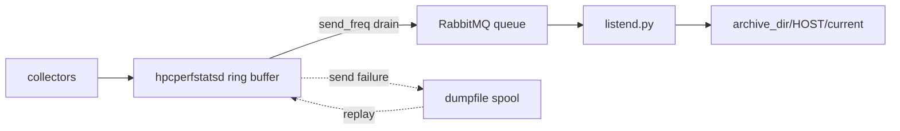

# Monitor daemon design

This page explains how `hpcperfstatsd` collects, tiers and ships host statistics, and why it runs the way it does.
It is for monitor developers and for consumer developers who need the reasoning behind the wire contract.

`hpcperfstatsd` is a C daemon that collects host and job statistics on each compute node and publishes them as UTF-8 text payloads to RabbitMQ.
It uses AMQP through rabbitmq-c and an event loop through libev, and it reads hardware counters by direct `perf_event_open` with no PMU library.
The consumer contract is `HPCPerfStats/hpcperfstats/listend.py`: a stable host field and `$`-prefixed rotation payloads.
The line grammar is in [the raw data format](../RAW_DATA_FORMAT.md) and every key is in [the metrics reference](../METRICS_REFERENCE.md).

## Data flow

A `$` payload starts a new `current` file on the consumer; every other payload appends to it.

## Two-tier collection

Performance keys need a short interval; inventory, capacity and error keys change slowly.
Two tiers keep performance keys fresh while cutting the volume of slow keys on the wire and the CPU spent collecting them.
The tiers are on by default.

| Conf key           | Default | Role                                               |
| ------------------ | ------- | -------------------------------------------------- |
| `sample_freq`      | `30`    | Fast-tier collect interval                         |
| `sample_freq_slow` | `600`   | Full-collect interval; clamped to `>= sample_freq` |
| `send_freq`        | `300`   | RabbitMQ drain interval, independent of the tiers  |
| `enable_slow_tier` | `1`     | Switch for tiering and sparse rows                 |

With `enable_slow_tier 1`:

- Key tiers come from a static `(type, key)` table in `collect_tier.c` plus a rule that makes any key ending in `_error` or `_errors` slow.
- A `KEYS` macro can mark a key slow with `R=S`.
- Fast samples collect and emit only fast keys; full samples collect and emit every key.
- On fast ticks the collectors skip `stats_set` and `stats_inc` for slow keys, so host CPU drops as well as wire volume.

With `enable_slow_tier 0` every key is collected and emitted full-width every `sample_freq`.
The row tokens (`@fast`, `@full`) and the `,R=S` schema suffix are defined in [the raw data format](../RAW_DATA_FORMAT.md).

### Schema payloads are always full

A payload whose first non-whitespace byte is `$` always carries every key, and its sample rows are `@full`, never `@fast`.
`stats_buffer_row_tier_decide()` in `stats_buffer_rows.c` enforces this, and `monitor_daemon.c` forces `COLLECT_FULL` on every `write_hdr=1` collect.
This keeps the rotation semantics `listend.py` relies on: a new `current` file always starts with a complete schema and a complete sample.

### Consumer rollout

`hpcperfstats/dbload/lib/sync_timedb_parsing.py` strips the tier markers and matches values against the fast or full schema subset.
Deploy the monitor and the consumer together on clusters that ingest sparse rows.
`enable_slow_tier 0` is the escape hatch for a site that still runs a consumer without tier support.

## Shared-node multi-jid

Nodes shared by several Slurm jobs need per-job attribution that a single `jobid_file` cannot give.
The default build reads `jobid_file` (`/var/run/stats_jobid`) with `%begin` and `%end` marks, and emits no `%jobs`, no `%affinity` and no `host_mem_job`.

A build with `--enable-shared-node-multi-jid` discovers jobs itself:

- It finds Slurm jids in `/proc` (`slurmstepd.scope` and `SLURM_JOB_ID`) and reads affinity with read-only `sched_getaffinity`.
- It never reads `stats_jobid` and never execs `scontrol` or `nvidia-smi`.
- It sends one RabbitMQ sample per jid with `%jobs` and `%affinity` marks.
- A sole jid that owns every online CPU and every available GPU sends the ordinary unmarked single-jid payload.
- With two or more jids, each jid payload keeps that job's GPUs and affinity CPUs (`host_cpu`, `host_cpu_hw`); the `-` payload keeps unscheduled GPUs and the remaining online CPUs.

Idle allocations stay tagged.
Once a job's steps end only root `slurmstepd` processes remain, and the `/proc` walk skips root pids.
A token that no job process names is then named from its extern stepd title: `step_extern/slurm/cgroup.procs` gives the pid, and `/proc/<PID>/cmdline` reads `slurmstepd: [<JID>.extern]`.
Title-named jobs never emit `%affinity`: alone they send the unmarked payload, and with other jobs they appear in `%jobs` and send only `host_mem_job`.
`tests/test_job_proc_discover.c` and `tests/test_job_discovery_marks.c` cover discovery; `src/job_emit_filter.c` holds the per-payload row filter.

`host_mem_job` reads per-jid cgroup memory at `slurmstepd.scope/<TOKEN>/` (`memory.current`, `memory.peak`, `memory.stat`) with device `j:<JID>`.
Its keys are a subset of `host_mem` (`mem_used`, `anon_pages` and others) plus `mem_peak` (`U=KB`); it does not give full NUMA `host_mem` parity.
`mem_peak` is `NOT_PRESENT` (`-2`) when the scope has no `memory.peak` (kernels before 5.19 without the backport), and so is a stat key that `memory.stat` does not list; an unreadable `memory.stat` gives the stat keys its errno sentinel.
It rides every jid payload, including the full-resource unmarked one, and is omitted on `-`.
Tests override the cgroup root with `HPCPERFSTATS_CGROUP_ROOT`.

The shared build adds three conf keys: `jid_require_step_id`, `jid_discover_pid_cap` and `affinity_pid_sample_limit`.
The consumer must understand `%jobs` and `%affinity` before shared-node RPMs reach a fleet; [deploy to nodes](../how-to/deploy-to-nodes.md) gives the order.

`<PID>`, `<JID>` and `<TOKEN>` are a process id, a Slurm job id and a cgroup scope name.

## Scaled counters and PMU sharing

Counters are never pinned: each event has its own fd, opened at startup or SIGHUP, and each read is scaled by `time_enabled` / `time_running` like `perf stat`.
When another program holds counters (`perf`, VTune, a user's LIKWID job, the NMI watchdog, `nvidia-powerd` on GB200 and GH200), the kernel multiplexes and the monitor reports a scaled estimate instead of stealing or zeroing the counter.
Nothing is re-armed per tick.

On Grace the scaled counts are accurate to about 1-2% even when `nvidia-powerd` leaves the monitor 17% of the counter time (`scripts/canary_counter_check.sh` against `perf stat` and the GEMM's own FLOP rate).

The sharing keys let a reader tell a scaled count from a directly counted one.
They come from each scaled read's own enabled and running times, with no process-name checks and no extra syscalls.

| Type                                | Key (`E,W=64,U=ns`)                    | Meaning                                                          |
| ----------------------------------- | -------------------------------------- | ---------------------------------------------------------------- |
| `host_cpu_hw`                       | `pmu_enabled_time`                     | Time the CPU's open core events were enabled, summed over events |
| `host_cpu_hw`                       | `pmu_running_time`                     | Time they ran on a counter                                       |
| `host_cpu_hw`                       | `pmu_solo_running_time`                | Time they would run if the monitor were the only PMU user        |
| `arm_aarch64_imc`, x86 uncore types | `pmu_enabled_time`, `pmu_running_time` | Same, per uncore device; no solo baseline                        |

The solo time counts the cycle event on its dedicated counter as always running, and gives general events `min(1, general counters / open general events)`.
It is published only for a core with a verified event row.
On Neoverse V2 the PMU has 6 general counters, so the monitor's 8 general events run about 75% of the time on an otherwise idle PMU.
On x86 see [x86 counters and roofline peaks](x86-counters-and-roofline.md#pmu-sharing-on-x86).

The keys are counters, not a percent gauge, because ingest sums `host_cpu_hw` rows across a host's CPUs.
The host's share is `delta(running) / delta(enabled)`, and the share lost to other programs is `1 - delta(running) / delta(solo)`.
Analysis reports these as `avg_pmu_running_pct` and `avg_pmu_outside_pct`; deploy the analysis release before an RPM that carries new sharing keys.
`scripts/canary_counter_check.sh` prints the three shares per load.

## Dumpfiles and conf permissions

When a RabbitMQ send fails, the daemon spools samples under the dumpfile directory, default `/var/lib/hpcperfstats/dump`, mode `0700` through `ensure_private_dir`, not a world-writable `/tmp`.
Appends create files with `O_NOFOLLOW` and mode `0600`.

Replay loads a dumpfile into the ring and deletes it before anything from it is sent.
If the delete fails, the loaded samples leave the ring again and the file stays on disk unsent, with one `Cannot delete dumpfile` error until a delete succeeds, so a later replay cannot send them twice.
A load that fails partway leaves nothing from that file in the ring (`ring_buffer_load_file`).

The RPM installs `hpcperfstats.conf` with mode `0600` because it holds broker credentials, as `%config(noreplace)`; [build the RPM](../how-to/build-the-rpm.md) covers the site conf that supplies them.

## Privilege model

`hpcperfstatsd` runs as root (euid 0) for the life of the process.
perf_event on the core, uncore and power PMUs, InfiniBand and OPA MAD, DCGM and GPU access, and the helper binaries need that access, and the daemon has no in-process `setuid` drop.

The shipped `hpcperfstats.service` adds a systemd sandbox as defense in depth, not as a substitute for root:

- `PrivateTmp=true`, `ProtectSystem=strict`, `ProtectHome=true`.
- `ProtectKernelTunables=true`, `ProtectControlGroups=true`, `NoNewPrivileges=true`.
- `RestrictAddressFamilies=AF_UNIX AF_INET AF_INET6 AF_NETLINK`.
- `ReadWritePaths=/var/lib/hpcperfstats /run` for dumpfiles and runtime files.
- `BindPaths=-/tmp/xpum_p.sock -/tmp/xpum_up.sock` exposes the XPU Manager sockets in the host `/tmp`, which `PrivateTmp` would hide from `xpumcli` (without them PVC `intel_gpu` emits no rows and `xpumcli` reports `XPUM Service Status Error`).
- `PrivateDevices` is unset on purpose, so `/dev/infiniband`, GPU device nodes and perf stay available.

The XPU Manager sockets are bound when the monitor starts, so restart the monitor after restarting `xpumd`.
`After=xpum.service` and a privileged `ExecStartPre` wait of up to 60 s, only while `xpum.service` is active, cover boot: `xpumd` is `Type=simple` and creates the sockets about 10 s after it reports started.
Both are no-ops on nodes without XPU Manager.

Residual risk: code execution or library injection inside the daemon still runs as uid 0 within the sandbox.
Narrowing `CapabilityBoundingSet` or adding a dedicated `User=` needs device and perf ACLs measured on fleet nodes first.

## Syscalls and blocking I/O

The daemon runs on loaded compute nodes, so it keeps per-sample syscalls few and bounds every wait.

- RabbitMQ publishing uses synchronous rabbitmq-c calls from libev timer callbacks.
  Connect uses `amqp_socket_open_noblock` with a bounded wait, login and RPC timeouts (`amqp_set_handshake_timeout`, `amqp_set_rpc_timeout`), `SO_RCVTIMEO` and `SO_SNDTIMEO` on the broker socket, and a non-zero AMQP heartbeat, so a wedged session fails faster than a kernel-default TCP stall.
- `MONITOR_AMQP_TIMEOUT_CPPFLAGS` in `src/Makefile.am` and `tests/Makefile.am` enables those timeouts for rabbitmq-c 0.9 and later; set `MONITOR_AMQP_TIMEOUT_CPPFLAGS=` (empty) to build against headers without those APIs.
- If the broker or network still blocks inside the library, the whole event loop waits until the call returns or times out.
- Reconnects back off exponentially (2 -> 4 -> 8 s) from a 2 s floor, capped at `min(send_freq, 60s)`, with 0-25% hostname-hash jitter so fleet nodes do not align.
- The fail streak resets only after a stable publish window (at least 30 s connected and one successful publish).
- After the first successful active queue declare and bind, reconnects use a passive declare, and an active one only on `NOT_FOUND`.
- While recovering, or when the ring is deep, per-tick resend batches and runtime shrink so a post-outage drain does not overload the broker quorum; sample cadence stays on `send_freq`.
- `pscanf` reads small files (JOBID, sysfs flags) into a stack buffer and falls back to a heap read only when the file does not fit.
- `cpu` keeps one `FILE *` on `/proc/stat` and rewinds it each sample.
- `net` caches the names of up interfaces and re-scans `/sys/class/net` every 32 samples instead of an `opendir` / `readdir` and per-interface `flags` read every tick, and also on SIGHUP, jobid rotation reset and shutdown.
- SIGHUP (`stats_buffer_runtime_caches_reset()`), log rotation and jobid re-init (`monitor_reset_all_stats_types()`), and SIGINT shutdown call `cpu_stats_invalidate_file_caches()` and `net_stats_invalidate_iface_cache()`, so cached fds and interface lists never outlive a reconfigure.

## Alternatives and trade-offs

- A worker thread with a bounded queue, or a non-blocking AMQP client on `ev_io`, would stop a stuck broker from stalling collection; both are larger changes than the timeouts above.
- Pinned counter groups would give exact counts but would fail or steal counters when another tool runs; scaled single-event fds share the PMU instead.
- Dropping root for a dedicated user would shrink the blast radius but needs per-device ACLs for perf, InfiniBand and GPUs.
- A single tier is simpler to parse but sends every slow key every `sample_freq`.

## Related

- [Raw data format](../RAW_DATA_FORMAT.md)
- [x86 counters and roofline peaks](x86-counters-and-roofline.md)
- [Source modules](../reference/source-modules.md)
- [Deploy to nodes](../how-to/deploy-to-nodes.md)
- [Legacy formats](../reference/legacy-formats.md)
  </content>
  </invoke>
